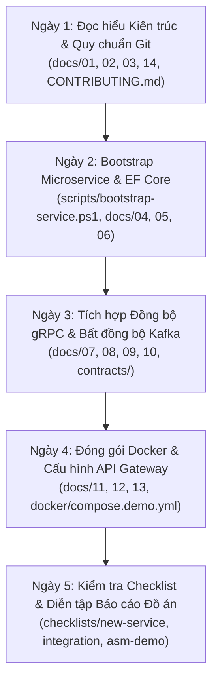

# 🎓 FPT Alumni Connect — Hướng dẫn Kiến trúc & Phát triển Dự án

[](https://dotnet.microsoft.com/)
[](https://react.dev/)
[](https://flutter.dev/)
[](https://www.microsoft.com/sql-server)
[](https://kafka.apache.org/)
[](scripts/verify-all.ps1)

Chào mừng bạn đến với kho tài liệu hướng dẫn kỹ thuật, kiến trúc chuẩn và bộ công cụ tự động hóa chính thức của dự án **FPT Alumni Connect** — Đồ án thực hành môn học **PRN232** tại Đại học FPT.

---

## 📌 1. Giới thiệu Dự án & Ràng buộc Kỹ thuật

**FPT Alumni Connect** là nền tảng kết nối mạng lưới cựu sinh viên và sinh viên Đại học FPT, hỗ trợ chia sẻ cơ hội việc làm, thảo luận chuyên môn, cố vấn nghề nghiệp (mentorship) và nhắn tin thời gian thực.

### 🎯 Các ràng buộc kỹ thuật cốt lõi (Core Project Constraints):
- **Đội ngũ phát triển (5 thành viên)**: 3 Backend Developers, 1 Web Frontend Developer, 1 Mobile Developer (Flutter).
- **Backend Framework**: **ASP.NET Core (.NET 10)**.
- **Kiến trúc mã nguồn**: **Layered Architecture (3 tầng chuẩn mực: API $\rightarrow$ Services $\rightarrow$ Repositories)**. Tuyệt đối tránh sự phức tạp quá mức (avoid overengineering) của Clean Architecture / CQRS / Event Sourcing doanh nghiệp lớn để phù hợp với đồ án sinh viên.
- **Tổ chức Repository & Dữ liệu**:
  - Các service độc lập với nhau (Independent service repositories).
  - Sử dụng chung **1 instance SQL Server**, nhưng **tách riêng từng Database độc lập cho từng service** (`FptAlumni_User_Db`, `FptAlumni_Chat_Db`, `FptAlumni_Forum_Db`, `FptAlumni_AI_Db`, `FptAlumni_Admin_Db`).
  - **Quy tắc bất biến**: Tuyệt đối **KHÔNG** truy cập trực tiếp bảng dữ liệu của service khác (Zero cross-database access).
- **Cổng giao tiếp**: Một **API Gateway (Microsoft YARP)** duy nhất phục vụ chung cho cả Web Client và Mobile Client tại cổng `5000`.
- **Giao thức kết nối**:
  - **REST API**: Giao tiếp chuẩn cho Client $\leftrightarrow$ API Gateway và các tác vụ CRUD thông thường.
  - **gRPC**: Giao tiếp đồng bộ hiệu năng cao (HTTP/2 binary) giữa **Chat Service $\rightarrow$ User Service** để tra cứu hồ sơ người dùng tức thời khi tải tin nhắn.
  - **Apache Kafka**: Xử lý các sự kiện nghiệp vụ bất đồng bộ (Domain Events: `user.registered.v1`, `user.suspended.v1`, v.v.).
  - **SignalR (WebSockets)**: Kênh giao tiếp thời gian thực cho tin nhắn trò chuyện (Chat) và thông báo diễn đàn (Forum).
  - **Background Worker**: Dịch vụ chạy ngầm độc lập (.NET Worker Service) tiêu thụ sự kiện từ Kafka để gửi email thông báo/OTP giả lập.

---

## 🗺️ 2. Lộ Trình 5 Ngày Dành Cho Người Mới Bắt Đầu (Beginner Learning Path)

Dành cho sinh viên lần đầu tiếp cận Microservices, hãy làm theo lộ trình 5 ngày sau:



---

## 🏛️ 3. Sơ đồ Kiến trúc Tổng thể (System Architecture)

```mermaid
flowchart TD
    subgraph Clients["Tầng Khách hàng (Clients)"]
        Web["Web Portal\n(React 18 + Vite + TS)\nhttp://localhost:3000"]
        Mobile["Mobile App\n(Flutter)\nAndroid / iOS"]
    end

    subgraph Gateway["Cổng API Tập trung"]
        ApiGateway["API Gateway (Microsoft YARP)\nPort: 5000\n[CORS, JWT Offload, Path Rewrite]"]
    end

    subgraph Microservices["Các Dịch vụ Độc lập (.NET 10 Layered Architecture)"]
        UserSvc["User Service (:5001)\nAuth, Profiles, Directory\n[gRPC Server :50051]"]
        ChatSvc["Chat Service (:5002)\n1-1 & Group Chats\n[SignalR Hub, gRPC Client]"]
        ForumSvc["Forum Service (:5003)\nPosts, Comments, Reactions\n[SignalR Hub]"]
        AiSvc["AI Service (:5004)\nMentorship, FAQ Assistant"]
        AdminSvc["Admin Service (:5005)\nDashboard, Moderation, Audit"]
    end

    subgraph AsyncWorker["Xử lý Tác vụ Nền (Background Worker)"]
        NotiWorker["Notification Worker\n(Kafka Consumer -> Email Mock)"]
    end

    subgraph InfraBroker["Hạ tầng Thông điệp & Real-Time"]
        Kafka[("Apache Kafka Broker\nPort: 9092 / 29092")]
        SignalR["SignalR WebSockets (ChatHub, ForumHub)"]
    end

    subgraph Storage["Cơ sở Dữ liệu (1 Instance SQL Server)"]
        DB_User[("FptAlumni_User_Db")]
        DB_Chat[("FptAlumni_Chat_Db")]
        DB_Forum[("FptAlumni_Forum_Db")]
        DB_AI[("FptAlumni_AI_Db")]
        DB_Admin[("FptAlumni_Admin_Db")]
    end

    %% Client flows
    Web -->|HTTPS / REST| ApiGateway
    Mobile -->|HTTPS / REST| ApiGateway
    Web -.->|WSS / Real-time| SignalR
    Mobile -.->|WSS / Real-time| SignalR

    %% Gateway to services
    ApiGateway -->|/api/v1/users/*| UserSvc
    ApiGateway -->|/api/v1/chats/*| ChatSvc
    ApiGateway -->|/api/chat/* (Rewrite)| ChatSvc
    ApiGateway -->|/api/v1/forum/*| ForumSvc
    ApiGateway -->|/api/v1/ai/*| AiSvc
    ApiGateway -->|/api/v1/admin/*| AdminSvc

    %% Inter-service Sync
    ChatSvc -->|"Sync gRPC HTTP/2:50051"| UserSvc
    AdminSvc -->|"Authorized REST API: Suspend User"| UserSvc

    %% Database mapping
    UserSvc --- DB_User
    ChatSvc --- DB_Chat
    ForumSvc --- DB_Forum
    AiSvc --- DB_AI
    AdminSvc --- DB_Admin

    %% SignalR binding
    ChatSvc --- SignalR
    ForumSvc --- SignalR

    %% Kafka Events
    UserSvc -.->|"user.registered.v1"| Kafka
    ForumSvc -.->|"post.created.v1"| Kafka
    ChatSvc -.->|"message.sent.v1"| Kafka
    AdminSvc -.->|"user.suspended.v1"| Kafka

    Kafka -.->|"Consume"| NotiWorker
    Kafka -.->|"Consume"| AiSvc
```

---

## 👥 4. Phân chia Trách nhiệm Đội ngũ (Team Roles & Responsibilities)

| Thành viên | Vai trò | Trách nhiệm chính trong đồ án |
| :--- | :--- | :--- |
| **Backend 1** | **Backend Lead** | - Xây dựng **User Service** (Đăng ký, xác thực JWT, danh bạ cựu sinh viên, gRPC Profile Server).<br>- Xây dựng **Chat Service** (Hội thoại 1-1 & nhóm, SignalR ChatHub, gRPC Profile Client gọi User Service). |
| **Backend 2** | **Backend Developer** | - Xây dựng **Forum Service** (Bài viết, bình luận đa tầng, thả tim, báo cáo vi phạm, SignalR ForumHub).<br>- Xây dựng **AI Service** (Trợ lý ảo FAQ, gợi ý kết nối cựu sinh viên, Kafka Consumer). |
| **Backend 3** | **Backend Developer** | - Xây dựng **Admin Service** (Thống kê Dashboard, điều phối duyệt nội dung, Audit Log).<br>- Phụ trách **Hạ tầng & Gateway (Infrastructure)**: Cấu hình YARP API Gateway, Docker Compose, Notification Background Worker & Kafka Broker setup. |
| **Frontend Web** | **Web Developer** | - Phát triển giao diện Web Portal bằng React 18, Vite, TypeScript, Tailwind CSS, shadcn/ui.<br>- Tích hợp REST API qua Gateway, kết nối SignalR thời gian thực. |
| **Mobile App** | **Flutter Developer** | - Phát triển ứng dụng di động đa nền tảng (Android/iOS) bằng Flutter.<br>- Tối ưu trải nghiệm lướt danh bạ, gửi tin nhắn chat và nhận thông báo đẩy. |

---

## 📚 5. Danh Mục Tài Liệu Hệ Thống (Documentation Index)

Toàn bộ quy chuẩn và tài liệu kỹ thuật được đánh số thứ tự logic trong thư mục `docs/`:

1. 🚀 [**Tài liệu 01 — Hướng dẫn Tiếp cận & Bắt đầu Cho Người Mới (Getting Started)**](file:///c:/Use/University/PRN232/ASM/guideline/docs/01-getting-started.md):
   - Cài đặt công cụ (.NET 10, Docker, Git, SQL Server), lộ trình tiếp cận 5 ngày và cẩm nang xử lý lỗi thường gặp.
2. 📘 [**Tài liệu 02 — Kiến trúc Hệ thống (System Architecture)**](file:///c:/Use/University/PRN232/ASM/guideline/docs/02-architecture.md):
   - Mô tả chi tiết cấu trúc 3 tầng (Layered Architecture: API $\rightarrow$ Services $\rightarrow$ Repositories).
   - Quy tắc bất di bất dịch về cô lập cơ sở dữ liệu (Zero Cross-DB Access).
   - Ma trận giao thức giao tiếp (REST, gRPC, Kafka, SignalR).
   - Sơ đồ tuần tự nghiệp vụ Admin khóa tài khoản và Đăng ký gửi email xác thực.
3. 📗 [**Tài liệu 03 — Ranh giới Dịch vụ & Phân loại User Stories (Service Boundaries & User Stories)**](file:///c:/Use/University/PRN232/ASM/guideline/docs/03-service-boundaries.md):
   - Ranh giới nghiệp vụ cụ thể cho từng dịch vụ (Nên làm gì & Không được làm gì).
   - Bảng sở hữu cơ sở dữ liệu và danh mục toàn bộ **50 User Stories** phân loại P0, P1, P2.
4. 📕 [**Tài liệu 04 — Quy chuẩn Phát triển .NET 10 & Kiến trúc Phân tầng (Layered Architecture Standards)**](file:///c:/Use/University/PRN232/ASM/guideline/docs/04-dotnet-standards.md):
   - Chuẩn hóa cấu trúc thư mục 3 tầng: `Api` $\rightarrow$ `Services` $\rightarrow$ `Repositories`.
   - Quy tắc ràng buộc phụ thuộc nghiêm ngặt và xử lý ngoại lệ tập trung qua Middleware (RFC 7807).
5. 💾 [**Tài liệu 05 — Quy chuẩn Cơ sở Dữ liệu & EF Core (Database & EF Core Standards)**](file:///c:/Use/University/PRN232/ASM/guideline/docs/05-database.md):
   - Nguyên tắc Database-per-Service trên 1 instance SQL Server (`FptAlumni_*_Db`).
   - Quản lý EF Core Migrations cho môi trường Local Dev vs Deployment (Idempotent SQL Scripts).
6. 🌐 [**Tài liệu 06 — Quy chuẩn Thiết kế REST API & OpenAPI (REST API & Contract Standards)**](file:///c:/Use/University/PRN232/ASM/guideline/docs/06-rest-api.md):
   - Quy chuẩn định tuyến URL `/api/v1/{resources}`, phương thức HTTP và mã trạng thái chuẩn.
   - Định dạng phản hồi lỗi chuẩn RFC 7807 (`ProblemDetails`) kèm `traceId` và phân trang chuẩn.
7. 🔐 [**Tài liệu 07 — Hợp đồng Xác thực & Phân quyền JWT (JWT Authentication & Authorization Contract)**](file:///c:/Use/University/PRN232/ASM/guideline/docs/07-authentication.md):
   - Xác định User Service là thẩm quyền duy nhất cấp phát JWT.
   - Đặc tả chuẩn các claims: `sub`, `email`, `role` (`USER`, `ADMIN`).
   - Cấu hình ký HS256 qua configuration và dung sai thời gian (ClockSkew).
8. 📨 [**Tài liệu 08 — Hợp đồng Sự kiện Kafka & Xử lý Bất đồng bộ (Kafka Event Contracts & Async Processing)**](file:///c:/Use/University/PRN232/ASM/guideline/docs/08-kafka.md):
   - Chuẩn hóa cấu trúc phong bì sự kiện chung `EventEnvelope<T>` (`eventId`, `eventType`, `version`, `occurredAt`, `correlationId`, `producer`, `data`).
   - Đặc tả schema JSON và C# model cho sự kiện mẫu `user.registered.v1`.
   - Hướng dẫn thực hành dự án mẫu độc lập tại [`examples/kafka-demo/`](file:///c:/Use/University/PRN232/ASM/guideline/examples/kafka-demo/).
9. ⚡ [**Tài liệu 09 — Quy chuẩn Giao tiếp Đồng bộ gRPC & Tra cứu Hồ sơ (Chat-to-User gRPC Profile Lookup)**](file:///c:/Use/University/PRN232/ASM/guideline/docs/09-grpc.md):
   - Định nghĩa hợp đồng Protobuf v1 tại [`contracts/grpc/user-profile/v1/user_profile.proto`](file:///c:/Use/University/PRN232/ASM/guideline/contracts/grpc/user-profile/v1/user_profile.proto).
   - Xử lý lỗi chuẩn RFC 7807 (`ProblemDetails`) từ `RpcException` và cơ chế fallback an toàn.
   - Hướng dẫn chạy thử nghiệm dự án mẫu độc lập tại [`examples/grpc-demo/`](file:///c:/Use/University/PRN232/ASM/guideline/examples/grpc-demo/).
10. 📬 [**Tài liệu 10 — Quy chuẩn Dịch vụ Xử lý Tác vụ Nền & Gửi Email (Notification Background Worker)**](file:///c:/Use/University/PRN232/ASM/guideline/docs/10-background-worker.md):
    - Tách rời luồng gửi email tốn thời gian ra khỏi HTTP Request bằng `.NET BackgroundService`.
    - Tiêu thụ sự kiện `user.registered.v1` từ Kafka và cơ chế khử trùng lặp (Idempotent Consumer).
    - Dự án mẫu tại [`examples/demo-worker/`](file:///c:/Use/University/PRN232/ASM/guideline/examples/demo-worker/).
11. 🚪 [**Tài liệu 11 — Quy chuẩn Cổng API Tập trung với YARP (Central API Gateway Standards)**](file:///c:/Use/University/PRN232/ASM/guideline/docs/11-api-gateway.md):
    - Điểm truy cập duy nhất cho Web và Mobile tại cổng `5000`.
    - Kiến trúc Reverse Proxy bằng Microsoft YARP, chuyển tiếp và biến đổi đường dẫn URL.
    - Dự án mẫu độc lập tại [`examples/gateway-demo/`](file:///c:/Use/University/PRN232/ASM/guideline/examples/gateway-demo/).
12. 🐳 [**Tài liệu 12 — Quy chuẩn Đóng gói Container & Docker Compose (Docker & Containerization Standards)**](file:///c:/Use/University/PRN232/ASM/guideline/docs/12-docker.md):
    - Đóng gói toàn bộ hệ sinh thái mẫu thành một hệ thống chạy cục bộ qua [`docker/compose.demo.yml`](file:///c:/Use/University/PRN232/ASM/guideline/docker/compose.demo.yml).
    - Phân biệt địa chỉ mạng nội bộ container và địa chỉ máy chủ host.
    - Bảo toàn kết nối gRPC HTTP/2 nhị phân giữa các container trong Docker bridge network.
13. 🧪 [**Tài liệu 13 — Chiến Lược & Quy Chuẩn Kiểm Thử Hệ Thống (Testing Standards & Verification Guide)**](file:///c:/Use/University/PRN232/ASM/guideline/docs/13-testing.md):
    - Tháp kiểm thử Microservices (Unit, Integration, End-to-End).
    - Kỹ thuật kiểm thử API với `WebApplicationFactory` sử dụng In-Memory database out-of-the-box.
    - Hướng dẫn thực thi 54 bài kiểm thử tự động đạt 100% PASS.
14. 📙 [**Tài liệu 14 — Quy chuẩn Git & Quy trình Làm việc Nhóm (Team Workflow & Git Standards)**](file:///c:/Use/University/PRN232/ASM/guideline/docs/14-team-workflow.md):
    - Quy chuẩn đặt tên Multi-Repository (`f-alumni-*`).
    - Chiến lược phân nhánh tinh gọn: `main`, `develop`, `feat/<ticket>-<name>`, `fix/<ticket>-<name>`.
    - Quy trình phối hợp thay đổi Hợp đồng API (Contract Change) và Mẫu Pull Request chuẩn.
15. 📦 [**Tài liệu 15 — Phân phối & Quản trị Hợp đồng Giao tiếp Microservices (Contract Distribution Standards)**](file:///c:/Use/University/PRN232/ASM/guideline/docs/15-contract-sharing.md):
    - Giải quyết bài toán phân phối hợp đồng trong kiến trúc Multi-Repository mà không cần Private NuGet feed hay Git Submodule phức tạp.
    - Cơ chế Snapshot kèm mã băm SHA-256 (`contracts.manifest.json`) đối chiếu nguồn gốc Git commit (Provenance).
    - Phân định rõ ràng 3 cấp độ đường dẫn: Repository-root, Project-relative (`.csproj`), và thư mục thực thi PowerShell.
    - Quy tắc tiến hóa tương thích ngược cho Kafka Events và gRPC Protobuf.
16. 🏁 [**Tài liệu 16 — Báo cáo Bàn giao & Đóng Pha Hướng dẫn Kỹ thuật (Guideline Phase Handover & Readiness)**](file:///c:/Use/University/PRN232/ASM/guideline/docs/16-phase-guideline-handover.md):
    - Tổng kết toàn bộ kết quả của pha Guideline, xác nhận tính sẵn sàng của hệ thống chuẩn mực và công nghệ (.NET 10, YARP, Kafka, gRPC, EF Core, Docker).
    - Hướng dẫn tổng hợp cho các lập trình viên bắt đầu pha triển khai thực tế (Service Implementation Phase).
    - Tiêu chuẩn Definition of Ready (DoR) cho từng repository dịch vụ độc lập.
17. 🤝 [**Hướng dẫn Đóng góp Mã Nguồn (CONTRIBUTING.md)**](file:///c:/Use/University/PRN232/ASM/guideline/CONTRIBUTING.md):
    - Quy tắc chung dành cho thành viên khi đóng góp mã nguồn cho các repository trong tổ chức F-Alumni.

---

## ✅ 6. Danh Mục Bảng Kiểm Tra Chất Lượng (Checklists Index)

Trước khi gửi Pull Request hoặc bước vào buổi chấm thi, sinh viên bắt buộc phải rà soát các checklist sau:

1. 📋 [**Checklist 01 — Triển Khai Microservice Mới (New Service Checklist)**](file:///c:/Use/University/PRN232/ASM/guideline/checklists/new-service.md):
   - Danh sách kiểm tra 7 giai đoạn từ nhận ticket, bootstrap, tạo Entity/Migration đến viết unit tests.
2. 🔗 [**Checklist 02 — Tích Hợp Giữa Các Microservices (Integration Checklist)**](file:///c:/Use/University/PRN232/ASM/guideline/checklists/integration.md):
   - Kiểm tra định tuyến Gateway, gRPC HTTP/2, Kafka Event Envelope, Database Isolation và JWT.
3. 🎓 [**Checklist 03 — Kịch Bản & Bảng Kiểm Tra Buổi Báo Cáo Đồ Án PRN232 (ASM Demo Checklist)**](file:///c:/Use/University/PRN232/ASM/guideline/checklists/asm-demo.md):
   - Bản đồ khớp nối tiêu chí chấm điểm (REST, EF Core, JWT, gRPC, Kafka, Background Worker, Gateway, Docker).
   - Kịch bản trình diễn chi tiết 5 bước kéo dài 10–15 phút kèm câu lệnh mẫu và kết quả mong đợi.

---

## 🛠️ 7. Bộ Kịch Bản Tự Động Hóa (Automation Scripts)

Dự án cung cấp sẵn 5 kịch bản PowerShell giúp tối ưu hóa 100% thời gian khởi tạo, chia sẻ hợp đồng và kiểm thử:

### 1. Khởi tạo Microservice Mới (`scripts/bootstrap-service.ps1`)
Sao chép mẫu chuẩn 3 tầng, tự động đổi tên toàn bộ namespace, project, solution và cấu hình kiểm thử In-Memory độc lập:
```powershell
.\scripts\bootstrap-service.ps1 -ServiceName "ForumService" -TargetDirectory "..\fpt-alumni-forum-service"
```

### 2. Phân phối Hợp đồng Giao tiếp (`scripts/import-contracts.ps1`)
Nhập khẩu hợp đồng gRPC Protobuf và schema Kafka Event từ guideline vào repository dịch vụ độc lập, tự động tạo manifest và băm mật mã SHA-256:
```powershell
.\scripts\import-contracts.ps1 -SourceGuidelinePath "." -TargetDirectory "..\fpt-alumni-chat-service" -ContractId "grpc/user-profile/v1"
```

### 3. Kiểm tra Tính toàn vẹn Hợp đồng Ngoại tuyến (`scripts/verify-contracts.ps1`)
Kiểm toán độc lập không cần mạng Internet hay guideline repo; phát hiện tức thời hợp đồng bị sửa đổi cục bộ trái phép:
```powershell
.\scripts\verify-contracts.ps1 -Path "..\fpt-alumni-chat-service"
```

### 4. Xác minh Toàn diện Hệ thống (`scripts/verify-all.ps1`)
Biên dịch 5 solution, kiểm tra cấu hình tĩnh và chạy toàn bộ các ca kiểm thử tự động:
```powershell
# Chạy toàn bộ kiểm tra:
.\scripts\verify-all.ps1

# Chỉ kiểm tra biên dịch và cấu hình, bỏ qua chạy test:
.\scripts\verify-all.ps1 -SkipTests
```

### 5. Kiểm thử Khói Tích Hợp (`scripts/smoke-test.ps1`)
Kiểm tra luồng kết nối end-to-end `Gateway -> Chat REST -> User gRPC` và `Kafka -> Notification Worker`:
```powershell
.\scripts\smoke-test.ps1
```

---

## 🚀 8. Lệnh Khởi Chạy Nhanh Toàn Bộ Hệ Thống Với Docker

```powershell
# 1. Tạo tệp môi trường từ mẫu
Copy-Item docker/.env.example docker/.env

# 2. Khởi chạy toàn bộ hệ thống
docker compose --env-file docker/.env -f docker/compose.demo.yml up --build -d

# 3. Chạy smoke test kiểm tra hệ thống
.\scripts\smoke-test.ps1

# 4. Tắt hệ thống sau khi làm việc xong
docker compose -f docker/compose.demo.yml down
```
