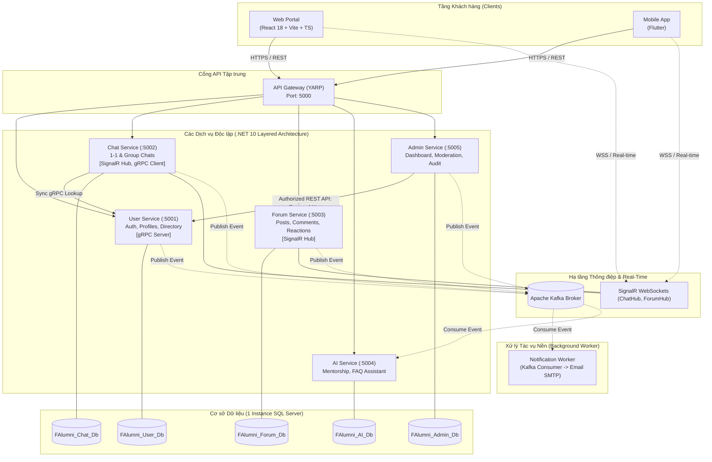

# 🎓 FPT Alumni Connect — Hướng dẫn Kiến trúc & Phát triển Dự án

Chào mừng bạn đến với kho tài liệu hướng dẫn kỹ thuật và kiến trúc chuẩn chính thức của dự án **FPT Alumni Connect** — Đồ án tốt nghiệp môn **PRN232**.

---

## 📌 1. Giới thiệu Dự án & Ràng buộc Kỹ thuật

**FPT Alumni Connect** là nền tảng kết nối mạng lưới cựu sinh viên và sinh viên Đại học FPT, hỗ trợ chia sẻ cơ hội việc làm, thảo luận chuyên môn, cố vấn nghề nghiệp (mentorship) và nhắn tin thời gian thực.

### 🎯 Các ràng buộc kỹ thuật cốt lõi (Core Project Constraints):
- **Đội ngũ phát triển (5 thành viên)**: 3 Backend Developers, 1 Web Frontend Developer, 1 Mobile Developer (Flutter).
- **Backend Framework**: **ASP.NET Core (.NET 10)**.
- **Kiến trúc mã nguồn**: **Layered Architecture (3 tầng chuẩn mực: API $\rightarrow$ Services $\rightarrow$ Repositories)**. Tuyệt đối tránh sự phức tạp quá mức (avoid overengineering) của Clean Architecture / CQRS / Event Sourcing doanh nghiệp lớn để phù hợp với đồ án sinh viên.
- **Tổ chức Repository & Dữ liệu**:
  - Các service độc lập với nhau (Independent service repositories).
  - Sử dụng chung **1 instance SQL Server**, nhưng **tách riêng từng Database độc lập cho từng service** (`FAlumni_User_Db`, `FAlumni_Chat_Db`, `FAlumni_Forum_Db`, `FAlumni_AI_Db`, `FAlumni_Admin_Db`).
  - **Quy tắc bất biến**: Tuyệt đối **KHÔNG** truy cập trực tiếp bảng dữ liệu của service khác (Zero cross-database access).
- **Cổng giao tiếp**: Một **API Gateway** duy nhất phục vụ chung cho cả Web Client và Mobile Client.
- **Giao thức kết nối**:
  - **REST API**: Giao tiếp chuẩn cho Client $\leftrightarrow$ API Gateway và các tác vụ CRUD thông thường.
  - **gRPC**: Giao tiếp đồng bộ hiệu năng cao giữa **Chat Service $\rightarrow$ User Service** để tra cứu hồ sơ người dùng tức thời khi tải tin nhắn.
  - **Apache Kafka**: Xử lý các sự kiện nghiệp vụ bất đồng bộ (Domain Events: `UserRegistered`, `UserSuspended`, `PostCreated`, v.v.).
  - **SignalR (WebSockets)**: Kênh giao tiếp thời gian thực cho tin nhắn trò chuyện (Chat) và thông báo diễn đàn (Forum).
  - **Background Worker**: Một dịch vụ chạy ngầm độc lập (.NET Worker Service) tiêu thụ sự kiện từ Kafka để gửi email thông báo/OTP qua SMTP.

---

## 🏛️ 2. Sơ đồ Kiến trúc Tổng thể (System Architecture)

---

## 👥 3. Phân chia Trách nhiệm Đội ngũ (Team Roles & Responsibilities)

| Thành viên | Vai trò | Trách nhiệm chính trong đồ án |
| :--- | :--- | :--- |
| **Backend 1** | **Backend Lead** | - Cấu hình API Gateway (YARP) & Bảo mật JWT. - Xây dựng **User Service** (Đăng ký, xác thực, danh bạ, gRPC Server). - Xây dựng **Notification Worker** và thiết lập Docker cho cụm Kafka. |
| **Backend 2** | **Backend Developer** | - Xây dựng **Forum Service** (Bài viết, bình luận đa tầng, thả tim, báo cáo vi phạm). - Xây dựng **Admin Service** (Thống kê Dashboard, điều phối duyệt nội dung, Audit Log). |
| **Backend 3** | **Backend Developer** | - Xây dựng **Chat Service** (Hội thoại 1-1 & nhóm, SignalR ChatHub). - Tích hợp **gRPC Client** tra cứu Profile từ User Service. - Xây dựng **AI Service** (Trợ lý ảo FAQ và gợi ý kết nối). |
| **Frontend Web** | **Web Developer** | - Phát triển giao diện Web Portal bằng React 18, Vite, TypeScript, Tailwind CSS, shadcn/ui. - Tích hợp REST API qua Gateway, kết nối SignalR thời gian thực. |
| **Mobile App** | **Flutter Developer** | - Phát triển ứng dụng di động đa nền tảng (Android/iOS) bằng Flutter. - Tối ưu trải nghiệm lướt danh bạ, gửi tin nhắn chat và nhận thông báo đẩy. |

---

## 📚 4. Thư mục Tài liệu Hướng dẫn Chi tiết (Documentation Index)

Toàn bộ quy chuẩn và đặc tả chi tiết của dự án được lưu trữ trong thư mục `docs/`:

1. 📘 [**Tài liệu 02 — Kiến trúc Hệ thống (System Architecture)**](file:///c:/Use/University/PRN232/ASM/guideline/docs/02-architecture.md):
   - Mô tả chi tiết cấu trúc 3 tầng (Layered Architecture: API $\rightarrow$ Services $\rightarrow$ Repositories).
   - Quy tắc bất di bất dịch về cô lập cơ sở dữ liệu (Zero Cross-DB Access).
   - Ma trận giao thức giao tiếp (REST, gRPC, Kafka, SignalR).
   - Sơ đồ tuần tự nghiệp vụ Admin khóa tài khoản người dùng qua API ủy quyền.
   - Sơ đồ tuần tự quy trình đăng ký & gửi email xác thực tài khoản (End-to-End Email Verification).
   - Bảng phân biệt giữa Hạ tầng kỹ thuật bắt buộc của môn học (Required ASM Infrastructure) và các Tính năng nghiệp vụ.

2. 📗 [**Tài liệu 03 — Ranh giới Dịch vụ & Phân loại User Stories (Service Boundaries & User Stories)**](file:///c:/Use/University/PRN232/ASM/guideline/docs/03-service-boundaries.md):
   - Ranh giới nghiệp vụ cụ thể cho từng dịch vụ (Nên làm gì & Không được làm gì).
   - Bảng sở hữu cơ sở dữ liệu và danh mục các bảng dữ liệu cốt lõi.
   - Danh sách và ma trận phân loại toàn bộ **50 User Stories**:
     - **US-01 đến US-11**: Tài khoản & Hồ sơ cựu sinh viên (User Service).
     - **CH-01 đến CH-10**: Trò chuyện thời gian thực (Chat Service).
     - **FO-01 đến FO-16**: Diễn đàn & Kết nối cộng đồng (Forum Service).
     - **AI-01 đến AI-04**: Trợ lý thông minh & Khuyến nghị (AI Service).
     - **AD-01 đến AD-09**: Quản trị hệ thống & Kiểm duyệt (Admin Service).
   - Phân cấp mức độ ưu tiên: **P0 (Must Have - Cốt lõi MVP)**, **P1 (Should Have - Tiêu chuẩn đồ án)**, **P2 (Nice to Have - Nâng cao)**.

---

## 🚀 5. Hướng dẫn Dành cho Lập trình viên Mới (Beginner Developer Quickstart)

1. **Clone repository và đọc kỹ tài liệu**:
   - Mọi thành viên cần đọc kỹ [docs/02-architecture.md](file:///c:/Use/University/PRN232/ASM/guideline/docs/02-architecture.md) trước khi viết dòng code đầu tiên.
2. **Quy tắc tạo bảng và liên kết**:
   - Nếu bạn làm việc trên `Chat Service` hoặc `Forum Service`, bạn chỉ được lưu `UserId` dưới dạng số nguyên (`int`) hoặc `Guid`. Tuyệt đối không tạo Foreign Key sang bảng `Users` của service khác.
3. **Quy tắc giao tiếp**:
   - Khi cần dữ liệu của service khác: Nếu cần phản hồi tức thì để hiển thị giao diện, hãy sử dụng **gRPC / REST API**. Nếu chỉ cần thông báo sự kiện đã hoàn tất, hãy phát thông điệp lên **Kafka**.
