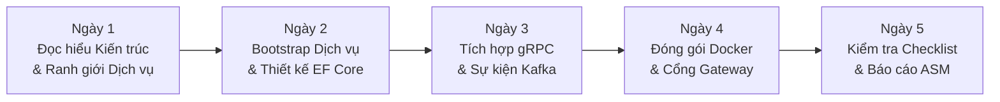

# Hướng Dẫn Bắt Đầu & Tiếp Cận Cho Người Mới (Getting Started & Onboarding Guide)

> **Mã tài liệu**: `DOC-01-GETTING-STARTED`  
> **Dự án**: FPT Alumni Connect (PRN232 Final Assignment)  
> **Trạng thái**: Hoàn thành & Phê duyệt  
> **Đối tượng độc giả**: Thành viên nhóm phát triển (BE1, BE2, BE3, Web Dev, Mobile Dev), đặc biệt là các bạn sinh viên lần đầu tiếp cận kiến trúc Microservices.  
> **Bộ công cụ tự động**: [`scripts/bootstrap-service.ps1`](file:///c:/Use/University/PRN232/ASM/guideline/scripts/bootstrap-service.ps1) | [`scripts/verify-all.ps1`](file:///c:/Use/University/PRN232/ASM/guideline/scripts/verify-all.ps1) | [`scripts/smoke-test.ps1`](file:///c:/Use/University/PRN232/ASM/guideline/scripts/smoke-test.ps1)

---

## 🎯 1. Giới thiệu & Triết lý Dự án

Chào mừng bạn đến với **FPT Alumni Connect**! Đây là dự án đồ án kết thúc học phần môn học **PRN232** tại Trường Đại học FPT.

Hệ thống được thiết kế theo kiến trúc **Microservices Tinh gọn (Lightweight Microservices)**. Điều này đồng nghĩa với việc:
- **Tập trung vào kiến trúc cốt lõi**: Phân tách ranh giới rõ ràng, cơ sở dữ liệu riêng biệt cho từng dịch vụ, giao tiếp đồng bộ qua REST/gRPC và bất đồng bộ qua Kafka.
- **Tránh phức tạp hóa quá mức (No Overengineering)**: Không sử dụng Kubernetes, không dùng Service Mesh phức tạp, không dùng Eureka hay Consul ngoài tầm kiến thức môn học. Toàn bộ hệ thống chạy trơn tru trên máy cá nhân của sinh viên bằng Docker Compose.

---

## 💻 2. Yêu cầu Cài đặt Môi trường (Prerequisites)

Trước khi bắt đầu, máy tính của bạn cần được cài đặt các công cụ sau:

| Công cụ | Phiên bản Tối thiểu | Mục đích Sử dụng | Lệnh Kiểm tra |
| :--- | :---: | :--- | :--- |
| **.NET SDK** | `10.0.x` | Biên dịch backend microservices, YARP Gateway và Worker | `dotnet --version` |
| **Docker Desktop** | `4.25+` | Chạy SQL Server, Apache Kafka và các container dịch vụ | `docker --version` |
| **Git** | `2.40+` | Quản lý mã nguồn theo quy chuẩn nhánh | `git --version` |
| **PowerShell** | `5.1+` / `7+` | Thực thi các kịch bản tự động hóa bootstrap và kiểm thử | `$PSVersionTable.PSVersion` |
| **IDE / Editor** | Visual Studio 2022 / VS Code / Rider | Phát triển mã nguồn (.NET 10 C# 13) | — |

---

## 🗺️ 3. Lộ trình Tiếp Cận 5 Ngày (5-Day Onboarding Roadmap)

Dành cho thành viên mới tham gia dự án để nắm bắt toàn diện hệ thống từ con số 0:



- **Ngày 1 — Đọc hiểu Kiến trúc & Quy chuẩn Git**:
  - Đọc [`docs/02-architecture.md`](file:///c:/Use/University/PRN232/ASM/guideline/docs/02-architecture.md) để nắm bức tranh tổng thể và sơ đồ Mermaid.
  - Đọc [`docs/03-service-boundaries.md`](file:///c:/Use/University/PRN232/ASM/guideline/docs/03-service-boundaries.md) để biết bạn phụ trách dịch vụ nào (User, Chat, Forum, AI, Admin).
  - Đọc [`docs/14-team-workflow.md`](file:///c:/Use/University/PRN232/ASM/guideline/docs/14-team-workflow.md) để biết cách đặt tên nhánh (`feat/...`), cam kết commit và mở Pull Request.
- **Ngày 2 — Khởi tạo Dịch vụ & Cơ sở Dữ liệu**:
  - Chạy kịch bản [`scripts/bootstrap-service.ps1`](file:///c:/Use/University/PRN232/ASM/guideline/scripts/bootstrap-service.ps1) để sinh mã nguồn ban đầu cho microservice được phân công.
  - Đọc [`docs/04-dotnet-standards.md`](file:///c:/Use/University/PRN232/ASM/guideline/docs/04-dotnet-standards.md) và [`docs/05-database.md`](file:///c:/Use/University/PRN232/ASM/guideline/docs/05-database.md) để tạo Entity, Migration và DbContext độc lập.
- **Ngày 3 — Tích hợp Inter-Service (gRPC & Kafka)**:
  - Nếu làm **User Service**: xem [`docs/09-grpc.md`](file:///c:/Use/University/PRN232/ASM/guideline/docs/09-grpc.md) để mở gRPC Server tra cứu hồ sơ; xem [`docs/08-kafka.md`](file:///c:/Use/University/PRN232/ASM/guideline/docs/08-kafka.md) để phát sự kiện `user.registered.v1`.
  - Nếu làm **Chat Service**: xem [`docs/09-grpc.md`](file:///c:/Use/University/PRN232/ASM/guideline/docs/09-grpc.md) để gọi gRPC Client sang User Service.
  - Nếu làm **Notification Worker**: xem [`docs/10-background-worker.md`](file:///c:/Use/University/PRN232/ASM/guideline/docs/10-background-worker.md) để tiêu thụ sự kiện và giả lập gửi email.
- **Ngày 4 — Kiểm thử & Đóng gói Container**:
  - Đọc [`docs/11-api-gateway.md`](file:///c:/Use/University/PRN232/ASM/guideline/docs/11-api-gateway.md) và cấu hình chuyển tiếp qua YARP Gateway.
  - Đọc [`docs/12-docker.md`](file:///c:/Use/University/PRN232/ASM/guideline/docs/12-docker.md) để tạo Dockerfile cho dịch vụ của bạn.
  - Chạy [`scripts/smoke-test.ps1`](file:///c:/Use/University/PRN232/ASM/guideline/scripts/smoke-test.ps1) để kiểm thử luồng tích hợp hoàn chỉnh.
- **Ngày 5 — Chuẩn bị Báo cáo Đồ án**:
  - Rà soát lại từng tiêu chí chấm điểm trong [`checklists/asm-demo.md`](file:///c:/Use/University/PRN232/ASM/guideline/checklists/asm-demo.md).

---

## 🚀 4. Khởi Tạo Microservice Mới với Kịch Bản Bootstrap

Để tránh việc mỗi thành viên tự tạo cấu trúc thư mục lộn xộn hoặc sai lệch chuẩn 3 tầng, hãy sử dụng kịch bản PowerShell tự động:

### 4.1. Lệnh Khởi tạo

Mở terminal PowerShell tại thư mục gốc của repository này và chạy:

```powershell
# Ví dụ: Khởi tạo Forum Service tại thư mục riêng
.\scripts\bootstrap-service.ps1 -ServiceName "ForumService" -TargetDirectory "..\fpt-alumni-forum-service"
```

### 4.2. Các Tham số Hỗ trợ:
- `-ServiceName`: Tên dịch vụ (bắt buộc, theo chuẩn PascalCase, ví dụ: `UserService`, `ChatService`, `ForumService`, `AiService`, `AdminService`).
- `-TargetDirectory`: Thư mục lưu trữ mã nguồn dịch vụ (bắt buộc).
- `-Force`: Cho phép ghi đè nếu thư mục đích đã tồn tại và không rỗng.
- `-SkipBuild`: Bỏ qua bước kiểm tra biên dịch và chạy test (mặc định luôn tự động biên dịch và kiểm thử để đảm bảo tính độc lập).

### 4.3. Kịch bản Bootstrap Đã Tự Động Hóa Những Gì?
1. Sao chép sạch sẽ mẫu [`templates/dotnet-service`](file:///c:/Use/University/PRN232/ASM/guideline/templates/dotnet-service) (loại bỏ toàn bộ rác `bin/`, `obj/`, `.vs/`).
2. Tự động đổi tên toàn bộ namespace, tên tệp dự án (`.csproj`), tệp solution (`.sln`), chuỗi kết nối cơ sở dữ liệu (`FAlumni_ForumService_Db`).
3. Tích hợp sẵn cơ chế kiểm thử In-Memory tự động trong bộ test, giúp sinh viên chạy `dotnet test` thành công 100% ngay sau khi khởi tạo mà không phụ thuộc vào SQL Server thật.

---

## 🐳 5. Khởi Chạy Hệ Sinh Thái Mẫu Bằng Docker Compose

Repository cung cấp sẵn một hệ sinh thái mẫu đầy đủ gồm 6 container để bạn thử nghiệm:

```powershell
# Bước 1: Sao chép tệp cấu hình môi trường mẫu
Copy-Item docker/.env.example docker/.env

# Bước 2: Khởi chạy toàn bộ hệ thống
docker compose --env-file docker/.env -f docker/compose.demo.yml up --build -d

# Bước 3: Kiểm tra trạng thái các container
docker compose -f docker/compose.demo.yml ps

# Bước 4: Chạy smoke test kiểm tra hệ thống
.\scripts\smoke-test.ps1

# Bước 5: Xem nhật ký container (khi cần gỡ lỗi)
docker compose -f docker/compose.demo.yml logs -f api-gateway
docker compose -f docker/compose.demo.yml logs -f notification-worker

# Bước 6: Dừng hệ thống khi kết thúc làm việc
docker compose -f docker/compose.demo.yml down
```

---

## 🛠️ 6. Cẩm Nang Xử Lý Sự Cố Thường Gặp (Troubleshooting Guide)

### 6.1. Docker Desktop Không Khởi Động Được (Pipe `dockerDesktopLinuxEngine` not found)
- **Hiện tượng**: Lệnh `docker ps` báo lỗi `failed to connect to the docker API at npipe:////./pipe/dockerDesktopLinuxEngine`.
- **Nguyên nhân**: Ứng dụng Docker Desktop trên Windows chưa được bật hoặc dịch vụ `com.docker.service` bị dừng.
- **Cách khắc phục**:
  1. Mở ứng dụng **Docker Desktop** từ Start Menu và đợi biểu tượng cá voi chuyển sang màu xanh (Engine running).
  2. Nếu dùng WSL2, đảm bảo tính năng **Virtual Machine Platform** đã được bật trong Windows Features.

### 6.2. Xung Đột Cổng SQL Server (Port 1433 Collision)
- **Hiện tượng**: Không thể khởi động container SQL Server hoặc kết nối bị từ chối.
- **Nguyên nhân**: Trên máy tính Windows của bạn đã cài sẵn SQL Server cục bộ (SQLEXPRESS) đang chiếm dụng cổng `1433`.
- **Cách khắc phục**:
  - Trong tệp `docker/compose.demo.yml`, cổng máy chủ của SQL Server container đã được ánh xạ sang **`14333`** (`localhost:14333`).
  - Khi kết nối từ SSMS/Azure Data Studio, dùng: `Server=localhost,14333;Database=...;User Id=sa;Password=...`.

### 6.3. Không Thể Kết Nối Tới Apache Kafka
- **Hiện tượng**: Ứng dụng báo lỗi `Broker: Broker transport failure` hoặc không thể gửi message.
- **Nguyên nhân**: Nhầm lẫn giữa địa chỉ kết nối nội bộ container và địa chỉ từ máy thật.
- **Quy tắc chuẩn**:
  - Dịch vụ chạy **bên trong Docker**: cấu hình `KAFKA_BOOTSTRAP_SERVERS = kafka:9092`.
  - Ứng dụng chạy **trên máy tính của bạn (Visual Studio/Console)**: cấu hình `BootstrapServers = localhost:29092`.

### 6.4. Lỗi Giao Thức gRPC HTTP/2 Cleartext (`Protocol error`)
- **Hiện tượng**: Chat Service gọi User gRPC Service trả về lỗi `Bad gRPC response` hoặc `HTTP/1.1 request received on HTTP/2 endpoint`.
- **Nguyên nhân**: gRPC yêu cầu HTTP/2. Khi chạy kết nối không mã hóa TLS (H2C), Kestrel cần được chỉ định tường minh.
- **Cách khắc phục**: Đảm bảo tệp cấu hình của gRPC Server có:
  ```json
  "Kestrel": {
    "Endpoints": {
      "gRpc": {
        "Url": "http://+:50051",
        "Protocols": "Http2"
      }
    }
  }
  ```

### 6.5. Lỗi JWT 401 Unauthorized / Signature Validation Failed
- **Hiện tượng**: Gửi request có kèm token nhưng API vẫn trả về `401 Unauthorized`.
- **Cách khắc phục**:
  1. Kiểm tra khóa bí mật: Khóa ký đối xứng (`Jwt:Key`) phải giống nhau giữa User Service (nơi cấp) và các dịch vụ khác (nơi xác thực).
  2. Độ dài khóa ký: Thuật toán HMAC-SHA256 yêu cầu khóa ký phải có độ dài **tối thiểu 32 bytes (256 bits)**.
  3. Lệch múi giờ (Clock Skew): Đảm bảo cấu hình `ClockSkew = TimeSpan.FromMinutes(1)` để tránh từ chối token vừa mới tạo.

### 6.6. Lỗi Khởi Động Khi Thiếu Khóa Ký JWT (`InvalidOperationException`)
- **Hiện tượng**: Khi gõ lệnh `dotnet run`, ứng dụng dừng ngay lập tức và in ra lỗi:  
  `InvalidOperationException: JWT signing key ('Jwt:Key') is missing. Configure it via environment variable 'Jwt__Key'...`
- **Nguyên nhân**: Để tuân thủ chuẩn an toàn bảo mật, template không lưu cứng khóa ký trong file `appsettings.json` đã commit lên Git.
- **Cách khắc phục**:
  - **Trên PowerShell**: Gán biến môi trường trước khi chạy:  
    `$env:Jwt__Key = "FAlumniConnect_SuperSecretSigningKey_MustBeAtLeast32BytesLong_PRN232_ASM_2026!"`  
    `dotnet run --project src/<ServiceName>.Api`
  - **Dùng .NET User Secrets**: Khởi tạo và lưu bí mật trên máy cá nhân:  
    `dotnet user-secrets set "Jwt:Key" "FAlumniConnect_SuperSecretSigningKey_MustBeAtLeast32BytesLong_PRN232_ASM_2026!" --project src/<ServiceName>.Api`

---

## 📚 7. Danh Mục Tài Liệu & Bước Tiếp Theo

1. 🏛️ [**Tài liệu 02 — Kiến trúc Tổng thể Hệ thống**](file:///c:/Use/University/PRN232/ASM/guideline/docs/02-architecture.md)
2. 📐 [**Tài liệu 03 — Ranh giới Dịch vụ & Phân bổ Chức năng**](file:///c:/Use/University/PRN232/ASM/guideline/docs/03-service-boundaries.md)
3. 💻 [**Tài liệu 04 — Quy chuẩn Lập trình .NET 10**](file:///c:/Use/University/PRN232/ASM/guideline/docs/04-dotnet-standards.md)
4. 🧪 [**Tài liệu 13 — Chiến lược Kiểm thử Toàn diện**](file:///c:/Use/University/PRN232/ASM/guideline/docs/13-testing.md)
5. ✅ [**Checklist 01 — Các bước Triển khai Dịch vụ Mới**](file:///c:/Use/University/PRN232/ASM/guideline/checklists/new-service.md)
