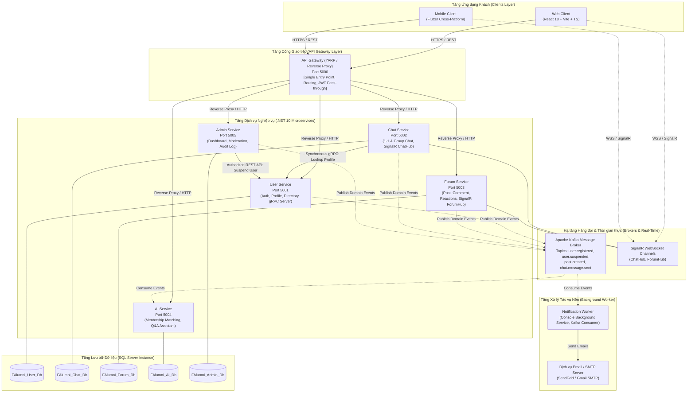
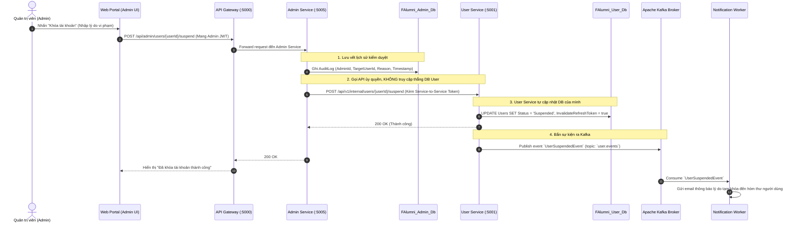
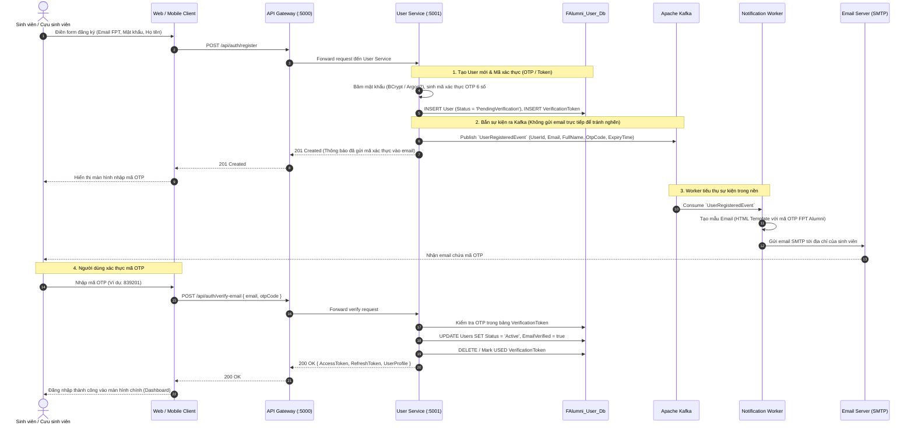

# 02. Kiến trúc Hệ thống FPT Alumni Connect (System Architecture)

> **Môn học**: PRN232 — Final Assignment  
> **Dự án**: FPT Alumni Connect  
> **Đối tượng tài liệu**: Dành cho toàn bộ thành viên trong nhóm phát triển (3 Backend, 1 Web, 1 Mobile). Tài liệu được viết bằng tiếng Việt với phong cách tường minh, dễ hiểu, tránh các khái niệm quá phức tạp (overengineering) nhưng vẫn bảo đảm đáp ứng đầy đủ yêu cầu kỹ thuật của bài tập lớn.

---

## 📑 Mục lục
1. [Tổng quan Kiến trúc Tổng thể (High-Level Architecture)](#1-tổng-quan-kiến-trúc-tổng-thể-high-level-architecture)
2. [Tổ chức Mã nguồn Backend: Layered Architecture (3 Tầng)](#2-tổ-chức-mã-nguồn-backend-layered-architecture-3-tầng)
3. [Quy tắc Độc lập Dữ liệu (Database Isolation & Zero Cross-DB Access)](#3-quy-tắc-độc-lập-dữ-liệu-database-isolation--zero-cross-db-access)
4. [Các Giao thức & Kênh Giao tiếp (Communication Matrix)](#4-các-giao-thức--kênh-giao-tiếp-communication-matrix)
5. [Quy trình Nghiệp vụ Tiêu biểu 1: Admin Khóa Tài khoản Người dùng](#5-quy-trình-nghiệp-vụ-tiêu-biểu-1-admin-khóa-tài-khoản-người-dùng)
6. [Quy trình Nghiệp vụ Tiêu biểu 2: Đăng ký & Xác thực Email (End-to-End Email Verification)](#6-quy-trình-nghiệp-vụ-tiêu-biểu-2-đăng-ký--xác-thực-email-end-to-end-email-verification)
7. [Phân biệt Hạ tầng Bắt buộc (Required ASM Infrastructure) vs Tính năng Nghiệp vụ](#7-phân-biệt-hạ-tầng-bắt-buộc-required-asm-infrastructure-vs-tính-năng-nghiệp-vụ)

---

## 1. Tổng quan Kiến trúc Tổng thể (High-Level Architecture)

Hệ thống **FPT Alumni Connect** được thiết kế theo mô hình **Microservices tinh gọn (Pragmatic Microservices)** phù hợp với quy mô đồ án sinh viên môn PRN232.

Toàn bộ hệ thống giao tiếp qua **API Gateway** duy nhất, các dịch vụ nghiệp vụ độc lập phân chia theo ranh giới nghiệp vụ (Bounded Contexts), cơ sở dữ liệu riêng biệt trên cùng một SQL Server instance, kết hợp giao tiếp đồng bộ (REST, gRPC) và bất đồng bộ (Apache Kafka, SignalR).



---

## 2. Tổ chức Mã nguồn Backend: Layered Architecture (3 Tầng)

Nhằm đảm bảo **dễ học, dễ viết, dễ bàn giao** giữa 3 thành viên Backend và tránh tình trạng chia nhỏ quá mức (overengineering) của Clean Architecture / CQRS:
- Mỗi Microservice được xây dựng theo kiến trúc **Layered Architecture (3 tầng chuẩn mực)**:
  1. **Tầng API (`*.API`)**: Presentation / Controllers / Endpoints
  2. **Tầng Nghiệp vụ (`*.Services`)**: Business Logic, Interfaces, DTOs, Event Handlers
  3. **Tầng Dữ liệu (`*.Repositories`)**: Entity Framework Core DbContext, Repositories, Database Entities, Migrations

### 2.1 Cấu trúc Solution cho từng Service

Ví dụ cấu trúc chuẩn cho `FAlumni.User`:

```text
FAlumni.User/
├── src/
│   ├── FAlumni.User.API/
│   │   ├── Controllers/             # REST API Controllers (AuthController.cs, ProfileController.cs)
│   │   ├── Grpc/                    # gRPC Service Implementation (UserProfileGrpcService.cs)
│   │   ├── Middlewares/             # ExceptionMiddleware.cs, JwtMiddleware.cs
│   │   ├── appsettings.json         # Chuỗi kết nối FAlumni_User_Db, Kafka config
│   │   └── Program.cs               # Đăng ký DI, Swagger, JWT Auth, gRPC endpoint
│   │
│   ├── FAlumni.User.Services/
│   │   ├── Interfaces/              # IAuthService.cs, IUserService.cs, ITokenService.cs
│   │   ├── Implementations/         # AuthService.cs, UserService.cs, TokenService.cs
│   │   ├── DTOs/                    # RegisterRequestDto.cs, UserProfileResponseDto.cs
│   │   ├── Events/                  # UserRegisteredEvent.cs (Kafka Contract)
│   │   └── Protos/                  # user_profile.proto (Định nghĩa hợp đồng gRPC)
│   │
│   └── FAlumni.User.Repositories/
│       ├── Context/                 # UserDbContext.cs (EF Core)
│       ├── Entities/                # User.cs, UserProfile.cs, Role.cs, VerificationToken.cs
│       ├── Interfaces/              # IUserRepository.cs, IVerificationTokenRepository.cs
│       ├── Implementations/         # UserRepository.cs, VerificationTokenRepository.cs
│       └── Migrations/              # EF Core Code-First Migrations
│
└── FAlumni.User.sln
```

### 2.2 Luồng dữ liệu nội bộ trong 1 Service
`HTTP Request` $\rightarrow$ `API Controller` $\rightarrow$ `Service (Business Logic + Validation)` $\rightarrow$ `Repository` $\rightarrow$ `EF Core DbContext` $\rightarrow$ `SQL Server`.

---

## 3. Quy tắc Độc lập Dữ liệu (Database Isolation & Zero Cross-DB Access)

> [!CAUTION]
> **QUY TẮC BẤT DI BẤT DỊCH TRONG ĐỒ ÁN**:
> Tuyệt đối **KHÔNG ĐƯỢC PHÉP** truy cập trực tiếp vào bảng của Database thuộc về Service khác.

1. **Cấu hình Hạ tầng**: Cả nhóm sử dụng chung **một instance Microsoft SQL Server** (chạy trên Docker hoặc Local Developer machine), nhưng được tạo thành **5 database riêng biệt hoàn toàn**:
   - `FAlumni_User_Db`
   - `FAlumni_Chat_Db`
   - `FAlumni_Forum_Db`
   - `FAlumni_AI_Db`
   - `FAlumni_Admin_Db`
2. **Không khóa ngoại liên cơ sở dữ liệu (No Cross-DB Foreign Keys)**:
   - Các bảng trong `Chat`, `Forum`, `Admin` chỉ lưu trữ `UserId (Guid/int)` dưới dạng một giá trị định danh thông thường (Scalar ID), **không tạo Foreign Key constraint** sang bảng `Users` của `FAlumni_User_Db`.
3. **Không viết câu lệnh SQL join giữa 2 database**:
   - Tuyệt đối không dùng `SELECT ... FROM FAlumni_User_Db.dbo.Users u JOIN FAlumni_Forum_Db.dbo.Posts p...`.
4. **Cách lấy thông tin bổ trợ giữa các Service**:
   - Cần lấy nhanh thông tin hiển thị (Avatar, Họ tên, Mã sinh viên): Sử dụng **gRPC** (cho Chat Service) hoặc lưu trữ bản sao dữ liệu (Data Replication) thông qua **Kafka Event**.

---

## 4. Các Giao thức & Kênh Giao tiếp (Communication Matrix)

Bảng dưới đây quy định rõ ràng trách nhiệm của từng công nghệ giao tiếp trong hệ thống:

| Kênh giao tiếp | Công nghệ áp dụng | Chiều tương tác | Trách nhiệm & Nghiệp vụ áp dụng |
| :--- | :--- | :--- | :--- |
| **Client $\rightarrow$ Gateway** | HTTPS / REST | Web / Mobile $\rightarrow$ Gateway | Gọi các API tra cứu, tạo mới, cập nhật dữ liệu. |
| **Gateway $\rightarrow$ Services** | HTTP / Reverse Proxy | Gateway $\rightarrow$ 5 Microservices | Điều hướng request (routing), cân bằng tải, forward JWT Header. |
| **Đồng bộ nội bộ (Sync)** | **gRPC** (HTTP/2, Protobuf) | Chat Service $\rightarrow$ User Service | Khi Chat Service hiển thị tin nhắn/danh sách hội thoại, nó cần thông tin tức thời (DisplayName, AvatarUrl, IsOnline) của người nhận $\rightarrow$ Gọi gRPC để có độ trễ cực thấp (< 5ms). |
| **Đồng bộ nội bộ (Sync)** | **REST API Nội bộ** | Admin Service $\rightarrow$ User Service | Admin Service gọi API `POST /api/v1/users/{id}/suspend` kèm Service Token/Admin JWT để yêu cầu User Service tự đổi trạng thái tài khoản. |
| **Bất đồng bộ (Async)** | **Apache Kafka** | Service $\rightarrow$ Broker $\rightarrow$ Consumer | Bắn Domain Events khi có sự kiện nghiệp vụ xảy ra (Đăng ký tài khoản, Đăng bài viết, Khóa tài khoản) để Notification Worker và AI Service xử lý ngầm mà không làm chậm Client. |
| **Thời gian thực (Real-Time)**| **ASP.NET Core SignalR** | Web / Mobile $\leftrightarrow$ Chat/Forum | Nhận/gửi tin nhắn chat tức thời (ChatHub), cập nhật trạng thái đã xem (Read Receipt), cập nhật phản hồi mới (ForumHub). |

---

## 5. Quy trình Nghiệp vụ Tiêu biểu 1: Admin Khóa Tài khoản Người dùng

Để chứng minh nguyên tắc **Không truy cập chéo Database**, thao tác khóa tài khoản từ phía Ban quản trị (Admin) được thiết kế qua API ủy quyền:



---

## 6. Quy trình Nghiệp vụ Tiêu biểu 2: Đăng ký & Xác thực Email (End-to-End Email Verification)

Quy trình đăng ký tài khoản sinh viên/cựu sinh viên và gửi email xác thực bất đồng bộ qua **Kafka** và **Notification Worker**:



---

## 7. Phân biệt Hạ tầng Bắt buộc (Required ASM Infrastructure) vs Tính năng Nghiệp vụ

Để đảm bảo nhóm không bị phân tâm hoặc quá tải, nhóm cần phân định rạch ròi giữa **Hạ tầng kỹ thuật bắt buộc của đề tài môn PRN232** và **Các tính năng nghiệp vụ của ứng dụng**:

| Phân loại | Thành phần / Khả năng | Trạng thái | Ghi chú kỹ thuật |
| :--- | :--- | :--- | :--- |
| **Required ASM Infrastructure** | **API Gateway** | Bắt buộc (Mandatory) | Sử dụng YARP làm Reverse Proxy điều phối toàn bộ traffic từ Web/Mobile vào các service nội bộ. |
| **Required ASM Infrastructure** | **SQL Server Isolated DBs** | Bắt buộc (Mandatory) | 1 instance SQL Server với 5 database riêng biệt (`FAlumni_*_Db`). Nghiêm cấm cross-database query. |
| **Required ASM Infrastructure** | **Apache Kafka Broker** | Bắt buộc (Mandatory) | Phục vụ kiến trúc Event-Driven bất đồng bộ (`UserRegisteredEvent`, `UserSuspendedEvent`, v.v.). |
| **Required ASM Infrastructure** | **gRPC Communication** | Bắt buộc (Mandatory) | Giao tiếp đồng bộ hiệu năng cao giữa Chat Service $\rightarrow$ User Service để tra cứu Profile. |
| **Required ASM Infrastructure** | **SignalR WebSockets** | Bắt buộc (Mandatory) | Kênh giao tiếp thời gian thực cho tin nhắn chat và thông báo tức thì. |
| **Required ASM Infrastructure** | **Notification Background Worker** | Bắt buộc (Mandatory) | .NET Worker Service độc lập, lắng nghe sự kiện từ Kafka để gửi email thông báo. |
| **Required ASM Infrastructure** | **JWT Authentication** | Bắt buộc (Mandatory) | Cấp và xác thực Access Token (HS256 hoặc RS256) bảo vệ API Gateway và các Service. |
| **Business Features (P0)** | Đăng ký, Đăng nhập, Profile, Chat 1-1, Diễn đàn cơ bản, Admin khóa User | Bắt buộc (MVP) | Xem chi tiết tại [Tài liệu 03 - Service Boundaries](file:///c:/Use/University/PRN232/ASM/guideline/docs/03-service-boundaries.md). |
| **Business Features (P1)** | Nhóm Chat, Đổi mật khẩu, Tìm kiếm bộ lọc, Báo cáo bài viết, AI Q&A FAQ | Khuyến nghị (Standard) | Triển khai sau khi hoàn tất kiểm thử P0. |
| **Business Features (P2)** | Gửi tệp đính kèm, AI matching cựu sinh viên, Xuất báo cáo Excel | Mở rộng (Bonus) | Chỉ triển khai khi còn thời gian trước hạn nộp bài. |
