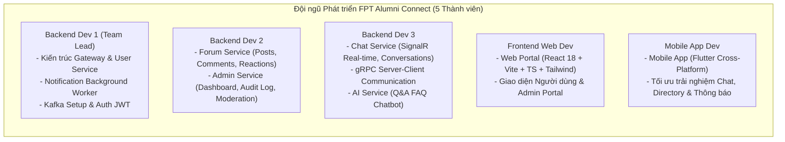

# 03. Ranh giới Dịch vụ & Phân loại User Stories (Service Boundaries & User Stories)

> **Môn học**: PRN232 — Final Assignment  
> **Dự án**: FPT Alumni Connect  
> **Mục tiêu**: Định rõ ranh giới trách nhiệm (Service Boundaries) cho từng dịch vụ, phân bổ quyền sở hữu dữ liệu (Database Ownership), và phân loại chi tiết toàn bộ 50 User Stories theo mức độ ưu tiên (P0 / P1 / P2).

---

## 📑 Mục lục
1. [Ranh giới Nghiệp vụ từng Dịch vụ (Service Boundaries)](#1-ranh-giới-nghiệp-vụ-từng-dịch-vụ-service-boundaries)
2. [Ma trận Sở hữu Cơ sở Dữ liệu & Quy tắc Cấm truy cập chéo](#2-ma-trận-sở-hữu-cơ-sở-dữ-liệu--quy-tắc-cấm-truy-cập-chéo)
3. [Chi tiết Thao tác Ủy quyền: Admin Khóa Tài khoản Người dùng](#3-chi-tiết-thao-tác-ủy-quyền-admin-khóa-tài-khoản-người-dùng)
4. [Ma trận Phân loại 50 User Stories (US, CH, FO, AI, AD)](#4-ma-trận-phân-loại-50-user-stories-us-ch-fo-ai-ad)
   - [4.1 Nhóm User Stories — Tài khoản & Hồ sơ (US-01 đến US-11)](#41-nhóm-user-stories--tài-khoản--hồ-sơ-us-01-đến-us-11)
   - [4.2 Nhóm Chat Stories — Nhắn tin & Trò chuyện (CH-01 đến CH-10)](#42-nhóm-chat-stories--nhắn-tin--trò-chuyện-ch-01-đến-ch-10)
   - [4.3 Nhóm Forum Stories — Diễn đàn & Thảo luận (FO-01 đến FO-16)](#43-nhóm-forum-stories--diễn-đàn--thảo-luận-fo-01-đến-fo-16)
   - [4.4 Nhóm AI Stories — Trợ lý Thông minh & Gợi ý (AI-01 đến AI-04)](#44-nhóm-ai-stories--trợ-lý-thông-minh--gợi-ý-ai-01-đến-ai-04)
   - [4.5 Nhóm Admin Stories — Quản trị & Kiểm duyệt (AD-01 đến AD-09)](#45-nhóm-admin-stories--quản-trị--kiểm-duyệt-ad-01-đến-ad-09)
5. [Phân chia Công việc Đội ngũ Phát triển (5 Thành viên)](#5-phân-chia-công-việc-đội-ngũ-phát-triển-5-thành-viên)

---

## 1. Ranh giới Nghiệp vụ từng Dịch vụ (Service Boundaries)

Để tránh tình trạng chồng chéo tính năng (Spaghetti Architecture), mỗi dịch vụ chỉ nắm giữ một phần nghiệp vụ chuyên biệt:

### 1.1 User Service (Cổng danh tính & Hồ sơ)
- **Trách nhiệm chính**:
  - Quản lý danh tính người dùng: Đăng ký, đăng nhập, cấp JWT Access Token và Refresh Token.
  - Quản lý mã OTP và kích hoạt tài khoản qua xác thực Email.
  - Quản lý thông tin hồ sơ (UserProfile): Họ tên, MSSV, niên khóa, chuyên ngành, công ty hiện tại, kỹ năng, mạng xã hội.
  - Cung cấp danh bạ cựu sinh viên (Alumni Directory) và tìm kiếm bộ lọc.
  - Đóng vai trò **gRPC Server** (`UserProfileGrpcService`) để trả về thông tin người dùng tức thời cho Chat Service.
- **Không được làm**: Không quản lý nội dung tin nhắn, không quản lý bài đăng diễn đàn, không tự động gửi email trực tiếp (phải ủy thác cho Notification Worker qua Kafka).

### 1.2 Chat Service (Nhắn tin & Trò chuyện thời gian thực)
- **Trách nhiệm chính**:
  - Quản lý cuộc hội thoại 1-1 và nhóm chat.
  - Lưu trữ lịch sử tin nhắn chat và trạng thái đã đọc (Read Receipts).
  - Triển khai **SignalR ChatHub** để gửi/nhận tin nhắn real-time giữa các client.
  - Đóng vai trò **gRPC Client** gọi sang User Service để lấy Avatar/Tên hiển thị của người chat.
  - Bắn sự kiện ra Kafka khi có tin nhắn mới cho người dùng đang offline.
- **Không được làm**: Không truy cập trực tiếp bảng `Users`, không tự xác thực mật khẩu người dùng.

### 1.3 Forum Service (Diễn đàn & Kết nối cộng đồng)
- **Trách nhiệm chính**:
  - Quản lý danh mục diễn đàn (Categories: Việc làm, Học bổng, Kinh nghiệm phỏng vấn, Sự kiện).
  - Quản lý bài đăng (Posts), bình luận (Comments), trả lời đa tầng (Threaded Replies).
  - Quản lý lượt thích (Reactions: Like, Upvote) và đánh dấu lưu bài viết (Bookmarks).
  - Tiếp nhận báo cáo vi phạm nội dung (Reports).
  - Triển khai **SignalR ForumHub** để cập nhật bình luận mới theo thời gian thực.
  - Bắn sự kiện ra Kafka (`PostCreatedEvent`) cho AI Service và Notification Worker.
- **Không được làm**: Không quản lý tài khoản người dùng, không tự ý sửa bảng `AuditLogs` của Admin.

### 1.4 AI Service (Trí tuệ nhân tạo & Khuyến nghị)
- **Trách nhiệm chính**:
  - Gợi ý ghép đôi Mentor - Mentee (Alumni Matching) dựa trên chuyên ngành và kỹ năng.
  - Trợ lý ảo Q&A hỗ trợ giải đáp quy định nhà trường, thủ tục cựu sinh viên.
  - Lắng nghe Kafka event `PostCreatedEvent` để quét và gắn cờ các bài đăng chứa từ khóa độc hại / spam (Content Moderation).
- **Không được làm**: Không chứa dữ liệu giao dịch cốt lõi của người dùng.

### 1.5 Admin Service (Quản trị & Kiểm duyệt nền tảng)
- **Trách nhiệm chính**:
  - Cung cấp số liệu thống kê Dashboard (tổng số người dùng, số bài viết, mức độ hoạt động).
  - Xử lý các báo cáo vi phạm nội dung diễn đàn từ người dùng.
  - Điều phối quy trình khóa/mở khóa tài khoản: Ghi nhận nhật ký kiểm duyệt (Audit Log) và gọi REST API sang User Service.
  - Quản lý danh mục diễn đàn và phát thông báo hệ thống.
- **Không được làm**: **TUYỆT ĐỐI KHÔNG** kết nối vào database `FAlumni_User_Db` để tự ý đổi cột `Status` của User.

### 1.6 API Gateway (Cổng điều phối tập trung)
- **Trách nhiệm chính**:
  - Là điểm tiếp nhận duy nhất cho toàn bộ request từ Web và Mobile (Port 5000).
  - Định tuyến (Routing) đường dẫn API đến đúng service nội bộ (ví dụ: `/api/v1/users/*` $\rightarrow$ User Service, `/api/v1/posts/*` $\rightarrow$ Forum Service).
  - Chuyển tiếp (Pass-through) Header Authorization (JWT Token) xuống các service.

### 1.7 Notification Worker (Xử lý tác vụ nền & Email)
- **Trách nhiệm chính**:
  - Là một .NET Background Service độc lập, không mở cổng HTTP public.
  - Lắng nghe sự kiện từ Kafka (`user.registered`, `user.suspended`, v.v.).
  - Biên dịch mẫu HTML Email và gửi thông báo qua giao thức SMTP (SendGrid / Gmail SMTP).

---

## 2. Ma trận Sở hữu Cơ sở Dữ liệu & Quy tắc Cấm truy cập chéo

Nhóm sử dụng chung một instance SQL Server, được chia làm **5 Database hoàn toàn độc lập**:

| Service sở hữu | Tên Database | Các bảng cốt lõi (Core Tables) | Quy tắc cấm truy cập chéo (Strict Prohibition) |
| :--- | :--- | :--- | :--- |
| **User Service** | `FAlumni_User_Db` | `Users`, `UserProfiles`, `Roles`, `UserRoles`, `VerificationTokens`, `RefreshTokens` | **Cấm** Chat, Forum, AI, Admin kết nối trực tiếp. Mọi thông tin người dùng đều phải qua API hoặc gRPC của User Service. |
| **Chat Service** | `FAlumni_Chat_Db` | `Conversations`, `ConversationParticipants`, `Messages`, `MessageAttachments`, `MessageReceipts` | **Cấm** các service khác đọc bảng `Messages`. Chat Service chỉ lưu `UserId` dạng số nguyên hoặc Guid, không tạo Foreign Key sang `FAlumni_User_Db.dbo.Users`. |
| **Forum Service** | `FAlumni_Forum_Db` | `Categories`, `Posts`, `Comments`, `Reactions`, `Bookmarks`, `PostTags`, `Reports` | **Cấm** Admin Service can thiệp thẳng vào bảng `Posts`. Mọi thao tác ẩn/xóa bài viết vi phạm phải qua API của Forum Service. |
| **AI Service** | `FAlumni_AI_Db` | `FaqKnowledgeBase`, `UserSkillVectors`, `ModerationRules`, `RecommendationCaches` | Tự trị hoàn toàn dữ liệu huấn luyện và vector đặc trưng. |
| **Admin Service** | `FAlumni_Admin_Db` | `AuditLogs`, `SystemAnnouncements`, `ModerationQueues`, `SystemSettings` | **Cấm** ghi đè từ các service khác. Bảng `AuditLogs` là nguồn lưu vết tối thượng cho các quyết định xử lý kỷ luật. |

---

## 3. Chi tiết Thao tác Ủy quyền: Admin Khóa Tài khoản Người dùng

Để bảo đảm tính toàn vẹn của mô hình Microservices, thao tác khóa tài khoản từ phía Ban Quản Trị phải tuân thủ nghiêm ngặt quy trình:

```text
[Admin UI] 
   │ (1) POST /api/admin/users/{id}/suspend
   ▼
[API Gateway]
   │ (Forward)
   ▼
[Admin Service] 
   │ (2) Ghi vết hành động vào AuditLogs trong FAlumni_Admin_Db
   │ (3) Gọi Authorized REST API: POST /api/v1/internal/users/{id}/suspend kèm Token
   ▼
[User Service]
   │ (4) Xác thực Service Token & Quyền Admin
   │ (5) Cập nhật Status = 'Suspended' trong FAlumni_User_Db
   │ (6) Thu hồi Refresh Token lập tức
   │ (7) Bắn Kafka event: UserSuspendedEvent
   ▼
[Apache Kafka Broker]
   │ (8) Broadcast sự kiện
   ├──► [Notification Worker]: Gửi email thông báo lý do tạm khóa
   └──► [Chat & Forum Services]: Hủy kết nối SignalR đang hoạt động của người dùng
```

> [!IMPORTANT]
> **Điểm mấu chốt**: Admin Service **không bao giờ** chạm tay vào Database của User Service. User Service toàn quyền kiểm soát vòng đời dữ liệu tài khoản của mình.

---

## 4. Ma trận Phân loại 50 User Stories (US, CH, FO, AI, AD)

Dưới đây là bảng ánh xạ toàn bộ 50 User Stories của dự án FPT Alumni Connect, kèm mức độ ưu tiên:
- **P0 (Must Have - Cốt lõi MVP)**: Bắt buộc hoàn thiện để đạt điều kiện cơ bản của đồ án.
- **P1 (Should Have - Tiêu chuẩn)**: Tính năng chuẩn giúp hệ thống hoàn thiện và phong phú.
- **P2 (Nice to Have - Nâng cao/Điểm thưởng)**: Tính năng mở rộng, triển khai khi đã hoàn tất P0 và P1.

---

### 4.1 Nhóm User Stories — Tài khoản & Hồ sơ (US-01 đến US-11)

| Mã US | Tên tính năng | Mô tả chi tiết nghiệp vụ | Service phụ trách | Mức ưu tiên | Kênh giao tiếp kỹ thuật |
| :--- | :--- | :--- | :--- | :---: | :--- |
| **US-01** | Đăng ký tài khoản | Người dùng điền Email trường FPT (`@fpt.edu.vn` / `@fe.edu.vn`), mật khẩu và thông tin cơ bản để tạo tài khoản mới. | **User Service** | **P0** | REST API |
| **US-02** | Xác thực Email | Người dùng nhập mã OTP nhận được từ hòm thư để kích hoạt tài khoản sang trạng thái `Active`. | **User Service** | **P0** | REST API + Kafka (Worker) |
| **US-03** | Đăng nhập hệ thống | Người dùng đăng nhập bằng Email/Password hợp lệ, nhận về JWT Access Token và Refresh Token. | **User Service** | **P0** | REST API |
| **US-04** | Đặt lại mật khẩu | Người dùng yêu cầu cấp lại mật khẩu qua mã xác nhận gửi về email khi quên mật khẩu. | **User Service** | **P1** | REST API + Kafka (Worker) |
| **US-05** | Xem hồ sơ cá nhân | Người dùng đăng nhập có thể xem đầy đủ thông tin cá nhân, khóa học, chuyên ngành và công việc hiện tại của mình. | **User Service** | **P0** | REST API |
| **US-06** | Cập nhật hồ sơ | Người dùng cập nhật tiểu sử (Bio), kỹ năng làm việc, liên kết LinkedIn/GitHub và chức danh nghề nghiệp. | **User Service** | **P0** | REST API |
| **US-07** | Tải ảnh đại diện | Người dùng tải lên ảnh đại diện (Avatar) cá nhân định dạng JPG/PNG. | **User Service** | **P1** | REST API (Multipart/form-data) |
| **US-08** | Xem hồ sơ công khai | Cựu sinh viên / Sinh viên xem trang cá nhân công khai của người khác trong mạng lưới. | **User Service** | **P0** | REST API |
| **US-09** | Tìm kiếm danh bạ | Tìm kiếm cựu sinh viên theo bộ lọc: Niên khóa tốt nghiệp, Chuyên ngành (KTPM, ATTT, QTKD), Công ty làm việc. | **User Service** | **P1** | REST API |
| **US-10** | Phân quyền vai trò | Hệ thống gán và kiểm tra quyền hạn của người dùng (`Student`, `Alumni`, `Admin`) qua JWT Claims. | **User Service** | **P1** | REST API |
| **US-11** | Làm mới Access Token | Client sử dụng Refresh Token để lấy Access Token mới khi token cũ hết hạn mà không cần đăng nhập lại. | **User Service** | **P0** | REST API |

---

### 4.2 Nhóm Chat Stories — Nhắn tin & Trò chuyện (CH-01 đến CH-10)

| Mã CH | Tên tính năng | Mô tả chi tiết nghiệp vụ | Service phụ trách | Mức ưu tiên | Kênh giao tiếp kỹ thuật |
| :--- | :--- | :--- | :--- | :---: | :--- |
| **CH-01** | Bắt đầu trò chuyện 1-1 | Người dùng tạo hoặc mở cuộc trò chuyện trực tiếp 1-1 với một cựu sinh viên khác. | **Chat Service** | **P0** | REST API |
| **CH-02** | Gửi nhận tin nhắn real-time | Hai người dùng trao đổi tin nhắn văn bản tức thời mà không cần tải lại trang. | **Chat Service** | **P0** | SignalR (`ChatHub`) |
| **CH-03** | Lịch sử cuộc trò chuyện | Tải danh sách tin nhắn cũ có phân trang (Pagination/Infinite scroll) khi cuộn màn hình chat. | **Chat Service** | **P0** | REST API |
| **CH-04** | Tra cứu thông tin người chat | Chat Service tra cứu thông tin tên hiển thị và avatar tức thời của đối phương từ User Service. | **Chat Service** | **P0** | **gRPC Client $\rightarrow$ Server** |
| **CH-05** | Tạo nhóm trò chuyện | Người dùng tạo nhóm chat nhiều thành viên (ví dụ nhóm cựu sinh viên K14, nhóm việc làm). | **Chat Service** | **P1** | REST API |
| **CH-06** | Nhắn tin nhóm real-time | Các thành viên trong nhóm nhận và gửi tin nhắn tức thời đồng thời. | **Chat Service** | **P1** | SignalR (`ChatHub`) |
| **CH-07** | Gửi tệp đính kèm | Người dùng chia sẻ hình ảnh hoặc tài liệu tệp (PDF, Word) qua cửa sổ trò chuyện. | **Chat Service** | **P2** | REST API + SignalR |
| **CH-08** | Trạng thái đã xem | Hiển thị trạng thái tin nhắn đã gửi (Sent) và đối phương đã xem (Read receipt). | **Chat Service** | **P1** | SignalR (`ChatHub`) |
| **CH-09** | Trạng thái Online/Offline | Hiển thị chấm xanh trực tuyến khi người dùng đang kết nối vào ứng dụng. | **Chat Service** | **P2** | SignalR Presence |
| **CH-10** | Bắn sự kiện tin nhắn mới | Phát sự kiện `ChatMessageSentEvent` ra Kafka để thông báo cho người dùng đang không mở ứng dụng. | **Chat Service** | **P1** | Apache Kafka |

---

### 4.3 Nhóm Forum Stories — Diễn đàn & Thảo luận (FO-01 đến FO-16)

| Mã FO | Tên tính năng | Mô tả chi tiết nghiệp vụ | Service phụ trách | Mức ưu tiên | Kênh giao tiếp kỹ thuật |
| :--- | :--- | :--- | :--- | :---: | :--- |
| **FO-01** | Xem danh mục diễn đàn | Xem danh sách các chuyên mục thảo luận (Cơ hội việc làm, Kinh nghiệm đồ án, Sự kiện cựu sinh viên). | **Forum Service** | **P0** | REST API |
| **FO-02** | Đăng bài viết mới | Người dùng soạn thảo và xuất bản bài viết mới kèm tiêu đề, nội dung Markdown, chuyên mục và thẻ Tags. | **Forum Service** | **P0** | REST API |
| **FO-03** | Xem chi tiết bài viết | Đọc toàn bộ nội dung bài viết, thông tin tác giả và danh sách các bình luận bên dưới. | **Forum Service** | **P0** | REST API |
| **FO-04** | Chỉnh sửa và xóa bài viết | Tác giả bài viết có thể sửa lại nội dung hoặc xóa bài viết do chính mình đăng tải. | **Forum Service** | **P1** | REST API |
| **FO-05** | Bình luận bài viết | Người dùng gửi bình luận đóng góp ý kiến dưới bài thảo luận. | **Forum Service** | **P0** | REST API |
| **FO-06** | Trả lời bình luận đa tầng | Trả lời trực tiếp vào một bình luận cụ thể (Nested Comment / Thread). | **Forum Service** | **P1** | REST API |
| **FO-07** | Sửa và xóa bình luận | Người dùng chỉnh sửa hoặc xóa bình luận của chính mình. | **Forum Service** | **P1** | REST API |
| **FO-08** | Tương tác Thích bài viết | Thả tim / Like / Upvote bài viết hoặc bình luận hữu ích. | **Forum Service** | **P0** | REST API |
| **FO-09** | Tìm kiếm bài viết | Tìm kiếm bài đăng theo từ khóa tiêu đề, nội dung, danh mục hoặc hashtag. | **Forum Service** | **P1** | REST API |
| **FO-10** | Ghim bài viết quan trọng | Ghim các thông báo quan trọng của Ban Quản Trị lên đầu trang chuyên mục. | **Forum Service** | **P2** | REST API |
| **FO-11** | Báo cáo bài viết vi phạm | Gửi báo cáo kèm lý do (Spam, nội dung phản cảm, vi phạm quy tắc) để Admin kiểm duyệt. | **Forum Service** | **P1** | REST API |
| **FO-12** | Cập nhật bình luận tức thời | Nhận thông báo thời gian thực khi có người vừa bình luận vào bài viết mình đang mở. | **Forum Service** | **P2** | SignalR (`ForumHub`) |
| **FO-13** | Bắn sự kiện bài đăng mới | Phát sự kiện `PostCreatedEvent` lên Kafka để kích hoạt kiểm duyệt tự động từ AI Service. | **Forum Service** | **P1** | Apache Kafka |
| **FO-14** | Lưu bài viết (Bookmark) | Đánh dấu bài viết hay vào danh sách bài viết đã lưu để đọc lại sau. | **Forum Service** | **P2** | REST API |
| **FO-15** | Xem bài viết của tác giả | Xem toàn bộ danh sách các bài viết đã được đăng bởi một cựu sinh viên cụ thể. | **Forum Service** | **P2** | REST API |
| **FO-16** | Ẩn nội dung vi phạm | Tạm ẩn bài viết khỏi luồng hiển thị công khai khi nhận nhiều báo cáo vi phạm. | **Forum Service** | **P2** | REST API |

---

### 4.4 Nhóm AI Stories — Trợ lý Thông minh & Gợi ý (AI-01 đến AI-04)

| Mã AI | Tên tính năng | Mô tả chi tiết nghiệp vụ | Service phụ trách | Mức ưu tiên | Kênh giao tiếp kỹ thuật |
| :--- | :--- | :--- | :--- | :---: | :--- |
| **AI-01** | Gợi ý kết nối Mentor | Đề xuất danh sách cựu sinh viên phù hợp làm Mentor dựa trên chuyên ngành và mục tiêu nghề nghiệp. | **AI Service** | **P2** | REST API |
| **AI-02** | Trợ lý hỏi đáp quy chế (Chatbot) | Trả lời tự động các câu hỏi thường gặp về quy định cựu sinh viên, thủ tục nhận bằng, sự kiện nhà trường. | **AI Service** | **P1** | REST API |
| **AI-03** | Tự động quét từ ngữ độc hại | Lắng nghe `PostCreatedEvent` từ Kafka, phân tích văn bản để cảnh báo nội dung ngôn từ kích động/toxic. | **AI Service** | **P2** | Kafka Consumer + Internal REST |
| **AI-04** | Gợi ý bài viết liên quan | Đề xuất danh sách bài viết liên quan dưới mỗi bài đọc dựa trên thẻ phân loại và sở thích. | **AI Service** | **P2** | REST API |

---

### 4.5 Nhóm Admin Stories — Quản trị & Kiểm duyệt (AD-01 đến AD-09)

| Mã AD | Tên tính năng | Mô tả chi tiết nghiệp vụ | Service phụ trách | Mức ưu tiên | Kênh giao tiếp kỹ thuật |
| :--- | :--- | :--- | :--- | :---: | :--- |
| **AD-01** | Bảng điều khiển tổng quan | Xem biểu đồ và chỉ số thống kê toàn hệ thống: Số người dùng mới, lượng bài viết, số tin nhắn chat. | **Admin Service** | **P1** | REST API |
| **AD-02** | Quản lý danh sách người dùng | Xem danh sách tài khoản, tìm kiếm theo email/MSSV, lọc theo trạng thái (`Active`, `Suspended`). | **Admin Service** | **P0** | REST API |
| **AD-03** | Khóa tài khoản người dùng | Tạm khóa tài khoản vi phạm thông qua lệnh ủy quyền gọi REST API của User Service và ghi Audit Log. | **Admin Service** | **P0** | **Authorized REST API $\rightarrow$ User Service** |
| **AD-04** | Mở khóa tài khoản | Mở khóa và khôi phục quyền truy cập cho tài khoản sau khi hết hạn phạt hoặc khiếu nại thành công. | **Admin Service** | **P1** | **Authorized REST API $\rightarrow$ User Service** |
| **AD-05** | Xử lý báo cáo bài viết | Duyệt danh sách các bài viết bị người dùng báo cáo, thực hiện phê duyệt hợp lệ hoặc gỡ bỏ vi phạm. | **Admin Service** | **P0** | REST API $\rightarrow$ Forum Service |
| **AD-06** | Quản lý danh mục diễn đàn | Tạo mới, cập nhật tên hoặc xóa các chuyên mục diễn đàn con. | **Admin Service** | **P1** | REST API $\rightarrow$ Forum Service |
| **AD-07** | Nhật ký kiểm duyệt (Audit Log) | Truy vết mọi thao tác quản trị (Ai khóa ai, lý do gì, vào thời điểm nào) để kiểm toán. | **Admin Service** | **P1** | REST API (Đọc `FAlumni_Admin_Db`) |
| **AD-08** | Phát thông báo toàn hệ thống | Gửi thông báo broadcast quan trọng từ trường tới toàn thể cựu sinh viên và sinh viên. | **Admin Service** | **P2** | REST API + Kafka |
| **AD-09** | Xuất báo cáo dữ liệu | Xuất dữ liệu thống kê hoạt động mạng lưới cựu sinh viên ra định dạng file Excel / CSV. | **Admin Service** | **P2** | REST API |

---

## 5. Phân chia Công việc Đội ngũ Phát triển (5 Thành viên)

Dự án gồm **3 lập trình viên Backend, 1 lập trình viên Web, 1 lập trình viên Flutter**, được phân công trách nhiệm rõ ràng như sau:



### Chi tiết phân công:
1. **Backend Developer 1 (Lead)**:
   - Chịu trách nhiệm cấu hình **API Gateway** (YARP), bảo mật JWT chung toàn hệ thống.
   - Phát triển **User Service** (Đăng ký, xác thực, thông tin cá nhân, danh bạ cựu sinh viên).
   - Phát triển **Notification Background Worker** (.NET Worker Service) và cấu hình Docker cụm Kafka Broker.
2. **Backend Developer 2**:
   - Phát triển **Forum Service** (CRUD bài viết, bình luận phân cấp, thả biểu cảm, tiếp nhận báo cáo).
   - Phát triển **Admin Service** (Bảng tin quản trị, xử lý báo cáo, điều phối API khóa tài khoản người dùng, ghi Audit Log).
3. **Backend Developer 3**:
   - Phát triển **Chat Service** (Triển khai SignalR ChatHub, quản lý phiên chat 1-1 và nhóm).
   - Thiết lập cấu hình **gRPC Client** gọi sang User Service để tra cứu Profile tức thì.
   - Phát triển **AI Service** (Xây dựng API Q&A Chatbot hỗ trợ cựu sinh viên).
4. **Web Developer**:
   - Xây dựng Web Portal bằng React 18, Vite, TypeScript, Tailwind CSS, shadcn/ui.
   - Tích hợp REST API qua Gateway, kết nối WebSocket SignalR cho Chat & Forum.
   - Xây dựng giao diện Admin Dashboard và trang quản lý kiểm duyệt.
5. **Mobile Developer (Flutter)**:
   - Xây dựng ứng dụng di động đa nền tảng (Android / iOS) bằng Flutter.
   - Tối ưu hóa trải nghiệm lướt danh bạ cựu sinh viên, giao diện nhắn tin thời gian thực qua SignalR.
