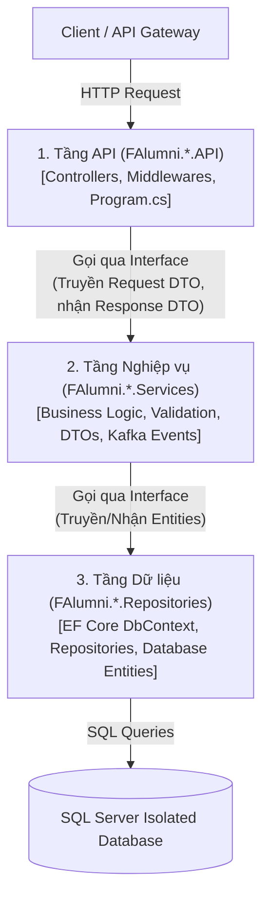

# 04. Quy chuẩn Phát triển .NET 10 & Kiến trúc Phân tầng (Layered Architecture Standards)

> **Môn học**: PRN232 — Final Assignment  
> **Dự án**: FPT Alumni Connect  
> **Áp dụng cho**: 3 Backend Developers (BE1, BE2, BE3).  
> **Mục tiêu**: Chuẩn hóa cấu trúc thư mục, quy tắc phân lớp mã nguồn, quy chuẩn đặt tên và hướng dẫn sử dụng mẫu template .NET 10 cho toàn bộ các dịch vụ Backend.

---

## 📑 Mục lục
1. [Nguyên tắc Cốt lõi của Kiến trúc Phân tầng (3-Layer Architecture)](#1-nguyên-tắc-cốt-lõi-của-kiến-trúc-phân-tầng-3-layer-architecture)
2. [Cấu trúc Thư mục Chuẩn của một Service](#2-cấu-trúc-thư-mục-chuẩn-của-một-service)
3. [Quy định Đặt Code: Từng Layer Phụ trách Gì?](#3-quy-định-đặt-code-từng-layer-phụ-trách-gì)
4. [Quy tắc Ràng buộc Phụ thuộc (Dependency Inversion & Restrictions)](#4-quy-tắc-ràng-buộc-phụ-thuộc-dependency-inversion--restrictions)
5. [Quy chuẩn Đặt tên & Phong cách Lập trình (Coding Conventions)](#5-quy-chuẩn-đặt-tên--phong-cách-lập-trình-coding-conventions)
6. [Xử lý Ngoại lệ Tập trung & Logging (Centralized Exception Handling & Logging)](#6-xử-lý-ngoại-lệ-tập-trung--logging-centralized-exception-handling--logging)
7. [Kiểm thử Đơn vị & Kiểm thử Tích hợp (Unit & Integration Testing)](#7-kiểm-thử-đơn-vị--kiểm-thử-tích-hợp-unit--integration-testing)
8. [Hướng dẫn Copy & Đổi tên Template cho Service Mới](#8-hướng-dẫn-copy--đổi-tên-template-cho-service-mới)

---

## 1. Nguyên tắc Cốt lõi của Kiến trúc Phân tầng (3-Layer Architecture)

Trong đồ án môn PRN232, nhóm lựa chọn mô hình **Kiến trúc Phân tầng (Layered Architecture: API $\rightarrow$ Services $\rightarrow$ Repositories)** thay vì Clean Architecture / CQRS phức tạp. Mô hình này giúp sinh viên:
- Tiếp cận nhanh, dễ hiểu và dễ bàn giao mã nguồn giữa 3 thành viên Backend.
- Phân tách rõ ràng giữa: Giao tiếp HTTP (API), Logic nghiệp vụ (Services) và Truy cập dữ liệu (Repositories).
- Dễ dàng viết Unit Test cho tầng Services bằng cách giả lập (mock/fake) tầng Repositories.



---

## 2. Cấu trúc Thư mục Chuẩn của một Service

Mỗi repository backend (ví dụ: `f-alumni-user-service`) tuân theo cấu trúc dự án chuẩn được tổ chức trong template `templates/dotnet-service/`:

```text
f-alumni-<service-name>/
├── src/
│   ├── FAlumni.<Service>.Api/                  # [Tầng 1] Web API Entry Point
│   │   ├── Controllers/                        # Các REST Controllers kế thừa ControllerBase
│   │   ├── Middlewares/                        # GlobalExceptionHandlingMiddleware
│   │   ├── appsettings.json                    # Cấu hình chuỗi kết nối, log level
│   │   ├── appsettings.Development.json
│   │   └── Program.cs                          # Đăng ký DI, Middleware Pipeline, HealthChecks
│   │
│   ├── FAlumni.<Service>.Services/             # [Tầng 2] Business Logic
│   │   ├── DTOs/
│   │   │   ├── Requests/                       # Request payload nhận từ client (có DataAnnotations)
│   │   │   └── Responses/                      # Response DTO trả về cho client
│   │   ├── Exceptions/                         # Custom Exception (NotFoundException, BadRequestException)
│   │   ├── Interfaces/                         # Hợp đồng Service (IUserService, IChatService)
│   │   ├── Implementations/                    # Hiện thực Service logic + logging
│   │   └── Extensions/                         # ServiceCollectionExtensions (Đăng ký DI tầng Services & Repos)
│   │
│   └── FAlumni.<Service>.Repositories/         # [Tầng 3] Data Access
│       ├── Entities/                           # Thực thể Database tương ứng với bảng trong SQL Server
│       ├── Interfaces/                         # Hợp đồng truy xuất dữ liệu (IUserRepository, IChatRepository)
│       ├── Implementations/                    # Hiện thực EF Core DbContext hoặc Repository
│       └── Extensions/                         # RepositoryServiceCollectionExtensions
│
├── tests/
│   └── FAlumni.<Service>.Tests/                # [Tầng Kiểm thử] xUnit Test Project
│       ├── Services/                           # Unit tests cho Business Services
│       └── Endpoints/                          # Integration tests cho REST API Endpoints
│
├── README.md                                   # Hướng dẫn chạy và test cục bộ của service
└── FAlumni.<Service>.sln                       # Solution chứa toàn bộ các project trên
```

---

## 3. Quy định Đặt Code: Từng Layer Phụ trách Gì?

| Layer | Được phép làm | Nghiêm cấm làm |
| :--- | :--- | :--- |
| **API Layer**<br>(`*.Api`) | - Tiếp nhận HTTP Request từ Gateway/Client.<br>- Kiểm tra ModelState, trả về mã HTTP chuẩn (200, 201, 204, 400, 404).<br>- Điều hướng exception qua Middleware tập trung.<br>- Gọi xuống các **Service Interface** (`IService`). | - **CẤM** chứa logic tính toán nghiệp vụ phức tạp.<br>- **CẤM** inject trực tiếp Repository (`IRepository`) hoặc `DbContext`.<br>- **CẤM** trả thẳng Database Entity về cho client (phải qua DTO). |
| **Services Layer**<br>(`*.Services`) | - Thực hiện validation nghiệp vụ, logic tính toán.<br>- Nhận Request DTO và trả về Response DTO.<br>- Bắn domain events lên Kafka broker khi có sự kiện nghiệp vụ.<br>- Ghi log nghiệp vụ (`ILogger<T>`).<br>- Ném custom exception (`NotFoundException`, `ValidationException`). | - **CẤM** phụ thuộc vào `HttpContext`, `HttpRequest`, `HttpResponse`.<br>- **CẤM** viết câu lệnh SQL thuần hay phụ thuộc trực tiếp vào HTTP framework. |
| **Repositories Layer**<br>(`*.Repositories`) | - Quản lý kết nối cơ sở dữ liệu (EF Core `DbContext`).<br>- Thực hiện các thao tác CRUD với Entity (`GetAll`, `GetById`, `Add`, `Update`, `Delete`).<br>- Định cấu hình Fluent API mapping cho các bảng SQL Server. | - **CẤM** chứa logic nghiệp vụ người dùng.<br>- **CẤM** gọi API hoặc bắn Kafka message.<br>- **CẤM** truy cập database của service khác (Zero cross-db access). |

---

## 4. Quy tắc Ràng buộc Phụ thuộc (Dependency Inversion & Restrictions)

> [!CAUTION]
> **QUY TẮC PHỤ THUỘC BẮT BUỘC**:
> 1. `Template.Api` **chỉ tham chiếu** `Template.Services`.
> 2. `Template.Services` **tham chiếu** `Template.Repositories`.
> 3. `Template.Repositories` **không tham chiếu bất kỳ project nào khác** trong solution.

### Cách đăng ký Dependency Injection chuẩn mực:
Để `Template.Api` không cần phải biết chi tiết triển khai của `Template.Repositories`, chúng ta sử dụng Extension Methods dạng chuỗi:
1. `Template.Repositories` cung cấp:
   ```csharp
   public static IServiceCollection AddRepositories(this IServiceCollection services);
   ```
2. `Template.Services` cung cấp:
   ```csharp
   public static IServiceCollection AddApplicationServices(this IServiceCollection services)
   {
       services.AddRepositories(); // Đăng ký Repository layer
       services.AddScoped<ISampleItemService, SampleItemService>(); // Đăng ký Service layer
       return services;
   }
   ```
3. Trong `Program.cs` của `Template.Api`:
   ```csharp
   builder.Services.AddApplicationServices(); // 1 dòng duy nhất, cực kỳ gọn gàng!
   ```

---

## 5. Quy chuẩn Đặt tên & Phong cách Lập trình (Coding Conventions)

- **Ngôn ngữ**: C# (.NET 10, C# 13), bật `<Nullable>enable</Nullable>` và `<ImplicitUsings>enable</ImplicitUsings>`.
- **Tên Class, Interface, Method, Property**: Sử dụng `PascalCase`.
  - Interface luôn bắt đầu bằng tiền tố `I`: `ISampleItemService`, `ISampleItemRepository`.
  - Controller luôn có hậu tố `Controller`: `SampleItemsController`.
  - Entity: Số ít, danh từ: `SampleItem`, `User`, `Post`.
  - DTO: Nêu rõ mục đích: `CreateSampleItemRequest`, `SampleItemResponse`.
- **Tên tham số, biến cục bộ**: Sử dụng `camelCase` (ví dụ: `sampleItemId`, `cancellationToken`).
- **Private Readonly Field**: Sử dụng tiền tố `_camelCase` (ví dụ: `private readonly ISampleItemService _sampleItemService;`).
- **Bất đồng bộ (Async/Await)**: Mọi phương thức có `async` đều phải có hậu tố `Async` và nhận tham số `CancellationToken cancellationToken = default`.

---

## 6. Xử lý Ngoại lệ Tập trung & Logging (Centralized Exception Handling & Logging)

Thay vì viết khối `try-catch` trong từng Action của Controller:
1. Sử dụng **`GlobalExceptionHandlingMiddleware`** đặt ngay đầu pipeline HTTP.
2. Khi không tìm thấy dữ liệu, tầng Service ném `NotFoundException`:
   ```csharp
   throw new NotFoundException(nameof(SampleItem), id);
   ```
3. Middleware tự động bắt ngoại lệ và trả về định dạng chuẩn quốc tế **RFC 7807 ProblemDetails** (`application/problem+json`) kèm mã HTTP `404 Not Found` và `traceId` để truy vết lỗi.
4. Ghi log có cấu trúc (Structured Logging) qua `ILogger<T>`:
   ```csharp
   _logger.LogInformation("Creating sample item with name: {Name}", request.Name);
   ```

---

## 7. Kiểm thử Đơn vị & Kiểm thử Tích hợp (Unit & Integration Testing)

Mỗi service đi kèm dự án test xUnit `*.Tests`:
- **Unit Test tầng Service**: Khởi tạo Service với in-memory/fake repository và `NullLogger<T>.Instance`. Đảm bảo kiểm thử đầy đủ các nhánh thành công và ngoại lệ (`NotFoundException`).
- **Integration Test tầng API**: Sử dụng `WebApplicationFactory<Program>` để kiểm thử toàn diện từ HTTP Request qua Controller $\rightarrow$ Service $\rightarrow$ Repository, kiểm tra mã HTTP status (`200 OK`, `201 Created`, `404 Not Found`) và endpoint `/health`.

Lệnh chạy kiểm thử:
```bash
dotnet test
```

---

## 8. Hướng dẫn Copy & Đổi tên Template cho Service Mới

Khi một thành viên backend bắt đầu xây dựng repository riêng (ví dụ `f-alumni-user-service`):

1. **Sao chép thư mục template**:
   ```bash
   cp -r templates/dotnet-service/* c:\Use\University\PRN232\ASM\f-alumni-user-service\
   cd c:\Use\University\PRN232\ASM\f-alumni-user-service
   ```
2. **Đổi tên các project và thư mục**:
   - `Template.sln` $\rightarrow$ `FAlumni.User.sln`
   - `src/Template.Api/` $\rightarrow$ `src/FAlumni.User.Api/`
   - `src/Template.Services/` $\rightarrow$ `src/FAlumni.User.Services/`
   - `src/Template.Repositories/` $\rightarrow$ `src/FAlumni.User.Repositories/`
   - `tests/Template.Tests/` $\rightarrow$ `tests/FAlumni.User.Tests/`
3. **Thay thế Namespace trong mã nguồn**:
   - Đổi toàn bộ namespace `Template.*` thành `FAlumni.User.*`.
4. **Kiểm tra**:
   ```bash
   dotnet restore
   dotnet build
   dotnet test
   ```
