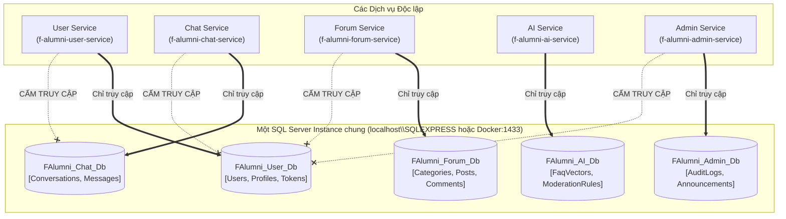

# 05. Quy chuẩn Cơ sở Dữ liệu & EF Core (Database & EF Core Standards)

> **Môn học**: PRN232 — Final Assignment  
> **Dự án**: FPT Alumni Connect  
> **Áp dụng cho**: 3 Backend Developers (BE1, BE2, BE3).  
> **Mục tiêu**: Chuẩn hóa việc thiết kế cơ sở dữ liệu, phân định quyền sở hữu DbContext riêng biệt, quản lý EF Core Migrations và đảm bảo các dịch vụ tích hợp độc lập mà không chia sẻ bảng dữ liệu.

---

## 📑 Mục lục
1. [Nguyên tắc Tối thượng: Database-per-Service](#1-nguyên-tắc-tối-thượng-database-per-service)
2. [Quy chuẩn Đặt tên Cơ sở Dữ liệu (Database Naming Convention)](#2-quy-chuẩn-đặt-tên-cơ-sở-dữ-liệu-database-naming-convention)
3. [Quyền Sở hữu DbContext & Entity (No Shared DbContext)](#3-quyền-sở-hữu-dbcontext--entity-no-shared-dbcontext)
4. [Tham chiếu Dữ liệu Liên Dịch vụ (Cross-Service Data References)](#4-tham-chiếu-dữ-liệu-liên-dịch-vụ-cross-service-data-references)
5. [Cấu hình Chuỗi Kết nối (Connection Strings Configuration)](#5-cấu-hình-chuỗi-kết-nối-connection-strings-configuration)
6. [Quy trình Quản lý EF Core Migrations (Local Dev vs Deployment)](#6-quy-trình-quản-lý-ef-core-migrations-local-dev-vs-deployment)
7. [Fluent API Configuration & Thực thi Mẫu trong Template](#7-fluent-api-configuration--thực-thi-mẫu-trong-template)

---

## 1. Nguyên tắc Tối thượng: Database-per-Service

Trong hệ thống Microservices của đồ án **FPT Alumni Connect**, cả nhóm sử dụng **chung một instance Microsoft SQL Server** (chạy cục bộ qua SQL Server Express hoặc Docker container), nhưng **mỗi service sở hữu một Database hoàn toàn độc lập**.



> [!CAUTION]
> **3 NGUYÊN TẮC CẤM TRUY CẬP CHÉO**:
> 1. **Cấm viết câu lệnh SQL liên database**: Tuyệt đối không dùng cú pháp `FAlumni_User_Db.dbo.Users` từ trong mã nguồn của Chat Service hay Forum Service.
> 2. **Cấm tạo Foreign Key liên database**: Không tạo khóa ngoại từ bảng `Messages` (trong `FAlumni_Chat_Db`) sang bảng `Users` (trong `FAlumni_User_Db`).
> 3. **Cấm chia sẻ DbContext hoặc Entity Library**: Mỗi repository tự định nghĩa `DbContext` và Entity của riêng mình. Không tạo project thư viện dùng chung `Common.Entities` chứa entity của tất cả các service.

---

## 2. Quy chuẩn Đặt tên Cơ sở Dữ liệu (Database Naming Convention)

Tên cơ sở dữ liệu trên SQL Server bắt buộc sử dụng tiền tố `FAlumni_` kết hợp với tên nghiệp vụ viết theo chuẩn `PascalCase`:

| Tên Cơ sở Dữ liệu | Service Sở hữu | Repository chứa Code & Migrations | Các bảng cốt lõi |
| :--- | :--- | :--- | :--- |
| **`FAlumni_User_Db`** | **User Service** | `f-alumni-user-service` | `Users`, `UserProfiles`, `Roles`, `UserRoles`, `VerificationTokens`, `RefreshTokens` |
| **`FAlumni_Chat_Db`** | **Chat Service** | `f-alumni-chat-service` | `Conversations`, `ConversationParticipants`, `Messages`, `MessageAttachments`, `MessageReceipts` |
| **`FAlumni_Forum_Db`** | **Forum Service** | `f-alumni-forum-service` | `Categories`, `Posts`, `Comments`, `Reactions`, `Bookmarks`, `PostTags`, `Reports` |
| **`FAlumni_AI_Db`** | **AI Service** | `f-alumni-ai-service` | `FaqKnowledgeBase`, `UserSkillVectors`, `ModerationRules`, `RecommendationCaches` |
| **`FAlumni_Admin_Db`** | **Admin Service** | `f-alumni-admin-service` | `AuditLogs`, `SystemAnnouncements`, `ModerationQueues`, `SystemSettings` |
| **`FAlumni_Template_Db`** | **Service Template** | `templates/dotnet-service` | `SampleItems`, `__EFMigrationsHistory` |

---

## 3. Quyền Sở hữu DbContext & Entity (No Shared DbContext)

1. **Một DbContext duy nhất cho mỗi Service**:
   - `UserDbContext` chỉ quản lý các thực thể liên quan đến tài khoản và hồ sơ.
   - `ChatDbContext` chỉ quản lý tin nhắn và phòng chat.
   - `ForumDbContext` chỉ quản lý bài đăng, chuyên mục và bình luận.
2. **Quyền sở hữu Migration hoàn toàn cục bộ**:
   - Thư mục `Migrations/` nằm ngay trong project `*.Repositories` của từng service độc lập.
   - Lập trình viên phụ trách service nào thì tự tạo migration và cập nhật database của service đó.

---

## 4. Tham chiếu Dữ liệu Liên Dịch vụ (Cross-Service Data References)

Khi một service cần thông tin từ một service khác (ví dụ: Chat Service cần biết tên và avatar của người gửi tin nhắn, hoặc Forum Service cần biết tác giả bài viết):

### ❌ Cách làm SAI (Vi phạm nguyên tắc Microservices):
```csharp
// SAI: Dùng navigation property trỏ sang entity của service khác
public class Message
{
    public Guid Id { get; set; }
    public string Content { get; set; }
    public User Sender { get; set; } // LỖI: Không được phép navigation sang User entity của User Service!
}
```

### ✅ Cách làm ĐÚNG (Chuẩn Microservices):
```csharp
// ĐÚNG: Chỉ lưu trữ khóa ngoại định danh (Scalar ID)
public class Message
{
    public Guid Id { get; set; }
    public string Content { get; set; }
    public Guid SenderId { get; set; } // Scalar ID thông thường
    public DateTime CreatedAtUtc { get; set; }
}
```

### Phương thức lấy thông tin bổ trợ:
1. **gRPC Đồng bộ (Synchronous)**: Chat Service gọi `UserProfileGrpcService.GetUserProfile(senderId)` sang User Service khi cần hiển thị tức thời thông tin người gửi.
2. **Kafka Bất đồng bộ (Data Replication)**: Khi User Service cập nhật Avatar hoặc Tên hiển thị, nó bắn sự kiện `UserProfileUpdatedEvent` ra Kafka topic. Các service khác lắng nghe và cập nhật bản sao nếu có lưu cache.

---

## 5. Cấu hình Chuỗi Kết nối (Connection Strings Configuration)

Mỗi service định nghĩa chuỗi kết nối trong file `appsettings.json` tại tầng API (`src/*.Api/appsettings.json`):

```json
{
  "ConnectionStrings": {
    "DefaultConnection": "Server=localhost\\SQLEXPRESS;Database=FAlumni_Template_Db;Trusted_Connection=True;TrustServerCertificate=True;"
  }
}
```

### Đối với môi trường Docker:
```json
{
  "ConnectionStrings": {
    "DefaultConnection": "Server=sqlserver,1433;Database=FAlumni_Template_Db;User Id=sa;Password=YourStrong@Password123;TrustServerCertificate=True;"
  }
}
```

---

## 6. Quy trình Quản lý EF Core Migrations (Local Dev vs Deployment)

### 6.1 Trong quá trình phát triển cục bộ (Local Development)

Khi lập trình viên thay đổi Entity hoặc thêm bảng mới:

1. **Tạo Migration mới**:
   ```bash
   dotnet ef migrations add <Tên_Migration> --project src/Template.Repositories --startup-project src/Template.Api
   ```
   Ví dụ:
   ```bash
   dotnet ef migrations add AddUserBioAndSkills --project src/FAlumni.User.Repositories --startup-project src/FAlumni.User.Api
   ```

2. **Cập nhật Database cục bộ**:
   ```bash
   dotnet ef database update --project src/Template.Repositories --startup-project src/Template.Api
   ```

3. **Kiểm tra danh sách Migration đã áp dụng**:
   ```bash
   dotnet ef migrations list --project src/Template.Repositories --startup-project src/Template.Api
   ```

### 6.2 Trong quá trình triển khai & Nộp bài (Deployment / Production)

> [!IMPORTANT]
> Khi nộp bài hoặc triển khai lên môi trường đánh giá:
> - Không chạy lệnh migrate tự động lúc ứng dụng khởi động nếu chưa có sự kiểm soát vì dễ gây xung đột khi chạy nhiều instance.
> - Sử dụng lệnh sinh file SQL Script có tính năng lũy đẳng (**Idempotent SQL Script**):
>   ```bash
>   dotnet ef migrations script --idempotent --output migrations.sql --project src/Template.Repositories --startup-project src/Template.Api
>   ```
> - Script này có thể chạy an toàn trên bất kỳ database nào: Bảng nào đã migrate thì bỏ qua, bảng nào chưa có thì tạo mới.

---

## 7. Fluent API Configuration & Thực thi Mẫu trong Template

Để tránh làm bẩn Entity class bằng các DataAnnotations thuộc về database, toàn bộ cấu hình bảng được viết trong thư mục `Configurations/` kế thừa `IEntityTypeConfiguration<T>`:

```csharp
public class SampleItemConfiguration : IEntityTypeConfiguration<SampleItem>
{
    public void Configure(EntityTypeBuilder<SampleItem> builder)
    {
        builder.ToTable("SampleItems");

        builder.HasKey(x => x.Id);

        builder.Property(x => x.Name)
            .IsRequired()
            .HasMaxLength(100);

        builder.Property(x => x.Description)
            .HasMaxLength(500)
            .HasDefaultValue(string.Empty);

        builder.Property(x => x.IsActive)
            .IsRequired()
            .HasDefaultValue(true);

        builder.Property(x => x.CreatedAtUtc)
            .IsRequired();
    }
}
```

Và được đăng ký tự động trong `DbContext`:
```csharp
protected override void OnModelCreating(ModelBuilder modelBuilder)
{
    base.OnModelCreating(modelBuilder);
    modelBuilder.ApplyConfiguration(new SampleItemConfiguration());
}
```
