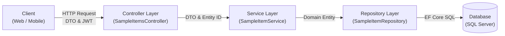

# 06. Quy chuẩn Thiết kế REST API & OpenAPI (REST API & Contract Standards)

> **Môn học**: PRN232 — Final Assignment  
> **Dự án**: FPT Alumni Connect  
> **Áp dụng cho**: 3 Backend Developers, 1 Web Developer, 1 Flutter Developer.  
> **Mục tiêu**: Chuẩn hóa toàn diện thiết kế REST API, mã trạng thái HTTP, định dạng phản hồi lỗi, phân trang, lọc dữ liệu và tài liệu OpenAPI/Swagger giữa Backend và Frontend/Mobile.

---

## 📑 Mục lục
1. [Quy chuẩn Định tuyến URL (URL Routing Conventions)](#1-quy-chuẩn-định-tuyến-url-url-routing-conventions)
2. [Các Phương thức HTTP & Mục đích Sử dụng](#2-các-phương-thức-http--mục-đích-sử-dụng)
3. [Mã Trạng thái HTTP Chuẩn (Standard HTTP Status Codes)](#3-mã-trạng-thái-http-chuẩn-standard-http-status-codes)
4. [Định dạng Phản hồi Lỗi Chuẩn RFC 7807 (ProblemDetails)](#4-định-dạng-phản-hồi-lỗi-chuẩn-rfc-7807-problemdetails)
5. [Quy chuẩn DTO & Validation (Data Annotations)](#5-quy-chuẩn-dto--validation-data-annotations)
6. [Tiêu chuẩn Phân trang, Tìm kiếm & Sắp xếp (Pagination, Filtering & Sorting)](#6-tiêu-chuẩn-phân-trang-tìm-kiếm--sắp-xếp-pagination-filtering--sorting)
7. [Quy chuẩn Tài liệu OpenAPI / Swagger](#7-quy-chuẩn-tài-liệu-openapi--swagger)
8. [Ví dụ Thực tế Minh họa từ Template Endpoint](#8-ví-dụ-thực-tế-minh-họa-từ-template-endpoint)
9. [Phân Định Trách Nhiệm Phân Tầng Trong CRUD](#9-phân-định-trách-nhiệm-phân-tầng-trong-crud)
10. [Hướng Dẫn Sao Chép Mẫu CRUD Sang Microservice Mới](#10-hướng-dẫn-sao-chép-mẫu-crud-sang-microservice-mới)

---

## 1. Quy chuẩn Định tuyến URL (URL Routing Conventions)

Mọi API công khai trong hệ thống phải tuân theo cấu trúc URL chuẩn mực:

```text
https://api.domain.com/api/v1/{resource-name}[/{id}][/{sub-resource}]
```

### Nguyên tắc đặt tên:
- **Tiền tố phiên bản**: Luôn bắt đầu bằng `/api/v1/`.
- **Danh từ số nhiều (Plural Nouns)**: Đại diện cho tập hợp tài nguyên, ví dụ:
  - `/api/v1/sample-items` (Thay vì `/api/v1/sampleItem` hay `/api/v1/getSampleItem`)
  - `/api/v1/users`
  - `/api/v1/posts`
  - `/api/v1/conversations`
- **Kebab-case cho tên ghép**: Sử dụng chữ thường ngăn cách bằng dấu gạch ngang (ví dụ: `sample-items`, `verification-tokens`).
- **Không chứa động từ trong URL**: Hành động được biểu thị thông qua phương thức HTTP (`GET`, `POST`, `PUT`, `DELETE`).
- **Tài nguyên con phân cấp**: Biểu thị mối quan hệ phụ thuộc cha - con:
  - `/api/v1/posts/{postId}/comments`: Lấy hoặc tạo bình luận của bài viết `{postId}`.

---

## 2. Các Phương thức HTTP & Mục đích Sử dụng

| HTTP Method | Mục đích | Tính Lũy đẳng (Idempotent) | Ví dụ Endpoint |
| :--- | :--- | :---: | :--- |
| **`GET`** | Đọc dữ liệu (danh sách hoặc chi tiết 1 bản ghi). Không làm thay đổi dữ liệu server. | Có | `GET /api/v1/sample-items` |
| **`POST`** | Tạo mới một tài nguyên hoặc kích hoạt tác vụ nghiệp vụ (đăng nhập, verify OTP). | Không | `POST /api/v1/sample-items` |
| **`PUT`** | Cập nhật / Thay thế toàn bộ nội dung của một tài nguyên hiện có. | Có | `PUT /api/v1/sample-items/{id}` |
| **`PATCH`**| Cập nhật một phần thuộc tính (Partial update), ví dụ đổi trạng thái, sửa 1 trường. | Không | `PATCH /api/v1/users/{id}/status` |
| **`DELETE`**| Xóa một tài nguyên theo định danh. | Có | `DELETE /api/v1/sample-items/{id}` |

### 🔍 So sánh Chi Tiết: `PUT` vs `PATCH` (PUT versus PATCH)
- **`PUT` (Full Replacement - Thay thế toàn phần)**:
  - **Khái niệm**: Client gửi toàn bộ biểu diễn mới của tài nguyên qua request body (`UpdateSampleItemRequest`). Mọi trường thuộc tính có thể sửa đổi đều được client cung cấp giá trị mới.
  - **Tính chất**: **Lũy đẳng (Idempotent)**. Dù client gọi `PUT /api/v1/sample-items/{id}` một lần hay gửi lặp lại 10 lần (do mạng chập chờn retry), kết quả cuối cùng trên cơ sở dữ liệu hoàn toàn giống hệt nhau.
  - **Mã phản hồi chuẩn**: Trả về `200 OK` kèm theo object đã cập nhật (hoặc `204 NoContent`). Nếu ID không tồn tại, trả về `404 NotFound`.
  - **Khi nào sử dụng**: Áp dụng cho các form cập nhật thông tin chuẩn (chỉnh sửa bài viết, cập nhật thông tin khóa học, cập nhật sample item).
- **`PATCH` (Partial Update - Cập nhật một phần)**:
  - **Khái niệm**: Client chỉ gửi duy nhất các trường thuộc tính muốn thay đổi (ví dụ: chỉ gửi `{ "isActive": false }` để khóa tài khoản hoặc `{ "avatarUrl": "..." }`). Các trường khác giữ nguyên giá trị cũ.
  - **Tính chất**: **Không đảm bảo lũy đẳng** (đặc biệt đối với các tác vụ cộng dồn như `incrementViewCount`, `addReaction`).
  - **Khi nào chọn PATCH thay vì PUT**: Khi entity có quá nhiều trường (như User Profile gồm 40 trường), việc gửi lại toàn bộ entity qua mạng di động gây lãng phí băng thông; hoặc khi các trường được cập nhật độc lập bởi các role khác nhau.

---

## 3. Mã Trạng thái HTTP Chuẩn (Standard HTTP Status Codes)

Mọi phản hồi từ Controller phải trả về mã HTTP chính xác theo ngữ cảnh:

| Mã HTTP | Tên mã | Ý nghĩa & Khi nào sử dụng? |
| :---: | :--- | :--- |
| **`200 OK`** | Success | Request `GET` lấy dữ liệu thành công; hoặc request `PUT` cập nhật tài nguyên thành công và trả về dữ liệu mới trong response body. |
| **`201 Created`** | Created | Request `POST` tạo mới tài nguyên thành công. **Bắt buộc kèm Header `Location`** (`CreatedAtAction`) trỏ tới URI của tài nguyên vừa tạo (`/api/v1/sample-items/{id}`). |
| **`204 NoContent`** | No Content | Request `DELETE` xóa tài nguyên thành công; client không cần nhận thêm nội dung body. |
| **`400 BadRequest`** | Bad Request | Dữ liệu đầu vào vi phạm DataAnnotations (tên quá ngắn, thiếu trường bắt buộc), hoặc định dạng JSON sai cú pháp. Trả về `ValidationProblemDetails`. |
| **`401 Unauthorized`** | Unauthorized | Client chưa truyền Bearer Token trong header `Authorization`, hoặc Token đã hết hạn, sai chữ ký số. |
| **`403 Forbidden`** | Forbidden | Token hợp lệ nhưng tài khoản không có quyền thực thi hành động này (ví dụ: User thông thường cố gắng xóa resource vốn chỉ dành cho `ADMIN`). |
| **`404 NotFound`** | Not Found | Không tìm thấy tài nguyên theo ID yêu cầu (`NotFoundException`). Trả về RFC 7807 `ProblemDetails`. |
| **`409 Conflict`** | Conflict | Xung đột trạng thái dữ liệu (ví dụ: Tạo tài khoản với Email đã tồn tại). |
| **`500 InternalServerError`** | Server Error | Lỗi không mong muốn phát sinh trong hệ thống. GlobalExceptionHandlingMiddleware bắt và che giấu stack trace nhạy cảm. |

---

## 4. Định dạng Phản hồi Lỗi Chuẩn RFC 7807 (ProblemDetails)

Khi xảy ra lỗi (4xx, 5xx), mọi service phải trả về định dạng chuẩn quốc tế **RFC 7807 (`application/problem+json`)**:

```json
{
  "type": "https://tools.ietf.org/html/rfc7231#section-6.5.4",
  "title": "Resource Not Found",
  "status": 404,
  "detail": "Resource 'SampleItem' with identifier '11111111-1111-1111-1111-111111111111' was not found.",
  "instance": "/api/v1/sample-items/11111111-1111-1111-1111-111111111111",
  "traceId": "0HN12AB34CD:00000001"
}
```

### Lợi ích:
- Frontend (React) và Mobile (Flutter) chỉ cần viết **một hàm xử lý lỗi duy nhất** cho toàn bộ hệ thống bằng cách đọc trường `detail` và `title`.
- Có `traceId` để lập trình viên Backend tra cứu ngay log tương ứng trong terminal hoặc console.

---

## 5. Quy chuẩn DTO & Validation (Data Annotations)

Toàn bộ dữ liệu đầu vào nhận từ Client phải được định nghĩa bằng DTO và kiểm tra tính hợp lệ qua **System.ComponentModel.DataAnnotations**:

### DTO Tạo mới (`CreateSampleItemRequest`):
```csharp
public class CreateSampleItemRequest
{
    [Required(ErrorMessage = "Tên không được để trống.")]
    [StringLength(100, MinimumLength = 2, ErrorMessage = "Tên phải từ 2 đến 100 ký tự.")]
    public string Name { get; set; } = string.Empty;

    [StringLength(500, ErrorMessage = "Mô tả không được vượt quá 500 ký tự.")]
    public string Description { get; set; } = string.Empty;
}
```

### DTO Cập nhật toàn phần (`UpdateSampleItemRequest`):
```csharp
public class UpdateSampleItemRequest
{
    [Required(ErrorMessage = "Name is required.")]
    [StringLength(100, MinimumLength = 2, ErrorMessage = "Name must be between 2 and 100 characters.")]
    public string Name { get; set; } = string.Empty;

    [StringLength(500, ErrorMessage = "Description cannot exceed 500 characters.")]
    public string Description { get; set; } = string.Empty;

    public bool IsActive { get; set; } = true;
}
```

- Khi validation thất bại, ASP.NET Core tự động kích hoạt `[ApiController]` filter và trả về `400 Bad Request` dạng `ValidationProblemDetails` liệt kê chi tiết các trường dữ liệu vi phạm mà không cần lập trình viên phải viết code kiểm tra if-else thủ công trong Controller.

---

## 6. Tiêu chuẩn Phân trang, Tìm kiếm & Sắp xếp (Pagination, Filtering & Sorting)

Khi API trả về danh sách có số lượng bản ghi lớn, bắt buộc phải hỗ trợ phân trang để tránh tràn bộ nhớ:

### 6.1 Tham số Query Parameters chuẩn:
- `pageNumber`: Số trang hiện tại (bắt đầu từ `1`, mặc định `1`).
- `pageSize`: Số bản ghi mỗi trang (mặc định `10`, giới hạn tối đa `100`).
- `search`: Từ khóa tìm kiếm (tìm kiếm theo tên hoặc mô tả).
- `sortBy`: Tên trường cần sắp xếp (ví dụ: `createdAt`, `name`).
- `sortOrder`: Hướng sắp xếp (`asc` hoặc `desc`, mặc định `desc`).

Ví dụ URL:
```text
GET /api/v1/sample-items/paged?search=alumni&pageNumber=1&pageSize=10&sortBy=createdAt&sortOrder=desc
```

### 6.2 Cấu trúc Phản hồi Phân trang chuẩn (`PagedResponse<T>`):
```json
{
  "items": [
    {
      "id": "11111111-1111-1111-1111-111111111111",
      "name": "Initial Sample Item",
      "description": "Seeded item for testing",
      "isActive": true,
      "createdAtUtc": "2026-10-24T09:17:53Z"
    }
  ],
  "pageNumber": 1,
  "pageSize": 10,
  "totalCount": 1,
  "totalPages": 1,
  "hasPreviousPage": false,
  "hasNextPage": false
}
```

---

## 7. Quy chuẩn Tài liệu OpenAPI / Swagger

Mọi Action trong Controller phải được trang bị đầy đủ XML Doc Comments và Swagger attributes:

```csharp
/// <summary>
/// Tạo mới một sample item resource.
/// </summary>
/// <param name="request">Payload dữ liệu bao gồm tên và mô tả.</param>
/// <param name="cancellationToken">Token hủy tác vụ.</param>
/// <response code="201">Tạo thành công, trả về resource kèm Header Location.</response>
/// <response code="400">Dữ liệu đầu vào vi phạm validation.</response>
[HttpPost]
[ProducesResponseType(typeof(SampleItemResponse), StatusCodes.Status201Created)]
[ProducesResponseType(typeof(ProblemDetails), StatusCodes.Status400BadRequest)]
public async Task<ActionResult<SampleItemResponse>> Create(
    [FromBody] CreateSampleItemRequest request,
    CancellationToken cancellationToken)
{
    var created = await _sampleItemService.CreateAsync(request, cancellationToken);
    return CreatedAtAction(nameof(GetById), new { id = created.Id }, created);
}
```

---

## 8. Ví dụ Thực tế Minh họa từ Template Endpoint

Bảng tra cứu các API mẫu đã được triển khai hoàn chỉnh trong [templates/dotnet-service/](file:///c:/Use/University/PRN232/ASM/guideline/templates/dotnet-service/):

| Phương thức | Đường dẫn URL | Mô tả nghiệp vụ | Quyền truy cập | Mã trạng thái thành công | Mã trạng thái lỗi |
| :--- | :--- | :--- | :---: | :---: | :---: |
| `GET` | `/health` | Kiểm tra tình trạng hoạt động của service | Public | `200 OK` | `503 Service Unavailable` |
| `GET` | `/api/v1/sample-items` | Lấy toàn bộ danh sách items | Public | `200 OK` | `500 Server Error` |
| `GET` | `/api/v1/sample-items/paged` | Lấy danh sách có phân trang và tìm kiếm | Public | `200 OK` | `400 Bad Request` |
| `GET` | `/api/v1/sample-items/{id}` | Lấy chi tiết một item theo GUID | Public | `200 OK` | `404 Not Found` |
| `POST` | `/api/v1/sample-items` | Tạo mới một item | `USER`, `ADMIN` | `201 Created` | `400 Bad Request, 401 Unauthorized, 403 Forbidden` |
| `PUT` | `/api/v1/sample-items/{id}` | Cập nhật toàn bộ thông tin item theo GUID | `USER`, `ADMIN` | `200 OK` | `400 Bad Request, 401 Unauthorized, 403 Forbidden, 404 Not Found` |
| `DELETE` | `/api/v1/sample-items/{id}` | Xóa một item theo GUID | `ADMIN` | `204 NoContent` | `401 Unauthorized, 403 Forbidden, 404 Not Found` |

---

## 9. Phân Định Trách Nhiệm Phân Tầng Trong CRUD

Để duy trì kiến trúc 3 tầng sạch sẽ (`API -> Services -> Repositories`), mọi thao tác CRUD phải tuân thủ nghiêm ngặt ranh giới trách nhiệm:



| Tầng kiến trúc | Trách nhiệm cụ thể trong thao tác CRUD | Điều cấm kỵ |
| :--- | :--- | :--- |
| **Controller Layer** | - Định tuyến URL (`Route`), xác thực JWT (`Authorize`), ràng buộc tham số (`FromBody`, `FromQuery`, `FromRoute`).<br>- Trích xuất an toàn danh tính người dùng từ validated claims (`User.FindFirst`).<br>- Ủy thác toàn bộ xử lý nghiệp vụ cho Service.<br>- Ánh xạ kết quả sang mã trạng thái HTTP chuẩn (`Ok`, `CreatedAtAction`, `NoContent`). | - **KHÔNG** truy cập trực tiếp `DbContext`.<br>- **KHÔNG** chứa business logic hay validation nghiệp vụ.<br>- **KHÔNG** reference tầng Repository. |
| **Service Layer** | - Nhận request DTO, kiểm tra `null`, thực thi logic nghiệp vụ (trimming chuỗi, kiểm tra quyền sở hữu).<br>- Điều phối gọi Repository để lấy, tạo, cập nhật, xóa entity.<br>- Ném domain exception chuẩn (`NotFoundException`, `ArgumentException`).<br>- Ánh xạ Domain Entity sang Response DTO trước khi trả về Controller. | - **KHÔNG** phụ thuộc vào ASP.NET Core MVC hay HttpContext.<br>- **KHÔNG** trả về mã HTTP (chỉ trả về DTO hoặc ném Exception). |
| **Repository Layer** | - Thực thi các truy vấn và thao tác lưu trữ EF Core (`AddAsync`, `FirstOrDefaultAsync`, `Remove`, `SaveChangesAsync`).<br>- Nhận và trả về Domain Entity hoặc kiểu dữ liệu cơ bản (`bool`, `int`).<br>- Đảm bảo truy vấn đọc sử dụng `AsNoTracking()` để tối ưu hiệu năng. | - **KHÔNG** biết về DTO (chỉ làm việc với Entity).<br>- **KHÔNG** chứa logic nghiệp vụ hay xác thực quyền hạn. |

---

## 10. Hướng Dẫn Sao Chép Mẫu CRUD Sang Microservice Mới

Khi triển khai nghiệp vụ thực tế cho một Microservice mới (ví dụ: `ForumService` quản lý bài viết `Post`, hoặc `ChatService` quản lý `Conversation`):

1. **Bước 1: Định nghĩa Entity trong `Repositories/Entities/`**
   - Tạo class entity (ví dụ: `Post.cs`) kế thừa khóa chính GUID và các trường nghiệp vụ.
   - Cấu hình EntityTypeConfiguration trong `Repositories/Configurations/`.
2. **Bước 2: Xây dựng Repository Interface & Implementation**
   - Trong `Repositories/Interfaces/`: Khai báo `IPostRepository` với đầy đủ các phương thức `GetAllAsync`, `GetPagedAsync`, `GetByIdAsync`, `CreateAsync`, `UpdateAsync`, `DeleteAsync`.
   - Trong `Repositories/Implementations/`: Thực hiện truy vấn EF Core qua DbContext của service đó.
3. **Bước 3: Định nghĩa Request & Response DTOs trong `Services/DTOs/`**
   - Tạo `CreatePostRequest` và `UpdatePostRequest` với DataAnnotations validation (`[Required]`, `[StringLength]`).
   - Tạo `PostResponse` chỉ chứa các trường thông tin cần trả về client.
4. **Bước 4: Xây dựng Service Interface & Implementation**
   - Trong `Services/Interfaces/`: Khai báo `IPostService`.
   - Trong `Services/Implementations/`: Implement logic nghiệp vụ, ném `NotFoundException(nameof(Post), id)` khi ID không tồn tại.
5. **Bước 5: Xây dựng Controller trong `Api/Controllers/`**
   - Khai báo route `[Route("api/v1/posts")]`.
   - Áp dụng `[Authorize(Roles = "...")]` theo đúng phân quyền nghiệp vụ (xem [docs/07-authentication.md](file:///c:/Use/University/PRN232/ASM/guideline/docs/07-authentication.md)).
   - Implement các action `GetAll`, `GetPaged`, `GetById`, `Create`, `Update`, `Delete`.
6. **Bước 6: Viết kiểm thử tự động (Unit & Integration Tests)**
   - Viết Unit Tests kiểm tra Service với EF Core In-Memory database.
   - Viết Integration Tests kiểm tra đầy đủ các mã lỗi `200`, `201`, `204`, `400`, `401`, `403`, `404`.
