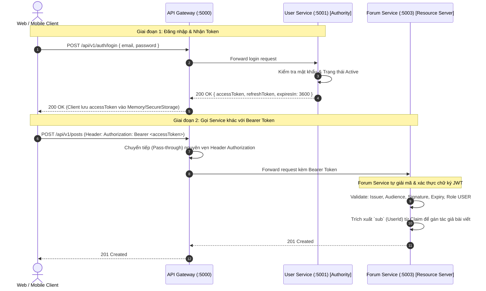

# 07. Hợp đồng Xác thực & Phân quyền JWT (JWT Authentication & Authorization Contract)

> **Môn học**: PRN232 — Final Assignment  
> **Dự án**: FPT Alumni Connect  
> **Áp dụng cho**: Toàn bộ 5 thành viên (3 Backend, 1 Web, 1 Mobile).  
> **Mục tiêu**: Chuẩn hóa cơ chế cấp phát, định dạng và xác thực JSON Web Token (JWT) trong toàn bộ hệ sinh thái Microservices. Xác định rõ ràng **User Service là thẩm quyền duy nhất (Sole Authority)** cấp phát token, và cách thức các dịch vụ khác cùng ứng dụng Web/Mobile xác thực và phân quyền.

---

## 📑 Mục lục
1. [Thẩm quyền Danh tính Cốt lõi: User Service (Single Authority)](#1-thẩm-quyền-danh-tính-cốt-lõi-user-service-single-authority)
2. [Cấu trúc Chuẩn của JWT Payload (Claims Specification)](#2-cấu-trúc-chuẩn-của-jwt-payload-claims-specification)
3. [Cấu hình Ký & Tham số Xác thực (Signing & Validation Parameters)](#3-cấu-hình-ký--tham-số-xác-thực-signing--validation-parameters)
4. [Phân quyền Vai trò: USER vs ADMIN](#4-phân-quyền-vai-trò-user-vs-admin)
5. [Quy định Bảo mật: Trích xuất Danh tính từ Claims (No Header Spoofing)](#5-quy-định-bảo-mật-trích-xuất-danh-tính-từ-claims-no-header-spoofing)
6. [Cơ chế Thực thi Trạng thái Tài khoản (Account Status Enforcement)](#6-cơ-chế-thực-thi-trạng-thái-tài-khoản-account-status-enforcement)
7. [Quy chuẩn Dành cho Client: Web (React) & Mobile (Flutter)](#7-quy-chuẩn-dành-cho-client-web-react--mobile-flutter)
8. [Đặc tả Ranh giới Nghiệp vụ Tương lai (Future Auth Boundaries)](#8-đặc-tả-ranh-giới-nghiệp-vụ-tương-lai-future-auth-boundaries)

---

## 1. Thẩm quyền Danh tính Cốt lõi: User Service (Single Authority)

Trong kiến trúc của FPT Alumni Connect:
- **User Service (`f-alumni-user-service`) là thẩm quyền DUY NHẤT** được phép quản lý tài khoản, băm mật khẩu, cấp Access Token và Refresh Token.
- **API Gateway và các Backend Services khác (Chat, Forum, AI, Admin)**: **KHÔNG** cấp token, **KHÔNG** lưu mật khẩu, mà chỉ đóng vai trò là **Resource Servers** có nhiệm vụ xác thực (validate) tính hợp lệ của JWT Bearer token và kiểm tra quyền hạn (Role/Policy).



---

## 2. Cấu trúc Chuẩn của JWT Payload (Claims Specification)

Token được cấp bởi User Service phải bao gồm đầy đủ các chuẩn Claims sau:

| Claim Name | Chuẩn RFC | Ý nghĩa & Định dạng | Ví dụ thực tế |
| :--- | :--- | :--- | :--- |
| `iss` | Issuer | Định danh cơ quan cấp phát token (User Service) | `https://identity.falumni.local` |
| `aud` | Audience | Đối tượng tiêu thụ hợp lệ (Toàn bộ các service trong hệ thống) | `falumni-services` |
| `sub` | Subject | Định danh duy nhất của người dùng (`Guid` hoặc MSSV) | `a1b2c3d4-0000-0000-0000-000000000001` |
| `email` | Email | Địa chỉ email trường FPT của người dùng | `tamnqse192621@fpt.edu.vn` |
| `role` | Role | Quyền hạn tài khoản (`USER` hoặc `ADMIN`) | `USER` |
| `status` | Status | Trạng thái tài khoản (`Active`, `Suspended`) | `Active` |
| `jti` | JWT ID | Mã định danh duy nhất của token để chống tấn công Replay | `e5f6g7h8-9999-4444-aaaa-bbbbbbbbbbbb` |
| `iat` | Issued At | Thời điểm cấp token (UNIX Timestamp tính bằng giây) | `1730000000` |
| `exp` | Expiration | Thời điểm hết hạn token (Mặc định: 60 phút sau khi cấp) | `1730003600` |

### Ví dụ Payload JSON giải mã:
```json
{
  "iss": "https://identity.falumni.local",
  "aud": "falumni-services",
  "sub": "a1b2c3d4-0000-0000-0000-000000000001",
  "nameid": "a1b2c3d4-0000-0000-0000-000000000001",
  "email": "tamnqse192621@fpt.edu.vn",
  "role": "USER",
  "status": "Active",
  "jti": "e5f6g7h8-9999-4444-aaaa-bbbbbbbbbbbb",
  "iat": 1730000000,
  "exp": 1730003600
}
```

---

## 3. Cấu hình Ký & Tham số Xác thực (Signing & Validation Parameters)

Để các service độc lập có thể xác thực token do User Service phát hành mà không cần gọi HTTP sang User Service mỗi lần:

1. **Thuật toán ký (Signing Algorithm)**:
   - Sử dụng **HMAC-SHA256 (HS256)** với khóa bí mật đối xứng (Symmetric Security Key).
   - Khóa ký phải có độ dài tối thiểu **256 bits (32 bytes)**.

2. **Cấu hình trong `appsettings.json` (Tuyệt đối không lưu khóa bí mật thực tế vào Git)**:
   > [!IMPORTANT]
   > **Nguyên tắc an toàn bảo mật**: Khóa ký JWT (`Jwt:Key`) là thông tin bí mật trọng yếu. Nếu commit khóa ký vào mã nguồn Git, kẻ tấn công có thể tự sinh token với role `ADMIN` để chiếm quyền toàn bộ hệ thống. Vì vậy, `appsettings.json` chỉ để giá trị rỗng hoặc cấu hình chung:
   ```json
   "Jwt": {
     "Issuer": "https://identity.falumni.local",
     "Audience": "falumni-services",
     "Key": "",
     "ClockSkewMinutes": 1
   }
   ```

3. **Cung cấp khóa ký khi chạy cục bộ (Local Development)**:
   > [!WARNING]
   > **Quy tắc bảo mật quan trọng (Compromised Key Rotation)**:
   > Bất kỳ chuỗi khóa nào từng xuất hiện trong lịch sử commit Git hoặc tài liệu demo đều phải được xem là **đã bị lộ (compromised)**. Lập trình viên **tuyệt đối không sao chép hoặc tái sử dụng** các chuỗi mẫu này trong User Service hay bất kỳ microservice nào.
   > 
   > Mỗi môi trường (Local Development, Staging, Production) **phải sở hữu một khóa ký ngẫu nhiên hoàn toàn độc lập**.

   Mỗi lập trình viên tự sinh một khóa bí mật 256 bits (32 bytes) ngẫu nhiên bằng bộ sinh số ngẫu nhiên chuẩn mật mã học (`RandomNumberGenerator`), sau đó nạp qua cấu hình .NET:

   - **Cách A: Biến môi trường hệ thống (Windows PowerShell)**:
     ```powershell
     # 1. Sinh khóa ngẫu nhiên chuẩn mã hóa (32 bytes ngẫu nhiên mã hóa Base64 = 44 ký tự)
     $bytes = New-Object byte[] 32; [System.Security.Cryptography.RandomNumberGenerator]::Create().GetBytes($bytes); $randomKey = [Convert]::ToBase64String($bytes)

     # 2. Gán vào biến môi trường phiên làm việc
     $env:Jwt__Key = $randomKey

     # 3. Khởi chạy service
     dotnet run --project src/Template.Api/Template.Api.csproj
     ```
     *(Lưu ý: Dấu hai chấm `:` trong .NET configuration được chuyển thành hai dấu gạch dưới `__` khi đặt tên biến môi trường).*

   - **Cách B: .NET User Secrets (Khuyên dùng khi phát triển cá nhân)**:
     ```powershell
     # 1. Khởi tạo User Secrets cho project API (nếu chưa có)
     dotnet user-secrets init --project src/Template.Api

     # 2. Sinh khóa ngẫu nhiên và lưu an toàn ngoài thư mục Git
     $bytes = New-Object byte[] 32; [System.Security.Cryptography.RandomNumberGenerator]::Create().GetBytes($bytes); $randomKey = [Convert]::ToBase64String($bytes)
     dotnet user-secrets set "Jwt:Key" $randomKey --project src/Template.Api

     # 3. Khởi chạy ứng dụng
     dotnet run --project src/Template.Api/Template.Api.csproj
     ```

   - **Cách C: Dành cho Linux / macOS (Bash/Zsh)**:
     ```bash
     export Jwt__Key=$(openssl rand -base64 32)
     dotnet user-secrets set "Jwt:Key" "$Jwt__Key" --project src/Template.Api
     dotnet run --project src/Template.Api/Template.Api.csproj
     ```

4. **Xác thực cấu hình lúc khởi động (Startup Validation)**:
   Trong `Program.cs`, ứng dụng kiểm tra bắt buộc sự tồn tại và độ dài của `Jwt:Key` ngay khi khởi động:
   ```csharp
   var jwtKey = builder.Configuration["Jwt:Key"];
   if (string.IsNullOrWhiteSpace(jwtKey))
   {
       throw new InvalidOperationException(
           "JWT signing key ('Jwt:Key') is missing. Configure it via environment variable 'Jwt__Key' (e.g. $env:Jwt__Key = '...') or .NET User Secrets ('dotnet user-secrets set \"Jwt:Key\" \"...\"'). The key must be at least 32 bytes (256 bits) long.");
   }
   if (Encoding.UTF8.GetByteCount(jwtKey) < 32)
   {
       throw new InvalidOperationException(
           "JWT signing key ('Jwt:Key') is too short. The key must be at least 32 bytes (256 bits) long for HMAC-SHA256.");
   }
   ```
   Nếu thiếu hoặc không đủ 32 bytes, ứng dụng sẽ dừng ngay lập tức (fail-fast) và hiển thị hướng dẫn khắc phục cụ thể, tuyệt đối không âm thầm sử dụng fallback secret không an toàn.

5. **Cơ chế nạp khóa trong Kiểm thử Tự động (Automated Tests)**:
   Các bài kiểm thử tích hợp (integration tests) không phụ thuộc vào biến môi trường máy host hay User Secrets. Lớp `CustomWebApplicationFactory` tự động inject khóa kiểm thử cục bộ:
   ```csharp
   // KHÓA ĐỊNH DANH DÀNH RIÊNG CHO TEST FIXTURE (DETERMINISTIC TEST KEY).
   // CẢNH BÁO: CHỈ SỬ DỤNG TRONG AUTOMATED TESTS (xUnit). TUYỆT ĐỐI KHÔNG SỬ DỤNG TRONG RUNTIME HOẶC PRODUCTION!
   public const string TestJwtSecret = "TestFixtureDeterministicKey_AtLeast32BytesLong_PRN232_ASM_2026!";

   protected override void ConfigureWebHost(IWebHostBuilder builder)
   {
       builder.UseSetting("DatabaseProvider", "InMemory");
       builder.UseSetting("Jwt:Key", TestJwtSecret);
   }
   ```
   Nhờ đó, lệnh `dotnet test` luôn chạy độc lập, đáng tin cậy và đạt 100% pass trên mọi máy tính của thành viên và CI/CD mà không ảnh hưởng đến bí mật môi trường thực tế.

6. **Nguyên Tắc Quản Lý Bí Mật Trong Production vs Local Development**:
   - **Local Development**: Dùng **.NET User Secrets** (`%APPDATA%\Microsoft\UserSecrets`) hoặc biến môi trường cục bộ `$env:Jwt__Key`. Không bao giờ commit lên GitHub.
   - **Production / Deployment**: Phải nạp từ nguồn cấu hình bảo mật thời gian chạy (Runtime Secrets), ví dụ: Docker Compose environment mapping từ file `.env` không commit, Kubernetes Secrets, hoặc CI/CD pipeline environment variables.
   - **Khi nghi ngờ lộ khóa (Compromise Rotation)**: Phải lập tức đổi khóa mới trên User Service và đồng bộ sang tất cả các resource services (Chat, Forum, AI, Admin). Mọi JWT cũ được ký bằng khóa cũ sẽ bị từ chối tự động (`401 Unauthorized`), buộc người dùng phải đăng nhập lại để nhận token mới an toàn.

7. **Dung sai thời gian (Clock Tolerance / ClockSkew)**:
   - Được thiết lập tối đa **1 phút** (`TimeSpan.FromMinutes(1)`) để bù trừ độ lệch đồng hồ giữa các máy tính khác nhau của sinh viên trong nhóm.

---

## 4. Phân quyền Vai trò: USER vs ADMIN

Hệ thống phân định 2 vai trò nghiệp vụ rõ ràng:

| Vai trò (Role) | Đối tượng áp dụng | Quyền hạn & Phạm vi truy cập |
| :--- | :--- | :--- |
| **`USER`** | Sinh viên và Cựu sinh viên FPT đã xác thực email thành công | - Đọc danh bạ, xem hồ sơ cá nhân và công khai.<br>- Nhắn tin 1-1, tham gia nhóm chat thời gian thực.<br>- Đăng bài viết, bình luận, tương tác like, báo cáo vi phạm.<br>- Hỏi đáp trợ lý ảo AI. |
| **`ADMIN`** | Cán bộ quản lý mạng lưới cựu sinh viên & Quản trị viên hệ thống | - Sở hữu toàn bộ quyền hạn của `USER`.<br>- Xem số liệu Dashboard thống kê tổng quan.<br>- Phê duyệt / Xóa bài viết bị báo cáo vi phạm.<br>- Thực thi lệnh khóa/mở khóa tài khoản người dùng (`AD-03`, `AD-04`).<br>- Xem nhật ký kiểm duyệt (Audit Log). |

### Cú pháp khai báo trong ASP.NET Core:
- Yêu cầu người dùng thông thường:
  ```csharp
  [Authorize(Roles = "USER,ADMIN")]
  ```
- Yêu cầu quyền quản trị viên tối cao:
  ```csharp
  [Authorize(Roles = "ADMIN")]
  ```

---

## 5. Quy định Bảo mật: Trích xuất Danh tính từ Claims (No Header Spoofing)

> [!CAUTION]
> **LỖ HỔNG BẢO MẬT PHỔ BIẾN CẦN TRÁNH**:
> Lập trình viên Backend **TUYỆT ĐỐI KHÔNG** tin tưởng các header tùy biến do client gửi lên như `X-User-Id` hay `userId` truyền trong request body để xác định người thực hiện hành động.

### ❌ Cách làm NGUY HIỂM (Bị giả mạo):
```csharp
[HttpPost("posts")]
public async Task<IActionResult> CreatePost([FromBody] CreatePostRequest request)
{
    // NGUY HIỂM: Client có thể truyền UserId của người khác để mạo danh!
    var authorId = request.AuthorId; 
    ...
}
```

### ✅ Cách làm CHUẨN MỰC BẢO MẬT:
```csharp
[HttpPost("posts")]
[Authorize]
public async Task<IActionResult> CreatePost([FromBody] CreatePostRequest request)
{
    // CHUẨN: Lấy trực tiếp từ Claim đã được JwtBearer Middleware giải mã và xác thực chữ ký
    var currentUserId = User.FindFirst(ClaimTypes.NameIdentifier)?.Value 
                     ?? User.FindFirst("sub")?.Value;
                     
    if (string.IsNullOrEmpty(currentUserId))
        return Unauthorized();

    var created = await _postService.CreatePostAsync(Guid.Parse(currentUserId), request);
    return CreatedAtAction(nameof(GetById), new { id = created.Id }, created);
}
```

---

## 6. Cơ chế Thực thi Trạng thái Tài khoản (Account Status Enforcement)

Khi tài khoản người dùng chuyển sang trạng thái **`Suspended` (Bị tạm khóa)** do vi phạm:

1. **Tại thời điểm Đăng nhập & Làm mới Token**:
   - User Service kiểm tra cột `Status` trong `FAlumni_User_Db`. Nếu `Status == 'Suspended'`, từ chối đăng nhập và trả về `403 Forbidden` kèm lý do vi phạm.
2. **Vô hiệu hóa phiên đang chạy (Real-Time Invalidation)**:
   - Khi Admin gọi API khóa tài khoản, User Service hủy Refresh Token và phát sự kiện `UserSuspendedEvent` lên Kafka topic `user.events`.
   - Chat Service và Forum Service lắng nghe event này để ngắt kết nối WebSocket SignalR của người dùng đó lập tức.

---

## 7. Quy chuẩn Dành cho Client: Web (React) & Mobile (Flutter)

### 7.1 Gửi Header xác thực
Với mọi request yêu cầu đăng nhập, Client bắt buộc đính kèm header:
```http
Authorization: Bearer <jwt_access_token>
```

### 7.2 Xử lý mã lỗi HTTP 401 & 403
Mọi lỗi xác thực và phân quyền đều trả về theo chuẩn RFC 7807 (`ProblemDetails`):
- **Khi nhận HTTP 401 Unauthorized**:
  1. Client kiểm tra xem còn `refreshToken` không.
  2. Nếu còn `refreshToken`: Gọi ngầm `POST /api/v1/auth/refresh-token` để lấy Access Token mới rồi tự động thực hiện lại request ban đầu (Axios Interceptor trên Web / Dio Interceptor trên Flutter).
  3. Nếu không có hoặc Refresh Token hết hạn: Xóa token trong bộ nhớ, chuyển hướng người dùng về màn hình Đăng nhập (Login screen).
- **Khi nhận HTTP 403 Forbidden**:
  - Không chuyển hướng về màn hình Login!
  - Hiển thị thông báo Toast hoặc Modal theo trường `detail` trong RFC 7807 response: *"Bạn không có quyền truy cập vào chức năng quản trị này"*.

---

## 8. Đặc tả Ranh giới Nghiệp vụ Tương lai (Future Auth Boundaries)

Để phục vụ các giai đoạn phát triển tiếp theo của đồ án, các ranh giới nghiệp vụ được quy định như sau:

| Nghiệp vụ | Service Phụ trách | Ranh giới trách nhiệm |
| :--- | :--- | :--- |
| **Đăng nhập Email/Password** | **User Service** | Xác thực mật khẩu băm BCrypt, kiểm tra email đã verify, cấp JWT. |
| **Đăng nhập Google SSO** | **User Service** | Nhận Google ID Token từ Web/Mobile, xác thực với Google Auth Server, tạo tài khoản sinh viên FPT tương ứng nếu lần đầu đăng nhập. |
| **Xác thực Email (OTP)** | **User Service & Worker** | User Service sinh mã OTP 6 số lưu trong `FAlumni_User_Db`, bắn Kafka event `UserRegisteredEvent`. Notification Worker gửi email SMTP. |
| **Quên & Đặt lại Mật khẩu** | **User Service & Worker** | Sinh Reset Token có thời hạn 15 phút, gửi link qua email. Người dùng đổi mật khẩu mới qua `POST /api/v1/auth/reset-password`. |
