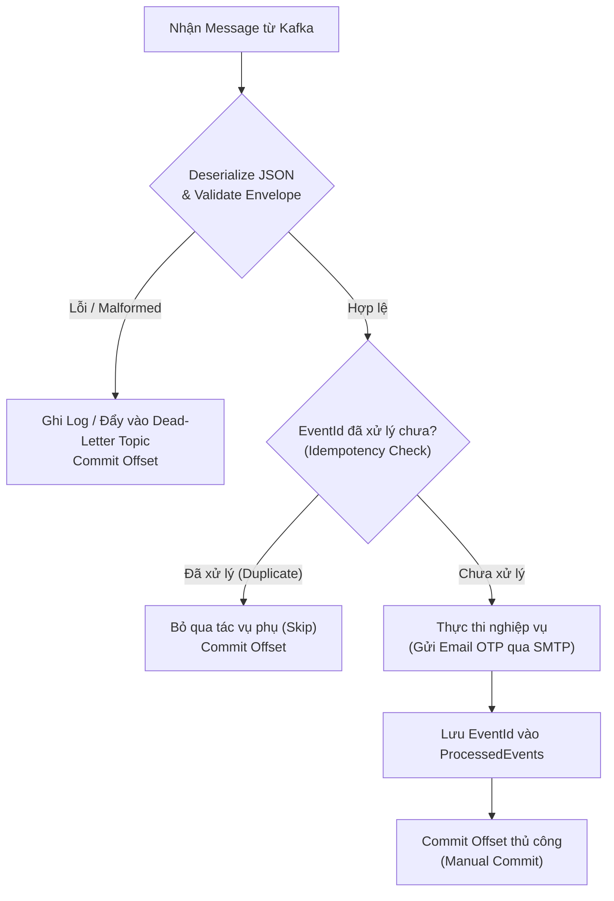
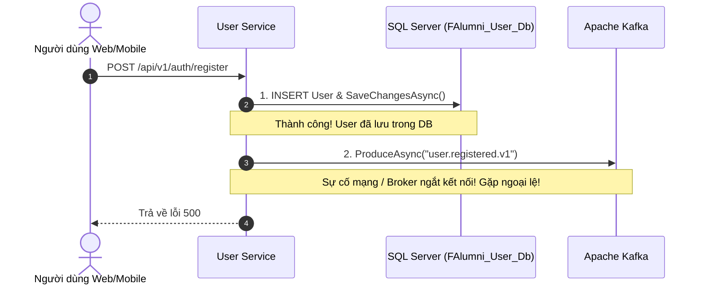
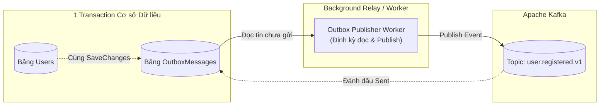

# Quy chuẩn Hợp đồng Sự kiện Kafka & Xử lý Bất đồng bộ (Kafka Event Contracts & Asynchronous Processing)

> **Mã tài liệu**: `DOC-08-KAFKA`  
> **Dự án**: FPT Alumni Connect (PRN232 Final Assignment)  
> **Trạng thái**: Hoàn thành & Phê duyệt  
> **Ngôn ngữ triển khai**: C# .NET 10 (`Confluent.Kafka`)  
> **Ví dụ thực tế**: [`examples/kafka-demo/`](file:///c:/Use/University/PRN232/ASM/guideline/examples/kafka-demo/) | **Hợp đồng sự kiện**: [`contracts/events/`](file:///c:/Use/University/PRN232/ASM/guideline/contracts/events/)

---

## 🎯 1. Tổng quan Kiến trúc Hướng Sự kiện (Event-Driven Architecture)

Trong hệ thống Microservices của **FPT Alumni Connect**, các dịch vụ cần giao tiếp với nhau theo hai hình thức:
1. **Đồng bộ (Synchronous - REST / gRPC)**: Dùng khi client hoặc service gọi cần phản hồi tức thì để tiếp tục luồng xử lý (ví dụ: Chat Service tra cứu thông tin tên/avatar người dùng qua gRPC từ User Service).
2. **Bất đồng bộ (Asynchronous - Apache Kafka)**: Dùng khi một service đã hoàn thành một hành động nghiệp vụ (Domain Event) và muốn thông báo cho toàn bộ hệ thống mà không cần chờ đợi các dịch vụ khác phản hồi (Decoupled & Non-blocking).

```mermaid
flowchart LR
    subgraph Publisher["Dịch vụ Phát Sự kiện (Producer)"]
        UserSvc["User Service\n(Đăng ký tài khoản thành công)"]
    end

    subgraph Broker["Message Broker"]
        KafkaTopic[("Kafka Topic:\nuser.registered.v1\nKey: userId")]
    end

    subgraph Consumers["Dịch vụ Tiêu thụ (Consumers)"]
        Worker["Notification Worker\n(Gửi email OTP xác thực)"]
        Audit["Admin Service\n(Ghi nhận log kiểm toán)"]
    end

    UserSvc -->|Publish Event| KafkaTopic
    KafkaTopic -->|Consume (Group 1)| Worker
    KafkaTopic -->|Consume (Group 2)| Audit
```

### Lợi ích cốt lõi cho nhóm sinh viên:
- **Tách rời hoàn toàn (Decoupling)**: `User Service` không cần biết `Notification Worker` hay `Admin Service` có đang sống hay không; không cần biết gửi email qua SMTP mất 2 giây hay 10 giây.
- **Khả năng chịu lỗi cao (Fault Tolerance)**: Nếu hệ thống gửi email bị sập tạm thời, thông điệp vẫn nằm an toàn trên Kafka cluster và sẽ được xử lý ngay khi worker khởi động lại.
- **Mở rộng dễ dàng (Extensibility)**: Khi cần thêm tính năng mới (ví dụ AI Service phân tích người dùng mới), chỉ cần thêm consumer mới mà không cần chỉnh sửa một dòng code nào của `User Service`.

---

## 📦 2. Cấu trúc Chuẩn Event Envelope (Standard Event Envelope)

Để đảm bảo mọi dịch vụ đều có thể hiểu và xử lý thông điệp một cách nhất quán, mọi sự kiện trên Kafka **BẮT BUỘC** phải được bọc trong một phong bì chuẩn (`EventEnvelope<T>`).

### 2.1. Đặc tả các trường trong Phong bì

| Trường | Kiểu dữ liệu | Bắt buộc | Mô tả & Ý nghĩa nghiệp vụ |
| :--- | :--- | :---: | :--- |
| `eventId` | `UUID (string)` | Có | Mã định danh duy nhất của thể hiện sự kiện (dùng cho khử trùng lặp - Idempotency Check). |
| `eventType` | `string` | Có | Tên định danh của loại sự kiện, định dạng `<domain>.<action>.<version>` (ví dụ: `user.registered.v1`). |
| `version` | `string` | Có | Phiên bản của schema sự kiện (ví dụ: `1.0`). |
| `occurredAt` | `ISO 8601 UTC` | Có | Thời điểm chính xác sự kiện phát sinh theo giờ chuẩn quốc tế UTC. |
| `correlationId` | `string` | Có | Mã định danh truy vết xuyên suốt (Distributed Tracing ID), truyền từ HTTP request ban đầu. |
| `producer` | `string` | Có | Tên của service phát sinh sự kiện (ví dụ: `f-alumni-user-service`). |
| `data` | `Object (T)` | Có | Payload chứa dữ liệu chi tiết của nghiệp vụ cụ thể. |

### 2.2. Schema JSON Sự kiện Mẫu (`user.registered.v1.json`)

Vị trí lưu trữ chính thức: [`contracts/events/user.registered.v1.json`](file:///c:/Use/University/PRN232/ASM/guideline/contracts/events/user.registered.v1.json)

```json
{
  "eventId": "3fa85f64-5717-4562-b3fc-2c963f66afa6",
  "eventType": "user.registered.v1",
  "version": "1.0",
  "occurredAt": "2026-10-24T12:00:00Z",
  "correlationId": "req-9b1deb4d-3b7d-4bad-9bdd-2b0d7b3dcb6d",
  "producer": "f-alumni-user-service",
  "data": {
    "userId": "a1b2c3d4-e5f6-7a8b-9c0d-1e2f3a4b5c6d",
    "email": "student2026@fpt.edu.vn",
    "fullName": "Nguyen Van A",
    "verificationCode": "827194",
    "registeredAt": "2026-10-24T12:00:00Z"
  }
}
```

### 2.3. Lớp C# Envelope Tái sử dụng

Vị trí hợp đồng: [`contracts/events/EventEnvelope.cs`](file:///c:/Use/University/PRN232/ASM/guideline/contracts/events/EventEnvelope.cs)

```csharp
namespace Contracts.Events;

public class EventEnvelope<T>
{
    [JsonPropertyName("eventId")]
    public Guid EventId { get; set; } = Guid.NewGuid();

    [JsonPropertyName("eventType")]
    public string EventType { get; set; } = string.Empty;

    [JsonPropertyName("version")]
    public string Version { get; set; } = "1.0";

    [JsonPropertyName("occurredAt")]
    public DateTime OccurredAt { get; set; } = DateTime.UtcNow;

    [JsonPropertyName("correlationId")]
    public string CorrelationId { get; set; } = Guid.NewGuid().ToString();

    [JsonPropertyName("producer")]
    public string Producer { get; set; } = string.Empty;

    [JsonPropertyName("data")]
    public T Data { get; set; } = default!;
}
```

---

## 🏷️ 3. Quy chuẩn Topic & Khóa Phân vùng (Partition Key)

### 3.1. Quy tắc đặt tên Topic

Mọi topic Kafka trong hệ thống phải tuân thủ cú pháp chữ thường kèm dấu chấm:
$$\text{<domain>}.\text{<entity>}.\text{<version>}$$

- Ví dụ chuẩn trong hệ thống:
  - `user.registered.v1`: Người dùng mới đăng ký thành công (cần gửi OTP).
  - `user.status_changed.v1`: Trạng thái tài khoản thay đổi (Active, Suspended, Banned).
  - `post.created.v1`: Bài viết mới được đăng trên diễn đàn.
  - `post.flagged.v1`: Bài viết bị báo cáo vi phạm cần kiểm duyệt.
  - `chat.message_sent.v1`: Tin nhắn mới phát sinh (dùng cho AI / tìm kiếm sau này).

> [!WARNING]
> **Tuyệt đối không thay đổi schema của topic hiện tại gây vỡ tương thích (Breaking Change)**. Khi cần thêm hoặc sửa đổi lớn cấu trúc payload `data`, hãy tạo topic mới với phiên bản tăng dần (ví dụ `user.registered.v2`).

### 3.2. Quy tắc Khóa phân vùng (Partition Key = EntityId)

Trong Kafka, một topic có thể gồm nhiều phân vùng (partitions). Kafka chỉ đảm bảo **thứ tự tuần tự nghiêm ngặt (FIFO Order)** bên trong *cùng một partition*.
- **Quy tắc**: Mọi thông điệp publish lên Kafka **BẮT BUỘC PHẢI CÓ MESSAGE KEY**.
- **Giá trị Key**: Dùng chính mã định danh của thực thể nghiệp vụ (`UserId.ToString()`, `PostId.ToString()`).

```csharp
// Luôn truyền Key khi Produce message
var message = new Message<string, string>
{
    Key = sampleUserId.ToString(), // Đảm bảo mọi sự kiện của User này vào cùng một Partition!
    Value = jsonPayload
};
await producer.ProduceAsync("user.registered.v1", message);
```

---

## 👥 4. Quy chuẩn Consumer Group & Quyền Sở Hữu

### 4.1. Quy tắc đặt tên Consumer Group

Cú pháp chuẩn cho nhóm người tiêu thụ:
$$\text{<service-name>}.\text{<purpose>}\text{-group}$$

- Ví dụ:
  - `notification-worker.user-registered-group`: Consumer của Background Worker lắng nghe sự kiện đăng ký để gửi email.
  - `admin-service.user-audit-group`: Consumer của Admin Service ghi nhận lịch sử tài khoản.
  - `ai-service.forum-moderation-group`: Consumer của AI Service phân tích ngôn từ độc hại bài đăng.

### 4.2. Nguyên tắc Độc quyền Consumer Group

> [!IMPORTANT]
> **Mỗi Service độc lập PHẢI sở hữu Consumer Group riêng biệt**.
> - Không bao giờ để `Admin Service` và `Notification Worker` dùng chung group name.
> - Nếu 2 service dùng chung 1 Consumer Group, Kafka sẽ chia tải (load balance) khiến service này nhận được thông điệp thì service kia bị mất thông điệp!

---

## 🛡️ 5. Chiến lược Xử lý Sự kiện Bền vững (Reliability Patterns)

### 5.1. Cơ chế Phân phối "At-Least-Once" & Thách thức Trùng lặp

Kafka hoạt động theo cơ chế **At-Least-Once Delivery** (phân phối ít nhất một lần). Điều này có nghĩa:
- Trong điều kiện bình thường, consumer nhận thông điệp 1 lần.
- Nhưng khi có sự cố mạng, consumer restart, hoặc rebalance phân vùng trước khi kịp commit offset, thông điệp có thể được gửi lại lần 2, lần 3 (Duplicate Redelivery).

### 5.2. Giải pháp: Idempotent Consumer (Xử lý Bất biến với Trùng lặp)

Consumer **BẮT BUỘC** phải xử lý idempotent (nếu nhận lại cùng một thông điệp thì không thực hiện lại các tác vụ phụ gây trùng lặp, ví dụ không gửi 2 email OTP giống nhau).

**Thuật toán Idempotency dựa trên `eventId`**:
1. Khi nhận message, trích xuất `eventId` từ `EventEnvelope`.
2. Kiểm tra xem `eventId` này đã từng được xử lý thành công chưa (tra cứu bảng `ProcessedEvents` trong DB hoặc cache Redis).
3. Nếu **ĐÃ TỒN TẠI**: Bỏ qua tác vụ gửi email/cập nhật, log cảnh báo `Duplicate`, và commit offset ngay.
4. Nếu **CHƯA TỒN TẠI**:
   - Thực thi nghiệp vụ (gửi email OTP).
   - Ghi lưu `eventId` vào kho dữ liệu đã xử lý.
   - Commit offset Kafka.



### 5.3. Cam kết Offset Thủ công (Manual Offset Commit)

Mặc định Kafka cho phép tự động commit sau mỗi khoảng thời gian (`EnableAutoCommit = true`). Trong hệ thống FPT Alumni, cấu hình này **bị vô hiệu hóa** (`EnableAutoCommit = false`):
- Consumer chỉ gọi `consumer.Commit(consumeResult)` **SAU KHI** toàn bộ tác vụ nghiệp vụ đã hoàn thành không có ngoại lệ.
- Nếu service bị crash giữa chừng lúc đang gửi email, offset chưa commit sẽ giúp lần khởi động kế tiếp nhận lại thông điệp để hoàn tất.

### 5.4. Xử lý Lỗi & Dead-Letter Topic (DLT / Poison Pill Protection)

Nếu một thông điệp trên Kafka bị lỗi định dạng (Malformed JSON, thiếu trường bắt buộc), việc ném ngoại lệ không xử lý sẽ khiến Consumer crash lặp đi lặp lại ở cùng một offset (gọi là **Poison Pill**), làm tắc nghẽn toàn bộ luồng xử lý của partition.
- **Giải pháp**:
  1. Bọc khối `JsonSerializer.Deserialize` trong `try-catch`.
  2. Khi gặp dữ liệu hỏng: Log cảnh báo đỏ, gửi thông điệp lỗi sang topic Dead-Letter (ví dụ `user.registered.v1.dlt`), và commit offset hiện tại để tiếp tục xử lý các thông điệp phía sau.

---

## ⚖️ 6. Nguy cơ Dual-Write & Kiến trúc Transactional Outbox Pattern

### 6.1. Vấn đề "Dual-Write Risk" là gì?

Khi lập trình viên triển khai tính năng Đăng ký tài khoản trong `User Service`, mã nguồn thường có 2 thao tác:
1. `_dbContext.Users.Add(user); await _dbContext.SaveChangesAsync();` (Ghi vào SQL Server)
2. `await _kafkaProducer.ProduceAsync("user.registered.v1", event);` (Ghi vào Kafka)



**Hậu quả**:
- Dữ liệu đã lưu vào SQL Server nhưng không có sự kiện nào được đẩy lên Kafka. Người dùng không nhận được mã OTP xác thực và tài khoản bị kẹt vĩnh viễn ở trạng thái chờ kích hoạt!
- Ngược lại, nếu publish Kafka trước rồi lưu DB sau mà DB lỗi, Notification Worker gửi email kích hoạt nhưng User không hề tồn tại trong database!

### 6.2. Giải pháp Định hướng: Transactional Outbox Pattern

Đối với đồ án môn học (PRN232), nhóm có thể triển khai đơn giản bằng cách publish Kafka trong khối try-catch an toàn. Tuy nhiên, quy chuẩn kiến trúc khuyến nghị giải pháp chuẩn công nghiệp là **Transactional Outbox Pattern**:



- Bảng `OutboxMessages` nằm ngay trong cơ sở dữ liệu của service.
- Khi tạo User, bản ghi sự kiện được lưu cùng lúc trong một Database Transaction duy nhất (`SaveChangesAsync`).
- Một background task độc lập sẽ đọc bảng Outbox, gửi lên Kafka và đánh dấu `IsProcessed = true`. Điều này loại bỏ hoàn toàn rủi ro Dual-Write.

---

## 💻 7. Hướng dẫn Chạy Dự án Mẫu Kafka Demo (`examples/kafka-demo/`)

Dự án mẫu độc lập hoàn chỉnh đã được xây dựng sẵn tại thư mục [`examples/kafka-demo/`](file:///c:/Use/University/PRN232/ASM/guideline/examples/kafka-demo/).

### 7.1. Cấu trúc Dự án Demo

```
examples/kafka-demo/
├── KafkaDemo.sln
├── src/
│   ├── KafkaDemo.Contracts/    # Thư viện chứa Envelope và DTO sự kiện dùng chung
│   │   ├── EventEnvelope.cs
│   │   └── UserRegisteredEventV1.cs
│   ├── KafkaProducer/          # Console app phát sinh và gửi sự kiện với Partition Key
│   │   └── Program.cs
│   └── KafkaConsumer/          # Console app tiêu thụ, lọc trùng idempotent và commit offset
│       ├── EventProcessor.cs
│       └── Program.cs
└── tests/
    └── KafkaDemo.Tests/        # 10 bài kiểm thử tự động (Serialization, Idempotency, Malformed, Mock Broker)
        └── EventProcessingTests.cs
```

### 7.2. Lệnh Build và Chạy Kiểm thử Tự động

Mọi thành viên có thể kiểm tra logic xử lý hợp đồng sự kiện mà không cần cài đặt broker Kafka thật nhờ bộ unit test tự chứa:

```powershell
# Chạy toàn bộ 10 unit tests của bộ Kafka Demo
dotnet test "examples/kafka-demo/KafkaDemo.sln"
```

Kết quả mong đợi:
```text
Passed!  - Failed:     0, Passed:    10, Skipped:     0, Total:    10, Duration: 308 ms - KafkaDemo.Tests.dll
```

### 7.3. Lệnh Chạy Ứng dụng Producer & Consumer Thực tế

Khi bạn có một broker Kafka đang chạy (hoặc chạy qua Docker với cổng 9092):

#### Bước 1: Khởi động Consumer (Lắng nghe sự kiện)
Mở Terminal 1:
```powershell
dotnet run --project "examples/kafka-demo/src/KafkaConsumer"
```

#### Bước 2: Khởi động Producer (Phát sự kiện)
Mở Terminal 2:
```powershell
dotnet run --project "examples/kafka-demo/src/KafkaProducer"
```

#### Kết quả hiển thị mẫu tại Consumer:
```text
=================================================
  🎓 FPT Alumni Connect — Kafka Consumer Demo
=================================================
Bootstrap Servers: localhost:9092
Subscribed Topic:  user.registered.v1
Consumer Group:    notification-worker.user-registered-group

[*] Waiting for incoming Kafka messages (Press Ctrl+C to exit)...

--> Received Message [Partition: 0, Offset: 14, Key: a1b2c3d4-e5f6-7a8b-9c0d-1e2f3a4b5c6d]
    [✓] Processed Event: user.registered.v1 (EventId: 3fa85f64-5717-4562-b3fc-2c963f66afa6)
        Recipient: Nguyen Van A <student2026@fpt.edu.vn>
        Verification OTP: 827194
    [Offset 14 committed successfully]
```

#### Kết quả khi nhận lại thông điệp trùng lặp (Idempotent Test):
```text
--> Received Message [Partition: 0, Offset: 15, Key: a1b2c3d4-e5f6-7a8b-9c0d-1e2f3a4b5c6d]
    [⚠] Duplicate event skipped: EventId 3fa85f64-5717-4562-b3fc-2c963f66afa6 already processed (Idempotent).
```

---

## 📦 8. Phân phối & Quản trị Hợp đồng Sự kiện (Contract Distribution)

Trong môi trường multi-repository của dự án FPT Alumni Connect, các service phát sinh (Producer) và tiêu thụ (Consumer) sự kiện không chia sẻ chung project mã nguồn. Thay vào đó, hợp đồng sự kiện Kafka và phong bì `EventEnvelope` được phân phối theo mô hình snapshot cục bộ có băm SHA-256 từ repository guideline:

```powershell
# Nhập khẩu hợp đồng sự kiện Kafka user.registered.v1 vào repository dịch vụ
..\f-alumni-guideline\scripts\import-contracts.ps1 `
    -SourceGuidelinePath "..\f-alumni-guideline" `
    -TargetDirectory "." `
    -ContractId "events/user-registered/v1"

# Xác minh tính toàn vẹn ngoại tuyến
.\scripts\verify-contracts.ps1
```

> [!TIP]
> Xem chi tiết hướng dẫn quản lý bản kê `contracts.manifest.json`, quy tắc tiến hóa tương thích ngược (Backward Compatibility) và quy trình phối hợp nhóm tại [Tài liệu 15 — Phân phối & Quản trị Hợp đồng Giao tiếp Microservices](file:///c:/Use/University/PRN232/ASM/guideline/docs/15-contract-sharing.md).

---

## 📋 9. Danh mục Kiểm tra Khi Lập trình với Kafka (Developer Checklist)

Trước khi mở Pull Request có chứa mã nguồn Kafka Producer hoặc Consumer, hãy kiểm tra danh sách sau:

- [x] **Có nhập khẩu hợp đồng chuẩn không?** Hợp đồng sự kiện và `EventEnvelope` được nhập khẩu từ guideline bằng `scripts/import-contracts.ps1` và xác minh bằng `scripts/verify-contracts.ps1`.
- [x] **Có dùng EventEnvelope không?** Mọi sự kiện phát đi phải bọc trong `EventEnvelope<T>` chứa đầy đủ `eventId`, `eventType`, `version`, `occurredAt`, `correlationId`, `producer`.
- [x] **Có chỉ định Partition Key không?** Producer phải truyền `Key = EntityId.ToString()` để đảm bảo thứ tự sự kiện trên cùng một đối tượng.
- [x] **Có tắt Auto-Commit không?** Consumer phải thiết lập `EnableAutoCommit = false` và gọi `consumer.Commit()` sau khi xử lý thành công.
- [x] **Có bảo vệ Idempotent không?** Consumer phải kiểm tra `eventId` để tránh nhân đôi tác vụ khi có replay thông điệp.
- [x] **Có phòng ngừa Poison Pill không?** Không để lỗi parse JSON làm sập Consumer; chuyển sang Dead-Letter Topic hoặc ghi log và commit để đi tiếp.
- [x] **Consumer Group có riêng biệt không?** Mỗi service tiêu thụ sự kiện phải khai báo Group ID riêng biệt theo chuẩn `<service>.<purpose>-group`.
