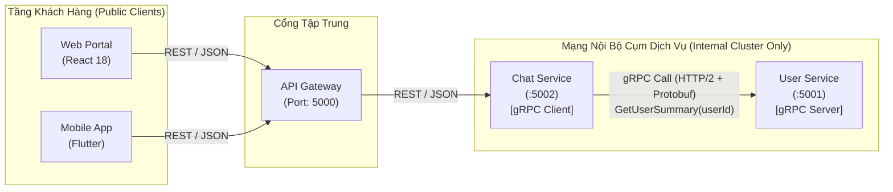

# Quy chuẩn Giao tiếp Đồng bộ gRPC & Tra cứu Hồ sơ Người dùng (Chat-to-User gRPC Profile Lookup)

> **Mã tài liệu**: `DOC-09-GRPC`  
> **Dự án**: FPT Alumni Connect (PRN232 Final Assignment)  
> **Trạng thái**: Hoàn thành & Phê duyệt  
> **Ngôn ngữ triển khai**: C# .NET 10 (`Grpc.AspNetCore`, `Grpc.Net.ClientFactory`)  
> **Hợp đồng Protobuf**: [`contracts/grpc/user-profile/v1/user_profile.proto`](file:///c:/Use/University/PRN232/ASM/guideline/contracts/grpc/user-profile/v1/user_profile.proto)  
> **Dự án mẫu thực tế**: [`examples/grpc-demo/`](file:///c:/Use/University/PRN232/ASM/guideline/examples/grpc-demo/)

---

## 🎯 1. Mục tiêu & Vị trí trong Kiến trúc Hệ thống

Trong đồ án **FPT Alumni Connect**, tính năng nhắn tin thời gian thực giữa các cựu sinh viên và sinh viên (**Chat Service**) cần hiển thị tên hiển thị (`displayName`) và ảnh đại diện (`avatarUrl`) của đối phương trên giao diện hộp thoại hoặc danh sách cuộc trò chuyện:

- Theo **User Story CH-04** (Priority: **P0** - Cốt lõi):
  > *"Chat Service tra cứu thông tin tên hiển thị và avatar tức thời của đối phương từ User Service."*
- Theo nguyên tắc cô lập cơ sở dữ liệu (**Zero Cross-DB Access** tại [`docs/02-architecture.md`](file:///c:/Use/University/PRN232/ASM/guideline/docs/02-architecture.md) & [`docs/05-database.md`](file:///c:/Use/University/PRN232/ASM/guideline/docs/05-database.md)):
  - Chat Service **TUYỆT ĐỐI KHÔNG ĐƯỢC** kết nối vào database `FAlumni_User_Db`.
  - Chat Service **TUYỆT ĐỐI KHÔNG ĐƯỢC** tham chiếu mã nguồn, DbContext hoặc repository của User Service.
- **Giải pháp bắt buộc của môn học (Required ASM Infrastructure)**: Sử dụng **gRPC** để thực hiện cuộc gọi đồng bộ (Synchronous RPC) từ Chat Service sang User Service với độ trễ cực thấp (< 5ms).



---

## ⚖️ 2. Tại sao Dùng gRPC Nội bộ trong khi Web & Mobile Dùng REST?

Một trong những quyết định kiến trúc quan trọng nhất của đồ án là phân định rõ ràng giữa **External Communication** và **Internal Communication**:

### 2.1. Bảng So sánh Chuyên sâu REST vs gRPC

| Tiêu chí | REST API (External Clients) | gRPC (Internal Service-to-Service) |
| :--- | :--- | :--- |
| **Giao thức mạng** | HTTP/1.1 hoặc HTTP/2 tiêu chuẩn | Bắt buộc **HTTP/2** (Framing, Multiplexing) |
| **Định dạng dữ liệu** | JSON (văn bản thuần - Human-readable text) | **Protocol Buffers (Protobuf)** (nhị phân nhồi nén - Binary) |
| **Kích thước gói tin** | Lớn (chứa đầy đủ tên thuộc tính text và khoảng trắng) | **Cực nhỏ** (giảm 60–80% so với JSON nhờ tag số nguyên) |
| **Tốc độ tuần tự hóa (Serialization)** | Chậm (phải phân tích chuỗi ký tự JSON text) | **Cực nhanh** (CPU decode nhị phân trực tiếp, tốn ít CPU) |
| **Ràng buộc hợp đồng (Contract)** | Lỏng lẻo (OpenAPI/Swagger mang tính tài liệu tham khảo) | **Nghiêm ngặt** (Tệp `.proto` sinh mã C# compile-time, sai kiểu là báo lỗi ngay) |
| **Độ trễ cuộc gọi (Latency)** | Trung bình (15ms – 50ms) | **Cực thấp (1ms – 5ms)** trong mạng nội bộ |

### 2.2. Tại sao Web (React) và Mobile (Flutter) KHÔNG gọi gRPC trực tiếp?

1. **Hạn chế của Trình duyệt Web (Browser Limitations)**:
   - Các trình duyệt hiện đại không cho phép mã JavaScript can thiệp sâu vào HTTP/2 framing và đọc gRPC trailers trực tiếp. Để Web gọi gRPC, cần phải có thêm proxy trung gian (`grpc-web` / Envoy proxy), làm phức tạp kiến trúc đồ án không cần thiết.
2. **Ranh giới Bảo mật & Kiểm soát (Security Perimeter)**:
   - Các dịch vụ nội bộ (như cổng gRPC port 50051 của User Service) chỉ được lắng nghe trong mạng nội bộ. Việc không mở cổng gRPC ra Internet giúp ngăn chặn nguy cơ bị quét lỗ hổng và tấn công từ chối dịch vụ (DDoS).
   - API Gateway đóng vai trò cổng gác duy nhất: kiểm tra tính hợp lệ của token JWT, giới hạn tần suất gọi (Rate Limiting), và che giấu địa chỉ IP nội bộ của các microservices.
3. **Tính thân thiện với nhà phát triển Client**:
   - Nhà phát triển Web (React) và Mobile (Flutter) đã quá quen thuộc với REST/JSON chuẩn, dễ dàng debug qua Network Tab của trình duyệt hoặc Postman.

---

## 📜 3. Đặc tả Hợp đồng Protobuf (`user_profile.proto`)

Vị trí lưu trữ chính thức: [`contracts/grpc/user-profile/v1/user_profile.proto`](file:///c:/Use/University/PRN232/ASM/guideline/contracts/grpc/user-profile/v1/user_profile.proto)

```protobuf
syntax = "proto3";

package falumni.userprofile.v1;

option csharp_namespace = "Contracts.Grpc.UserProfile.V1";

// Dịch vụ gRPC nội bộ tra cứu thông tin tóm tắt người dùng
service UserProfileService {
  // Tra cứu hồ sơ công khai của một người dùng dựa theo UserId
  rpc GetUserSummary (GetUserSummaryRequest) returns (GetUserSummaryResponse);
}

message GetUserSummaryRequest {
  string user_id = 1; // Chuỗi UUID của người dùng
}

message GetUserSummaryResponse {
  string user_id = 1;      // UUID của người dùng
  string display_name = 2; // Tên hiển thị (Ví dụ: "Nguyen Van A")
  string avatar_url = 3;   // URL ảnh đại diện
  string status = 4;       // Trạng thái cơ bản: "Active", "Alumni", "Student", "Suspended"
}
```

### 3.1. Nguyên tắc Đóng gói Dữ liệu Tối thiểu (Principle of Least Privilege)

> [!IMPORTANT]
> **Chỉ trả về các thông tin công khai cần thiết cho Chat Service hiển thị**:
> - Dữ liệu trả về chỉ gồm: `user_id`, `display_name`, `avatar_url`, và `status`.
> - **CẤM TUYỆT ĐỐI**: Không bao giờ đưa mật khẩu đã băm (`passwordHash`), số điện thoại, địa chỉ nhà, mã OTP xác thực, hoặc Refresh Token vào hợp đồng gRPC này.

### 3.2. Quyền Sở hữu & Phiên bản hóa (Contract Ownership & Versioning)

- **Đơn vị sở hữu chính (Owner)**: **User Service** (do Backend Dev 1 phụ trách). Mọi thay đổi trên `.proto` phải thông qua PR và được Backend Dev 3 (Chat Service) duyệt chéo.
- **Quy tắc phiên bản**: Tệp nằm trong thư mục `user-profile/v1/` và package `falumni.userprofile.v1`. Khi có thay đổi phá vỡ tương thích (breaking change), phải tạo thư mục mới `v2/`.

---

## 🛡️ 4. Xử lý Lỗi & Khả năng Phục hồi (Resilience & Error Handling)

Khi gọi gRPC qua mạng, các dịch vụ phải xử lý lỗi một cách duyên dáng (Graceful Degradation), không được để lỗi gRPC làm sập toàn bộ ứng dụng Chat.

### 4.1. Ma trận Ánh xạ Mã trạng thái gRPC sang HTTP REST Response

Khi Chat REST API nhận ngoại lệ `RpcException` từ User gRPC Server, nó chuyển đổi sang chuẩn phản hồi lỗi **RFC 7807 (`ProblemDetails`)**:

| Mã gRPC (`StatusCode`) | Ý nghĩa nghiệp vụ | Mã HTTP trả về Client | Tiêu đề ProblemDetails |
| :--- | :--- | :---: | :--- |
| `StatusCode.OK` | Thành công | **200 OK** | Dữ liệu `ConversationParticipantResponse` |
| `StatusCode.NotFound` | Không tìm thấy người dùng trong User DB | **404 Not Found** | *"Participant Profile Not Found"* |
| `StatusCode.InvalidArgument` | UserId không đúng định dạng GUID | **400 Bad Request** | *"Invalid Argument"* |
| `StatusCode.Unavailable` | User Service bị tắt / mất kết nối mạng | **503 Service Unavailable** | *"User Profile Service Unavailable"* |
| `StatusCode.DeadlineExceeded` | Hết thời gian chờ phản hồi (Timeout) | **504 Gateway Timeout** | *"User Profile Service Timeout"* |
| `StatusCode.PermissionDenied` | Tài khoản bị cấm quyền truy cập | **403 Forbidden** | *"Forbidden"* |
| `StatusCode.Unauthenticated` | Thiếu chứng chỉ xác thực nội bộ | **401 Unauthorized** | *"Unauthorized"* |

### 4.2. Thời hạn Chờ & Hủy bỏ (Deadline & Cancellation)

Trong môi trường phân tán, nếu User Service bị treo (deadlock hoặc quá tải), Chat Service không được phép chờ đợi vô hạn:
1. **Thiết lập Deadline**: Mọi lệnh gọi gRPC **BẮT BUỘC** phải có tham số `deadline` (mặc định lấy từ cấu hình, ví dụ `3 giây`):
   ```csharp
   var deadline = DateTime.UtcNow.AddSeconds(_timeoutSeconds);
   var response = await _userProfileClient.GetUserSummaryAsync(request, deadline: deadline, cancellationToken: cancellationToken);
   ```
2. **Truyền CancellationToken**: Khi client (người dùng web) hủy kết nối (ngắt trình duyệt), `cancellationToken` của HTTP request sẽ truyền thẳng vào gRPC call để lập tức giải phóng tài nguyên.

---

## ⚙️ 5. Cấu hình Tham số Dịch vụ (Configuration Standards)

Địa chỉ của User gRPC Server không được hardcode trong mã nguồn mà phải cấu hình qua file `appsettings.json` hoặc biến môi trường:

### Trong `ChatRestApi/appsettings.json`:
```json
{
  "GrpcServices": {
    "UserProfile": {
      "Address": "http://localhost:50051",
      "TimeoutSeconds": 3
    }
  }
}
```

### Đăng ký gRPC Client với Dependency Injection trong `Program.cs`:
```csharp
builder.Services.AddGrpcClient<UserProfileService.UserProfileServiceClient>((sp, options) =>
{
    var config = sp.GetRequiredService<IConfiguration>();
    var address = config["GrpcServices:UserProfile:Address"] ?? "http://localhost:50051";
    options.Address = new Uri(address);
});
```

---

## 💻 6. Hướng dẫn Chạy Thử nghiệm Dự án Mẫu (`examples/grpc-demo/`)

Dự án mẫu minh họa đầy đủ luồng từ đầu đến cuối được đặt tại [`examples/grpc-demo/`](file:///c:/Use/University/PRN232/ASM/guideline/examples/grpc-demo/).

### 6.1. Cấu trúc Giải pháp `GrpcDemo.sln`

```text
examples/grpc-demo/
├── GrpcDemo.sln
├── src/
│   ├── GrpcDemo.Contracts/    # Thư viện sinh code C# từ contracts/grpc/user-profile/v1/user_profile.proto
│   ├── UserGrpcServer/        # Server gRPC độc lập (Kestrel HTTP/2) cung cấp UserProfileService
│   └── ChatRestApi/           # Client REST API gọi User gRPC và trả về phản hồi tổng hợp
└── tests/
    └── GrpcDemo.Tests/        # 8 bài kiểm thử tự động (Unit, Integration, 404, 503, 504, Live Socket)
```

### 6.2. Lệnh Chạy Kiểm thử Tự động

```powershell
dotnet test "examples/grpc-demo/GrpcDemo.sln"
```

Kết quả mong đợi:
```text
Passed!  - Failed: 0, Passed: 8, Skipped: 0, Total: 8, Duration: 3 s - GrpcDemo.Tests.dll
```

### 6.3. Lệnh Chạy Trực tiếp (Live Execution)

#### Bước 1: Mở Terminal 1 và khởi động User gRPC Server
```powershell
dotnet run --project "examples/grpc-demo/src/UserGrpcServer"
```
*Server sẽ khởi động và lắng nghe gRPC HTTP/2 tại `http://localhost:50051`.*

#### Bước 2: Mở Terminal 2 và khởi động Chat REST API
```powershell
dotnet run --project "examples/grpc-demo/src/ChatRestApi" --urls "http://localhost:50052"
```
*API sẽ khởi động và lắng nghe REST HTTP/1.1 tại `http://localhost:50052`.*

#### Bước 3: Gửi HTTP Request kiểm tra bằng PowerShell
```powershell
# 1. Tra cứu người dùng thành công (Nguyen Van A)
Invoke-RestMethod -Uri "http://localhost:50052/api/v1/chats/conversations/99999999-9999-9999-9999-999999999999/participants/11111111-1111-1111-1111-111111111111"

# 2. Tra cứu người dùng không tồn tại (Kết quả: 404 Not Found)
Invoke-RestMethod -Uri "http://localhost:50052/api/v1/chats/conversations/99999999-9999-9999-9999-999999999999/participants/00000000-0000-0000-0000-000000000000"
```

---

## 📦 7. Phân phối & Quản trị Hợp đồng gRPC trong Multi-Repo (Contract Distribution)

Trong mô hình multi-repo, Chat Service và User Service tuyệt đối **không** dùng relative path trỏ sang repository khác (`..\..\..\..\contracts\`). Thay vào đó, hợp đồng Protobuf được phân phối bằng script tự động vào cây thư mục của service:

```powershell
# Chạy từ thư mục gốc của repository dịch vụ (PowerShell execution path):
..\f-alumni-guideline\scripts\import-contracts.ps1 `
    -SourceGuidelinePath "..\f-alumni-guideline" `
    -TargetDirectory "." `
    -ContractId "grpc/user-profile/v1"

# Kiểm tra tính toàn vẹn ngoại tuyến
.\scripts\verify-contracts.ps1
```

### Phân định 3 cấp độ đường dẫn:
1. **Repository-Root Path**: `<service-root>/contracts/grpc/user-profile/v1/user_profile.proto`.
2. **Project-Relative Path (.csproj)**: Lùi 2 cấp thư mục từ `src/<ProjectName>/` ra thư mục `contracts/`:
   - **Máy khách gRPC Client (Chat Service - BE1)** trong `src/FAlumni.Chat.Services/FAlumni.Chat.Services.csproj`:
     ```xml
     <ItemGroup>
       <PackageReference Include="Google.Protobuf" Version="3.30.0" />
       <PackageReference Include="Grpc.Net.Client" Version="2.70.0" />
       <PackageReference Include="Grpc.Tools" Version="2.70.0">
         <PrivateAssets>all</PrivateAssets>
         <IncludeAssets>runtime; build; native; contentfiles; analyzers; buildtransitive</IncludeAssets>
       </PackageReference>
     </ItemGroup>

     <ItemGroup>
       <Protobuf Include="..\..\contracts\grpc\user-profile\v1\user_profile.proto" GrpcServices="Client">
         <Link>Protos\user_profile.proto</Link>
       </Protobuf>
     </ItemGroup>
     ```
   - **Máy chủ gRPC Server (User Service - BE1)** trong `src/FAlumni.User.Api/FAlumni.User.Api.csproj`:
     ```xml
     <ItemGroup>
       <PackageReference Include="Grpc.AspNetCore" Version="2.70.0" />
     </ItemGroup>

     <ItemGroup>
       <Protobuf Include="..\..\contracts\grpc\user-profile\v1\user_profile.proto" GrpcServices="Server">
         <Link>Protos\user_profile.proto</Link>
       </Protobuf>
     </ItemGroup>
     ```
3. **PowerShell Execution Path**: Lệnh PowerShell thực thi từ thư mục gốc của repository (`.\scripts\verify-contracts.ps1`).

> [!TIP]
> Xem chi tiết hướng dẫn quản lý bản kê `contracts.manifest.json`, quy tắc bất biến số thứ tự tag (Field Tag Immutability) và phân định đường dẫn tại [Tài liệu 15 — Phân phối & Quản trị Hợp đồng Giao tiếp Microservices](file:///c:/Use/University/PRN232/ASM/guideline/docs/15-contract-sharing.md).

---

## 📋 8. Danh mục Kiểm tra Khi Lập trình với gRPC (Developer Checklist)

Trước khi gửi Pull Request cho phần tích hợp gRPC giữa Chat và User Service:

- [x] **Có nhập khẩu hợp đồng chuẩn không?** Hợp đồng Protobuf được nhập khẩu từ guideline bằng `scripts/import-contracts.ps1` và xác minh bằng `scripts/verify-contracts.ps1`.
- [x] **Có dùng file proto phiên bản hóa không?** Luôn tham chiếu contract từ `contracts/grpc/user-profile/v1/user_profile.proto` cục bộ của service.
- [x] **Có cô lập hoàn toàn không?** Chat Service không được tham chiếu project, class hay repository của User Service.
- [x] **Có cấu hình Deadline không?** Mọi cuộc gọi gRPC phải truyền `deadline: DateTime.UtcNow.AddSeconds(...)`.
- [x] **Có bắt ngoại lệ `RpcException` không?** Xử lý rõ ràng các trường hợp `NotFound` (404), `Unavailable` (503), và `DeadlineExceeded` (504).
- [x] **Có bảo vệ ranh giới mạng không?** Cổng gRPC chỉ lắng nghe nội bộ, không mở định tuyến trực tiếp từ API Gateway ra ngoài Internet.
