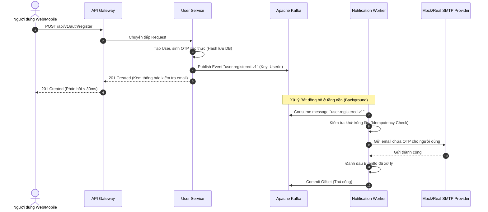

# Quy chuẩn Dịch vụ Xử lý Tác vụ Nền & Gửi Email Thông báo (Notification Background Worker)

> **Mã tài liệu**: `DOC-10-BACKGROUND-WORKER`  
> **Dự án**: FPT Alumni Connect (PRN232 Final Assignment)  
> **Trạng thái**: Hoàn thành & Phê duyệt  
> **Ngôn ngữ triển khai**: C# .NET 10 (`Microsoft.Extensions.Hosting`, `Confluent.Kafka`)  
> **Hợp đồng sự kiện**: [`contracts/events/`](file:///c:/Use/University/PRN232/ASM/guideline/contracts/events/) (`user.registered.v1`)  
> **Dự án mẫu thực tế**: [`examples/demo-worker/`](file:///c:/Use/University/PRN232/ASM/guideline/examples/demo-worker/)

---

## 🎯 1. Tổng quan Kiến trúc Xử lý Nền (Background Worker Architecture)

Trong hệ thống **FPT Alumni Connect**, các tác vụ tốn nhiều thời gian hoặc phụ thuộc vào bên thứ ba (như gửi email kích hoạt tài khoản qua SMTP, thông báo bài viết mới, gửi email đặt lại mật khẩu) **BẮT BUỘC KHÔNG ĐƯỢC THỰC THI ĐỒNG BỘ** trong luồng xử lý HTTP Request của API chính.

### 1.1. Tại sao phải tách rời thành Background Worker độc lập?

| Khía cạnh | Gọi Gửi Email Đồng bộ trong API | Xử lý Bất đồng bộ qua Worker & Kafka |
| :--- | :--- | :--- |
| **Thời gian phản hồi người dùng** | Rất chậm (**1.000ms – 5.000ms**) vì phải chờ SMTP server bắt tay TCP, TLS và gửi mail. | Cực nhanh (**< 30ms**), User Service lưu DB rồi đẩy event lên Kafka là trả về HTTP 201 ngay. |
| **Ảnh hưởng khi dịch vụ email lỗi** | Nếu SMTP server timeout hoặc chập chờn, API đăng ký sẽ báo lỗi HTTP 500, người dùng bị fail oan dù tài khoản có thể đã ghi vào DB. | Khả năng chịu lỗi cao: Thông điệp nằm an toàn trên Kafka cluster; Worker sẽ tự động thử lại khi hệ thống email hồi phục. |
| **Nguy cơ cạn kiệt tài nguyên (Thread Starvation)** | Mỗi request giữ chặt 1 thread của web server trong nhiều giây để chờ I/O mạng SMTP, dễ làm sập Gateway khi có lượng truy cập tăng đột biến. | Web API giải phóng thread ngay lập tức; Worker tiêu thụ thông điệp theo tốc độ xử lý phù hợp của nó (Backpressure Control). |



---

## 📦 2. Tiêu thụ Hợp đồng Sự kiện Hiện hữu (`user.registered.v1`)

Notification Worker tái sử dụng chính xác hợp đồng sự kiện đã được chuẩn hóa tại **TASK 06** mà **KHÔNG ĐƯỢC PHÉP THAY ĐỔI SCHEMA**:

- **Vị trí hợp đồng**:
  - Phong bì siêu dữ liệu: [`contracts/events/EventEnvelope.cs`](file:///c:/Use/University/PRN232/ASM/guideline/contracts/events/EventEnvelope.cs)
  - Payload dữ liệu đăng ký: [`contracts/events/UserRegisteredEventV1.cs`](file:///c:/Use/University/PRN232/ASM/guideline/contracts/events/UserRegisteredEventV1.cs)
  - JSON Schema Draft 2020-12: [`contracts/events/user.registered.v1.json`](file:///c:/Use/University/PRN232/ASM/guideline/contracts/events/user.registered.v1.json)
- **Topic tiêu thụ**: `user.registered.v1`
- **Consumer Group**: `notification-worker.user-registered-group`

```json
{
  "eventId": "8f7e6d5c-4b3a-2109-8765-43210fedcba9",
  "eventType": "user.registered.v1",
  "version": "1.0",
  "occurredAt": "2026-10-24T12:00:00Z",
  "correlationId": "req-9b1deb4d-3b7d-4bad-9bdd-2b0d7b3dcb6d",
  "producer": "f-alumni-user-service",
  "data": {
    "userId": "a1b2c3d4-e5f6-7a8b-9c0d-1e2f3a4b5c6d",
    "email": "student2026@fpt.edu.vn",
    "fullName": "Nguyen Van A",
    "verificationCode": "827194",
    "registeredAt": "2026-10-24T12:00:00Z"
  }
}
```

---

## 🔐 3. Cơ chế Opaque Verification Reference & Thẩm quyền Duy nhất của User Service

Một nguyên tắc kiến trúc bảo mật cốt lõi mà mọi thành viên trong nhóm cần nắm vững:

### 3.1. Notification Worker chỉ là "Người Chuyển Phát Thư" (Delivery Agent)
- Worker **KHÔNG BAO GIỜ** tự sinh mã OTP hoặc token kích hoạt.
- Worker **KHÔNG BAO GIỜ** lưu mã OTP vào database riêng hay kiểm tra tính đúng đắn của mã.
- Worker nhận chuỗi `verificationCode` trong phong bì sự kiện chỉ như một **tham chiếu mờ (Opaque Verification Reference)** để in vào nội dung bức thư điện tử, hoàn toàn không cần hiểu thuật toán sinh mã hay quy luật bảo mật đằng sau nó.

### 3.2. User Service là Thẩm quyền Duy nhất (Sole Authority for Identity)
- **Sinh mã**: `User Service` sử dụng bộ sinh số ngẫu nhiên an toàn (Cryptographically Secure PRNG) để tạo ra mã PIN 6 chữ số hoặc GUID token.
- **Lưu trữ an toàn**: `User Service` lưu bản băm (hashed) của mã kèm thời hạn hiệu lực (`ExpiresAtUtc = UtcNow.AddMinutes(15)`) trong bảng `VerificationTokens` của `FAlumni_User_Db`.
- **Thẩm định & Kích hoạt**: Khi người dùng nhận được thư và bấm link hoặc nhập mã OTP trên Web/Mobile, client gửi yêu cầu đến `POST /api/v1/auth/verify-email`. Chỉ có `User Service` mới có quyền đối chiếu mã, kiểm tra thời hạn và đổi trạng thái tài khoản từ `Pending` sang `Active`.

---

## 🛡️ 4. Quy chuẩn Ghi nhật ký An toàn (Safe Logging & Token Redaction)

Trong môi trường sản xuất, nhật ký (logs) thường được đẩy về các hệ thống thu thập tập trung (như ElasticSearch, Kibana, Seq, Azure Application Insights). Nếu lập trình viên vô tình log mã OTP hoặc mật khẩu vào console/file, bất kỳ ai có quyền xem log đều có thể chiếm quyền điều khiển tài khoản của người dùng.

### 4.1. Quy tắc Bất di bất dịch
> [!CAUTION]
> **TUYỆT ĐỐI KHÔNG BAO GIỜ GHI MÃ XÁC THỰC (OTP), MẬT KHẨU HAY CHỨNG CHỈ VÀO LOG.**

### 4.2. Những gì ĐƯỢC PHÉP log:
- **`eventId`** và **`correlationId`**: Bắt buộc phải log để phục vụ Distributed Tracing (truy vết lỗi xuyên suốt từ HTTP request ban đầu đến sự kiện Kafka).
- **`eventType`**, **`producer`**, **`partition`**, **`offset`**: Phục vụ việc theo dõi tình trạng tiêu thụ thông điệp của cụm Kafka.
- **Email đã được che một phần (Masked Email)**: Ví dụ `student2026@fpt.edu.vn` $\rightarrow$ `st***@fpt.edu.vn` để đảm bảo quyền riêng tư thông tin cá nhân.

```csharp
// ĐÚNG: Log an toàn chỉ chứa EventId, CorrelationId và Masked Recipient
_logger.LogInformation(
    "Consuming event: EventId={EventId}, CorrelationId={CorrelationId}, Producer={Producer}",
    envelope.EventId, envelope.CorrelationId, envelope.Producer);

_logger.LogInformation(
    "[MOCK EMAIL DELIVERED] Recipient: {MaskedEmail} | Subject: {Subject}",
    MaskEmail(envelope.Data.Email), subject);

// SAI NGHIÊM TRỌNG: Làm lộ mã xác thực vào hệ thống log
// _logger.LogInformation("Sending OTP {Code} to {Email}", envelope.Data.VerificationCode, envelope.Data.Email);
```

---

## ⚡ 5. Xử lý Lỗi & Độ Bền Vững (Resilience Patterns)

### 5.1. Cơ chế Tắt Ứng dụng An toàn (Graceful Shutdown)
Khi ứng dụng nhận tín hiệu dừng (nhấn `Ctrl+C` hoặc container nhận `SIGTERM`), `CancellationToken` của `BackgroundService` sẽ kích hoạt:
- Vòng lặp `consumer.Consume(stoppingToken)` kết thúc một cách tự nhiên.
- Consumer gọi `_consumer.Close()` để thông báo cho Kafka broker thực hiện rebalance phân vùng một cách sạch sẽ, không làm mất mát thông điệp đang xử lý.

### 5.2. Chống Trùng lặp Thông điệp (Idempotent Consumer Pattern)
Do Kafka hoạt động theo cơ chế **At-Least-Once Delivery**, sự cố mạng hoặc rebalance có thể khiến một thông điệp được gửi lại lần thứ hai.
- **Giải pháp**: Sử dụng `IProcessedEventTracker` để lưu trữ danh sách các `eventId` đã xử lý thành công.
- **Xử lý khi trùng**:
  1. Nếu `eventId` đã tồn tại trong tracker: Log cảnh báo `Duplicate event skipped`, **không gọi hàm gửi email**, và gọi `_consumer.Commit(consumeResult)` để đi tiếp.
  2. Người dùng sẽ không bị nhận 2 email giống hệt nhau khi có sự cố mạng.

### 5.3. Chiến lược Cam kết Offset (Manual Offset Commit Strategy)
Trong `NotificationBackgroundService`, thuộc tính `EnableAutoCommit = false` được bật:
- **Xử lý Thành công (Success)**: Gọi `_consumer.Commit()` sau khi email đã được gửi thành công và `eventId` đã ghi nhận vào tracker.
- **Sự kiện Trùng lặp (Duplicate)** hoặc **Dữ liệu Hỏng (Malformed / Poison Pill)**: Gọi `_consumer.Commit()` để đẩy offset qua, tránh làm nghẽn tiến trình của partition.
- **Lỗi Gửi Email Tạm thời (Transient Failure / Failed)**: **TUYỆT ĐỐI KHÔNG COMMIT OFFSET**. Worker giữ nguyên vị trí offset và đợi vài giây thử lại, đảm bảo thông điệp không bị mất mát.

---

## 🔌 6. Trừu tượng hóa `IEmailSender` & Thay thế Nhà Cung Cấp Thực Tế

Hệ thống sử dụng mẫu thiết kế Dependency Inversion thông qua interface `IEmailSender`:

```csharp
namespace NotificationWorker.Abstractions;

public interface IEmailSender
{
    Task SendEmailAsync(string toEmail, string subject, string body, CancellationToken cancellationToken = default);
}
```

### 6.1. Môi trường Phát triển (Development Mock)
Trong môi trường phát triển cục bộ và chạy kiểm thử tự động, lớp `MockEmailSender` được sử dụng:
- Không yêu cầu tài khoản hay mật khẩu SMTP thật.
- Ghi nhận lịch sử gửi thư vào bộ nhớ (`SentEmails`) phục vụ kiểm thử.
- Ghi log an toàn với email đã che một phần (`st***@fpt.edu.vn`).

### 6.2. Hướng dẫn Thay thế bằng SMTP Thật (Production / Staging)
Khi chuyển sang môi trường triển khai thực tế, bạn chỉ cần tạo lớp `SmtpEmailSender` và thay đổi khai báo trong Dependency Injection:

```csharp
// Ví dụ cài đặt SmtpEmailSender sử dụng thư viện MailKit
public class SmtpEmailSender : IEmailSender
{
    private readonly IConfiguration _config;
    public SmtpEmailSender(IConfiguration config) => _config = config;

    public async Task SendEmailAsync(string toEmail, string subject, string body, CancellationToken cancellationToken = default)
    {
        using var client = new MailKit.Net.Smtp.SmtpClient();
        await client.ConnectAsync(_config["Smtp:Host"], int.Parse(_config["Smtp:Port"]!), SecureSocketOptions.StartTls, cancellationToken);
        await client.AuthenticateAsync(_config["Smtp:Username"], _config["Smtp:Password"], cancellationToken);

        var message = new MimeMessage();
        message.From.Add(new MailboxAddress("FPT Alumni Connect", _config["Smtp:FromAddress"]));
        message.To.Add(new MailboxAddress("", toEmail));
        message.Subject = subject;
        message.Body = new TextPart("plain") { Text = body };

        await client.SendAsync(message, cancellationToken);
        await client.DisconnectAsync(true, cancellationToken);
    }
}
```

Thay đổi 1 dòng trong `Program.cs`:
```csharp
// Đổi từ Mock sang SMTP thật:
// builder.Services.AddSingleton<IEmailSender, MockEmailSender>();
builder.Services.AddTransient<IEmailSender, SmtpEmailSender>();
```

---

## 💻 7. Hướng dẫn Chạy Thử nghiệm Dự án Mẫu (`examples/demo-worker/`)

Toàn bộ mã nguồn hoàn chỉnh đã được đóng gói trong giải pháp [`examples/demo-worker/DemoWorker.sln`](file:///c:/Use/University/PRN232/ASM/guideline/examples/demo-worker/DemoWorker.sln).

### 7.1. Cấu trúc Thư mục

```text
examples/demo-worker/
├── DemoWorker.sln
├── src/
│   └── NotificationWorker/        # Ứng dụng Worker Service (.NET 10)
│       ├── Abstractions/IEmailSender.cs
│       ├── Services/MockEmailSender.cs
│       ├── Services/IProcessedEventTracker.cs
│       ├── Services/NotificationEventProcessor.cs
│       ├── Workers/NotificationBackgroundService.cs
│       ├── Program.cs
│       └── appsettings.json
└── tests/
    └── NotificationWorker.Tests/  # 10 bài kiểm thử tự động
        └── WorkerTests.cs
```

### 7.2. Lệnh Chạy Kiểm thử Tự động (Không cần Kafka broker thật)

Chạy toàn bộ 10 bài kiểm thử tự động kiểm tra xử lý sự kiện, lọc trùng lặp, che giấu OTP và commit offset:

```powershell
dotnet test "examples/demo-worker/DemoWorker.sln"
```

Kết quả mong đợi:
```text
Passed!  - Failed: 0, Passed: 10, Skipped: 0, Total: 10, Duration: 374 ms - NotificationWorker.Tests.dll
```

### 7.3. Lệnh Khởi chạy Worker Trực tiếp

Khi có Kafka broker đang hoạt động (cổng 9092):

```powershell
dotnet run --project "examples/demo-worker/src/NotificationWorker"
```

---

## 📋 8. Danh mục Kiểm tra Khi Lập trình với Worker (Developer Checklist)

Trước khi gửi Pull Request cho phần xử lý Background Worker:

- [x] **Có dùng IEmailSender abstraction không?** Không bao giờ hardcode lệnh gửi SMTP trực tiếp trong controller hay event handler.
- [x] **Có bảo mật log không?** Kiểm tra console log tuyệt đối không hiển thị mã xác thực (OTP), mật khẩu, hay token kích hoạt.
- [x] **Có kiểm tra trùng lặp (Idempotent) không?** Sử dụng `eventId` để lọc trùng trước khi thực hiện tác vụ phụ (gửi email).
- [x] **Có tắt Auto-Commit không?** Thiết lập `EnableAutoCommit = false` và chỉ commit offset sau khi gửi email thành công.
- [x] **Có xử lý Graceful Shutdown không?** Truyền `stoppingToken` vào `consumer.Consume()` và gọi `consumer.Close()` khi thoát ứng dụng.
