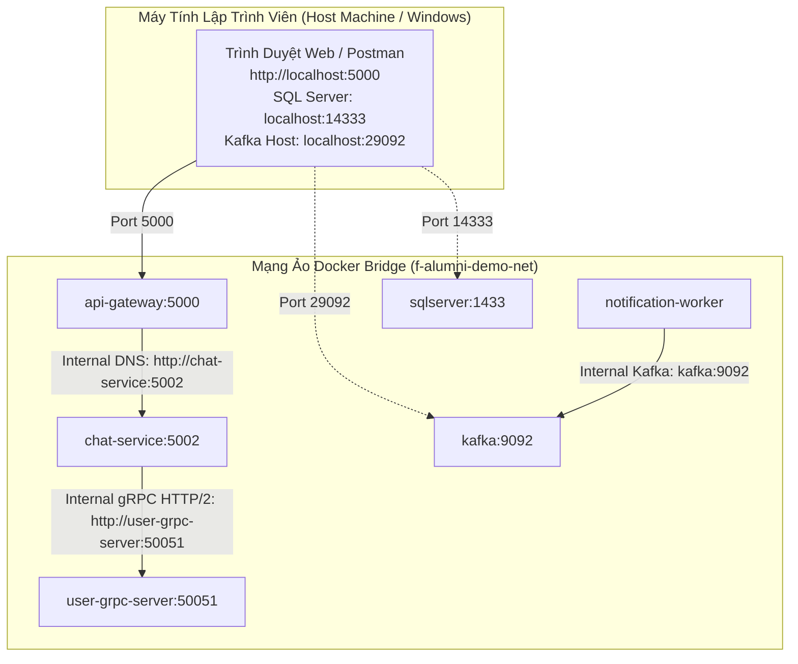

# Quy chuẩn Đóng gói Container & Môi trường Docker Compose (Docker & Containerization Standards)

> **Mã tài liệu**: `DOC-12-DOCKER`  
> **Dự án**: FPT Alumni Connect (PRN232 Final Assignment)  
> **Trạng thái**: Hoàn thành & Phê duyệt  
> **Tệp Compose Mẫu**: [`docker/compose.demo.yml`](file:///c:/Use/University/PRN232/ASM/guideline/docker/compose.demo.yml) | **Tệp Môi trường Mẫu**: [`docker/.env.example`](file:///c:/Use/University/PRN232/ASM/guideline/docker/.env.example)

---

## 🎯 1. Mục tiêu & Ranh giới Sở hữu Hạ tầng

Tài liệu này hướng dẫn cách đóng gói các dịch vụ thành các container độc lập và kết nối chúng thành một hệ sinh thái hoàn chỉnh trên máy phát triển cục bộ bằng **Docker Compose**.

> [!IMPORTANT]
> **Quy định Phân định Ranh giới Repository**:
> - Tệp `docker/compose.demo.yml` trong repository này (`f-alumni-guideline`) **CHỈ LÀ BẢN TRÌNH DIỄN MẪU (Guideline Demo Only)** để minh họa cách tích hợp giữa Gateway, REST, gRPC, Kafka, SQL Server và Worker.
> - **Cấu hình Docker Compose và hạ tầng chính thức cho 5 microservices thực tế thuộc về repository độc lập: `fpt-alumni-infra`**.

---

## 🏗️ 2. Kiến trúc Mạng Container (Container-Facing vs Host-Facing Networking)

Một lỗi rất phổ biến của sinh viên khi mới làm quen với Docker là nhầm lẫn giữa địa chỉ kết nối **bên trong mạng Docker** và **từ máy chủ (Host)**:



### 2.1. Bảng Phân bổ Địa chỉ Mạng & Cổng (Networking Matrix)

| Dịch vụ | Tên DNS Nội bộ (Container-facing) | Cổng Nội bộ | Cổng Ánh xạ Máy chủ (Host-facing) | Ghi chú & Mục đích |
| :--- | :--- | :---: | :---: | :--- |
| **YARP Gateway** | `api-gateway` | `5000` | **`localhost:5000`** | Cổng giao tiếp công khai duy nhất cho Web/Mobile. |
| **Chat REST API** | `chat-service` | `5002` | `localhost:5002` | Dịch vụ Chat nội bộ (được gọi qua Gateway). |
| **User gRPC Server** | `user-grpc-server` | `50051` | `localhost:50051` | Cung cấp gRPC HTTP/2 cho Chat Service tra cứu hồ sơ. |
| **Notification Worker** | `notification-worker` | N/A | N/A | Worker chạy ngầm, không mở cổng HTTP. |
| **Apache Kafka** | `kafka` | `9092` | **`localhost:29092`** | `9092` cho Worker nội bộ, `29092` cho app chạy trên host. |
| **SQL Server 2022** | `sqlserver` | `1433` | **`localhost:14333`** | Đổi sang `14333` để **không xung đột** với SQLEXPRESS (1433) trên máy thật. |

---

## ⚡ 3. Đảm bảo Giao tiếp gRPC HTTP/2 giữa các Container

gRPC yêu cầu giao thức **HTTP/2**. Mặc định, nếu kết nối HTTP không mã hóa (Cleartext / H2C), Kestrel cần được cấu hình tường minh để không bị hạ cấp xuống HTTP/1.1:

Trong `compose.demo.yml`:
```yaml
user-grpc-server:
  environment:
    ASPNETCORE_URLS: "http://+:50051"
    Kestrel__Endpoints__gRpc__Url: "http://+:50051"
    Kestrel__Endpoints__gRpc__Protocols: "Http2"
```

Nhờ cấu hình này, `chat-service` kết nối tới `http://user-grpc-server:50051` bên trong mạng bridge sẽ truyền tải các frame nhị phân Protobuf với tốc độ tối đa mà không gặp lỗi `Protocol error`.

---

## 🔐 4. Quản lý Biến Môi trường An toàn (`.env.example`)

Tuyệt đối không đưa mật khẩu thật vào tệp cấu hình được commit lên Git:
- **Tệp mẫu cam kết vào Git**: [`docker/.env.example`](file:///c:/Use/University/PRN232/ASM/guideline/docker/.env.example)
- **Tệp bí mật thực tế trên máy cá nhân**: `docker/.env` (đã được cấu hình trong `.gitignore`).

### Quy trình sử dụng:
1. Sao chép tệp mẫu:
   ```powershell
   Copy-Item docker/.env.example docker/.env
   ```
2. Mở `docker/.env` và chỉnh sửa mật khẩu SA hoặc các cổng mong muốn:
   ```ini
   MSSQL_SA_PASSWORD=YourStrong@Passw0rd!
   SQL_SERVER_HOST_PORT=14333
   GATEWAY_PORT=5000
   ```

---

## 🔄 5. Thứ tự Khởi động & Kiểm tra Tình trạng Sống (Healthchecks & Dependencies)

Tệp Compose sử dụng thuộc tính `depends_on` kết hợp với `condition: service_healthy`:
- **`chat-service`** chỉ khởi động sau khi **`user-grpc-server`** đã sẵn sàng.
- **`api-gateway`** chỉ khởi động sau khi **`chat-service`** đã sẵn sàng.
- **`notification-worker`** chỉ khởi động sau khi **`kafka`** đã vượt qua kiểm tra sức khỏe (`service_healthy` qua lệnh `kafka-topics.sh`).

---

## 💻 6. Lệnh Vận hành Cơ bản (Docker Operations)

### 6.1. Kiểm tra tính hợp lệ của cấu hình (Config Validation)
```powershell
docker compose -f docker/compose.demo.yml config
```
*Lệnh này phân tích cú pháp YAML, kiểm tra các biến môi trường và in ra toàn bộ cấu trúc định nghĩa dịch vụ.*

### 6.2. Khởi động toàn bộ hệ sinh thái demo
```powershell
docker compose -f docker/compose.demo.yml up -d --build
```

### 6.3. Theo dõi nhật ký hoạt động (Logs)
```powershell
# Xem log toàn bộ hệ thống
docker compose -f docker/compose.demo.yml logs -f

# Xem log riêng của Notification Worker để kiểm tra email mock
docker compose -f docker/compose.demo.yml logs -f notification-worker
```

### 6.4. Kiểm tra luồng End-to-End qua Gateway
Khi hệ thống đang chạy, bạn có thể gọi từ máy host vào cổng Gateway `5000`:
```powershell
# Tra cứu người dùng qua Gateway (Gateway -> Chat Service -> User gRPC)
curl http://localhost:5000/api/chat/conversations/11111111-1111-1111-1111-111111111111/participants/11111111-1111-1111-1111-111111111111
```

### 6.5. Chạy Kịch Bản Kiểm Thử Khói Tự Động (Automated Smoke Test)
Dự án cung cấp sẵn kịch bản PowerShell kiểm tra toàn bộ 2 luồng tích hợp phân tán (Workflow A & Workflow B):
```powershell
# Kiem tra truc tiep tren he thong Docker live dang chay:
.\scripts\smoke-test.ps1 -Live

# Kiem tra gia lap in-process (khi khong bat Docker):
.\scripts\smoke-test.ps1 -InProcess
```

### 6.6. Dừng và dọn dẹp tài nguyên an toàn (Graceful Shutdown)
```powershell
# Dung cac container ma khong lam mat du lieu database:
docker compose -f docker/compose.demo.yml down
```

> [!CAUTION]
> Tuyệt đối **KHÔNG** sử dụng cờ `-v` (`docker compose down -v`) vì lệnh này sẽ xóa sạch toàn bộ các Docker Volumes lưu trữ cơ sở dữ liệu!

---

## 🛠️ 7. Hướng Dẫn Khắc Phục Sự Cố Phổ Biến (Troubleshooting Guide)

### 7.1. Lỗi Kết nối Kafka từ Máy Host (`Failed to resolve 'kafka:9092'`)
- **Triệu chứng**: Chạy producer hoặc consumer trên máy host (Windows) báo lỗi không phân giải được tên miền `kafka`.
- **Nguyên nhân**: Tên miền `kafka:9092` chỉ tồn tại bên trong mạng nội bộ Docker bridge `f-alumni-demo-net`.
- **Cách khắc phục**:
  - Các ứng dụng chạy trong container (như `notification-worker`): Kết nối tới `kafka:9092`.
  - Các ứng dụng chạy trực tiếp trên máy host (như `KafkaProducer`): Kết nối tới cổng đã ánh xạ **`localhost:29092`**.

### 7.2. Lỗi Giao Thức gRPC HTTP/2 (`Protocol error` / `Bad Request`)
- **Triệu chứng**: Chat Service gọi User Service gRPC báo lỗi kết nối hoặc HTTP 400.
- **Nguyên nhân**: gRPC yêu cầu HTTP/2. Khi chạy HTTP không mã hóa (H2C) trong mạng nội bộ, Kestrel mặc định có thể hạ cấp xuống HTTP/1.1.
- **Cách khắc phục**: Trong tệp compose của `user-grpc-server`, bắt buộc đặt biến môi trường:
  ```yaml
  Kestrel__Endpoints__gRpc__Url: "http://+:50051"
  Kestrel__Endpoints__gRpc__Protocols: "Http2"
  ```

### 7.3. Lỗi Gateway Trả về `502 Bad Gateway` hoặc `504 Gateway Timeout`
- **Triệu chứng**: Gửi request tới cổng `5000` nhận phản hồi `502 Bad Gateway` hoặc `504 Gateway Timeout`.
- **Nguyên nhân**: Upstream service (`chat-service` hoặc `user-grpc-server`) chưa khởi động xong, đã bị dừng, hoặc phản hồi quá thời gian quy định (deadline 3s).
- **Cách khắc phục**:
  1. Kiểm tra trạng thái container: `docker compose -f docker/compose.demo.yml ps`.
  2. Xem nhật ký container nghi ngờ: `docker compose -f docker/compose.demo.yml logs chat-service`.

### 7.4. Xung Đột Cổng SQL Server (Port 1433 Conflict)
- **Triệu chứng**: Container SQL Server không khởi động được do cổng 1433 đã bị chiếm dụng.
- **Nguyên nhân**: Máy host đã cài sẵn SQL Server Express đang chiếm dụng cổng 1433.
- **Cách khắc phục**: Tệp `docker/compose.demo.yml` và `.env.example` đã chuẩn hóa cổng host sang **`14333`** (`- "14333:1433"`). Không bao giờ map đè lên cổng 1433 của máy host.

