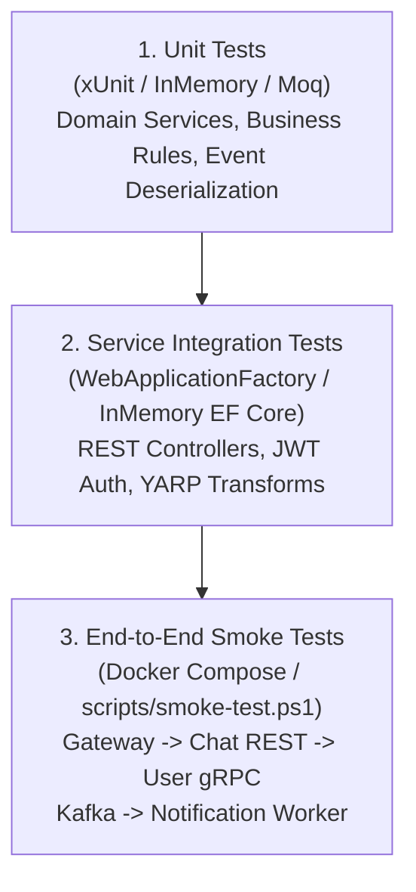

# Chiến Lược & Quy Chuẩn Kiểm Thử Hệ Thống (Testing Standards & Verification Guide)

> **Mã tài liệu**: `DOC-13-TESTING`  
> **Dự án**: FPT Alumni Connect (PRN232 Final Assignment)  
> **Trạng thái**: Hoàn thành & Phê duyệt  
> **Công cụ tự động hóa**: [`scripts/verify-all.ps1`](file:///c:/Use/University/PRN232/ASM/guideline/scripts/verify-all.ps1) | [`scripts/smoke-test.ps1`](file:///c:/Use/University/PRN232/ASM/guideline/scripts/smoke-test.ps1)  
> **Bộ kiểm thử mẫu**: [`templates/dotnet-service/tests/`](file:///c:/Use/University/PRN232/ASM/guideline/templates/dotnet-service/tests/) | [`examples/gateway-demo/tests/`](file:///c:/Use/University/PRN232/ASM/guideline/examples/gateway-demo/tests/) | [`examples/demo-worker/tests/`](file:///c:/Use/University/PRN232/ASM/guideline/examples/demo-worker/tests/)

---

## 🎯 1. Triết Lý Kiểm Thử Trong Đồ Án PRN232

Trong một hệ thống phân tán gồm nhiều microservices độc lập, việc kiểm thử đóng vai trò sống còn để đảm bảo:
1. **Tính độc lập của từng dịch vụ**: Mỗi dịch vụ có thể được kiểm thử đơn vị độc lập mà không cần phải bật toàn bộ hệ sinh thái.
2. **Tính toàn vẹn của hợp đồng tích hợp (Contract Integrity)**: Các dịch vụ giao tiếp đúng định dạng JSON REST, Protobuf gRPC nhị phân và Kafka Event Envelope.
3. **Độ tin cậy trong buổi thuyết trình đồ án (ASM Demo Readiness)**: Có kịch bản kiểm thử tự động rõ ràng để chứng minh cho giảng viên thấy hệ thống hoạt động ổn định và xử lý lỗi chuyên nghiệp.

---

## 🏗️ 2. Tháp Kiểm Thử (Testing Pyramid) Của Dự Án



---

## 🧪 3. Quy Chuẩn Kiểm Thử Từng Tầng

### 3.1. Kiểm Thử Đơn Vị Tầng Nghiệp Vụ (Service Unit Tests)
- **Mục tiêu**: Kiểm tra logic nghiệp vụ trong lớp `*Service.cs` độc lập với cơ sở dữ liệu và Web API.
- **Kỹ thuật**: Sử dụng interface repository (`ISampleItemRepository`) để giả lập dữ liệu mẫu (mock/stub) mà không cần gọi SQL Server thật.
- **Vị trí mẫu**: [`templates/dotnet-service/tests/Template.Tests/Services/SampleItemServiceTests.cs`](file:///c:/Use/University/PRN232/ASM/guideline/templates/dotnet-service/tests/Template.Tests/Services/SampleItemServiceTests.cs).

### 3.2. Kiểm Thử Tích Hợp API Với `WebApplicationFactory`
- **Mục tiêu**: Kiểm tra toàn bộ luồng HTTP Request từ Routing, Model Validation, Middleware, Authorization đến HTTP Response.
- **Quy tắc quan trọng**: Để bộ test chạy độc lập, không phụ thuộc vào trạng thái SQL Server trên máy chấm điểm:
  - Sử dụng [`CustomWebApplicationFactory`](file:///c:/Use/University/PRN232/ASM/guideline/templates/dotnet-service/tests/Template.Tests/Endpoints/CustomWebApplicationFactory.cs) cấu hình `DatabaseProvider = InMemory`.
  - Kiểm tra các trường hợp phân quyền:
    - Token hợp lệ `USER` $\rightarrow$ `201 Created`.
    - Token thiếu quyền `USER` cố gọi API quản trị $\rightarrow$ `403 Forbidden`.
    - Không truyền Header `Authorization` $\rightarrow$ `401 Unauthorized`.
    - Dữ liệu Request DTO không hợp lệ $\rightarrow$ `400 Bad Request ProblemDetails`.

### 3.3. Kiểm Thử Giao Tiếp Đồng Bộ gRPC (Chat $\rightarrow$ User)
- **Mục tiêu**: Đảm bảo Chat REST API gọi đúng Protobuf Client và xử lý trơn tru cả khi User gRPC Server trả về kết quả lẫn khi server gặp sự cố.
- **Vị trí mẫu**: [`examples/grpc-demo/tests/GrpcDemo.Tests/ChatServiceGrpcIntegrationTests.cs`](file:///c:/Use/University/PRN232/ASM/guideline/examples/grpc-demo/tests/GrpcDemo.Tests/ChatServiceGrpcIntegrationTests.cs).
- **Các ca kiểm thử bắt buộc**:
  1. Người dùng tồn tại $\rightarrow$ Trả về tên hiển thị và avatar đầy đủ.
  2. Người dùng không tồn tại (`Status.NotFound`) $\rightarrow$ Chat Service hiển thị tên ẩn danh dự phòng ("Anonymous User") thay vì gây sập ứng dụng.
  3. User Service gRPC ngắt kết nối (`Status.Unavailable`) $\rightarrow$ Chat Service kích hoạt cơ chế Fallback an toàn.

### 3.4. Kiểm Thử Sự Kiện Bất Đồng Bộ Kafka & Worker
- **Mục tiêu**: Đảm bảo Worker tiêu thụ đúng Envelope `user.registered.v1`, gửi email giả lập và không gửi trùng lặp.
- **Vị trí mẫu**: [`examples/demo-worker/tests/DemoWorker.Tests/NotificationWorkerTests.cs`](file:///c:/Use/University/PRN232/ASM/guideline/examples/demo-worker/tests/DemoWorker.Tests/NotificationWorkerTests.cs).
- **Các ca kiểm thử bắt buộc**:
  1. Sự kiện hợp lệ $\rightarrow$ Tiêu thụ thành công, ghi log gửi email che giấu token an toàn.
  2. Sự kiện bị gửi lặp lại (Duplicate `eventId`) $\rightarrow$ Bỏ qua không gửi email lần 2 (Idempotent Handling).
  3. Lỗi dịch vụ gửi mail tạm thời $\rightarrow$ Bắt lỗi và không commit offset lỗi.

### 3.5. Kiểm Thử Định Tuyến API Gateway (YARP)
- **Mục tiêu**: Đảm bảo YARP chuyển tiếp đúng địa chỉ upstream và biến đổi đường dẫn URL.
- **Vị trí mẫu**: [`examples/gateway-demo/tests/GatewayDemo.Tests/GatewayRoutingTests.cs`](file:///c:/Use/University/PRN232/ASM/guideline/examples/gateway-demo/tests/GatewayDemo.Tests/GatewayRoutingTests.cs).
- **Các ca kiểm thử bắt buộc**:
  1. Route rút gọn `/api/chat/rooms/{id}/messages` biến đổi thành `/api/v1/chats/rooms/{id}/messages`.
  2. Upstream microservice bị tắt $\rightarrow$ Gateway trả về `502 Bad Gateway` theo chuẩn RFC 7807 ProblemDetails.

---

## ⚡ 4. Bộ Công Cụ Tự Động Hóa Kiểm Thử Của Dự Án

Nhóm đồ án đã xây dựng sẵn 2 kịch bản PowerShell tự động để phục vụ kiểm thử:

### 4.1. Kịch Bản Xác Minh Toàn Diện (`scripts/verify-all.ps1`)
Chạy kiểm tra toàn bộ 5 solution, kiểm tra cấu hình tĩnh và chạy 54 ca kiểm thử đơn vị:

```powershell
# Thực hiện toàn bộ kiểm tra:
.\scripts\verify-all.ps1

# Chỉ kiểm tra biên dịch và cấu hình, bỏ qua chạy test:
.\scripts\verify-all.ps1 -SkipTests

# Dừng ngay khi gặp lỗi đầu tiên:
.\scripts\verify-all.ps1 -FailFast
```

**Bảng Tổng Hợp Kiểm Thử Trong `verify-all.ps1`**:
| Solution | Dự án Kiểm Thử | Số lượng Tests | Trạng thái |
| :--- | :--- | :---: | :---: |
| `Template.sln` | `Template.Tests` | 20 | **PASS** |
| `KafkaDemo.sln` | `KafkaDemo.Tests` | 10 | **PASS** |
| `GrpcDemo.sln` | `GrpcDemo.Tests` | 8 | **PASS** |
| `DemoWorker.sln` | `DemoWorker.Tests` | 10 | **PASS** |
| `GatewayDemo.sln` | `GatewayDemo.Tests` | 6 | **PASS** |
| **Tổng cộng** | **5 Test Projects** | **54 Tests** | **100% PASS** |

### 4.2. Kịch Bản Smoke Test Tích Hợp (`scripts/smoke-test.ps1`)
Chạy kiểm tra luồng tích hợp xuyên suốt giữa các microservices:

```powershell
.\scripts\smoke-test.ps1
```

- **Khi Docker đang chạy**: Tự động gửi request HTTP thật qua Gateway tại cổng `5000`, xác thực chuỗi `Gateway -> Chat REST -> User gRPC` và kiểm tra log Worker.
- **Khi Docker chưa bật**: Tự động chuyển sang chế độ In-Process Integration Test để kiểm tra toàn bộ luồng tương đương mà không làm gián đoạn công việc của lập trình viên.

---

## 🎓 5. Hướng Dẫn Trình Diễn Kiểm Thử Trong Buổi Báo Cáo Đồ Án (ASM Defense)

Khi trình bày với Hội đồng Giảng viên, các nhóm sinh viên hãy thực hiện theo trình tự 4 bước sau để đạt điểm tối đa:

1. **Bước 1 — Chứng minh Kiểm thử Đơn vị & Tự động hóa**:
   - Mở terminal và chạy lệnh `.\scripts\verify-all.ps1`.
   - Giới thiệu với giảng viên: Hệ thống có 54 bài kiểm thử tự động bao phủ toàn bộ 5 khía cạnh kiến trúc (REST, EF Core, JWT, gRPC, Kafka, Gateway).
2. **Bước 2 — Trình diễn Luồng Đồng bộ (REST + gRPC)**:
   - Gửi request tới Gateway: `GET http://localhost:5000/api/chat/rooms/room-101/messages`.
   - Chỉ ra rằng: Gateway đã rewrite đường dẫn, Chat Service đã nhận request và gọi sang User gRPC Server qua HTTP/2 nhị phân để lấy Avatar và Tên của cựu sinh viên.
3. **Bước 3 — Trình diễn Luồng Bất đồng bộ (Kafka + Background Worker)**:
   - Chạy Producer gửi sự kiện `user.registered.v1`.
   - Mở nhật ký của Notification Worker để thấy thông báo giả lập gửi email chào mừng với mã xác minh đã được bảo mật.
4. **Bước 4 — Trình diễn Tính Chịu Lỗi (Fault Tolerance)**:
   - Tắt container `user-grpc-server`.
   - Gửi lại request chat: Hệ thống không bị crash mà Chat Service kích hoạt cơ chế fallback hiển thị người dùng ẩn danh.
