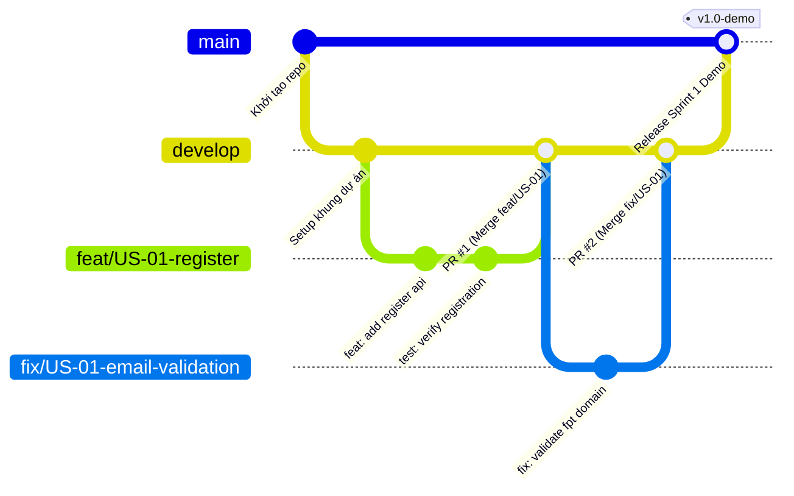
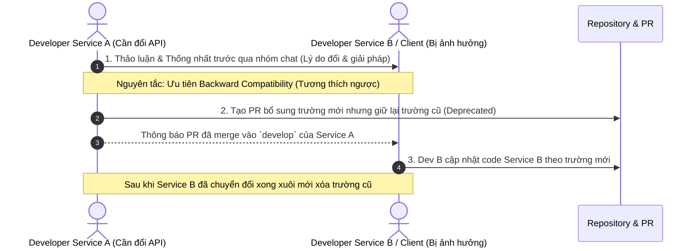

# 14. Quy chuẩn Git & Quy trình Làm việc Nhóm (Team Workflow & Git Standards)

> **Môn học**: PRN232 — Final Assignment  
> **Dự án**: FPT Alumni Connect  
> **Mục tiêu**: Thiết lập quy trình phát triển phần mềm cộng tác đơn giản, rõ ràng, thực tế cho 5 thành viên (3 Backend, 1 Web, 1 Mobile) làm việc trên các repository độc lập mà không bị xung đột hay phá vỡ hệ thống của nhau.

---

## 📑 Mục lục
1. [Quy chuẩn Đặt tên Repository (Repository Naming Convention)](#1-quy-chuẩn-đặt-tên-repository-repository-naming-convention)
2. [Phân định Trách nhiệm & Quyền sở hữu (Team Roles & Code Ownership)](#2-phân-định-trách-nhiệm--quyền-sở-hữu-team-roles--code-ownership)
3. [Chiến lược Phân nhánh Tinh gọn (Simplified Branching Strategy)](#3-chiến-lược-phân-nhánh-tinh-gọn-simplified-branching-strategy)
4. [Quy trình Phát triển: Từ Feature Branch đến Merge PR](#4-quy-trình-phát-triển-từ-feature-branch-đến-merge-pr)
5. [Quy chuẩn Thông điệp Commit (Conventional Commits)](#5-quy-chuẩn-thông-điệp-commit-conventional-commits)
6. [Quy trình Phối hợp Thay đổi Hợp đồng API & Breaking Changes](#6-quy-trình-phối-hợp-thay-đổi-hợp-đồng-api--breaking-changes)
7. [Ví dụ Mẫu Từng bước Dành cho Người mới (Beginner Step-by-Step Example)](#7-ví-dụ-mẫu-từng-bước-dành-cho-người-mới-beginner-step-by-step-example)
8. [Mẫu Pull Request Chuẩn (Pull Request Template)](#8-mẫu-pull-request-chuẩn-pull-request-template)

---

## 1. Quy chuẩn Đặt tên Repository (Repository Naming Convention)

Hệ thống **FPT Alumni Connect** áp dụng mô hình **Multi-Repository** (mỗi service/ứng dụng có một repository riêng biệt). Tất cả repository thuộc tổ chức GitHub của nhóm (`F-Alumni`) tuân theo tiền tố chuẩn `f-alumni-*` bằng chữ thường, nối với nhau bằng dấu gạch ngang (`kebab-case`):

| Tên Repository | Loại thành phần | Mô tả nội dung | Công nghệ chính |
| :--- | :--- | :--- | :--- |
| `f-alumni-guideline` | **Tài liệu & Quy chuẩn** | Kho tài liệu kiến trúc, ranh giới dịch vụ, user stories, quy chuẩn git | Markdown, Mermaid |
| `f-alumni-infrastructure` | **Hạ tầng & Gateway** | Docker Compose khởi chạy Kafka, SQL Server, và mã nguồn API Gateway (YARP) | Docker, .NET 10 (YARP) |
| `f-alumni-user-service` | **Backend Service** | Quản lý định danh, xác thực JWT, hồ sơ cựu sinh viên & Notification Worker | ASP.NET Core .NET 10 |
| `f-alumni-chat-service` | **Backend Service** | Quản lý hội thoại 1-1, nhóm chat, SignalR ChatHub & gRPC Client | ASP.NET Core .NET 10 |
| `f-alumni-forum-service` | **Backend Service** | Quản lý chuyên mục, bài viết, bình luận, tương tác & SignalR ForumHub | ASP.NET Core .NET 10 |
| `f-alumni-ai-service` | **Backend Service** | Trợ lý ảo FAQ, gợi ý kết nối cựu sinh viên & bộ lọc nội dung độc hại | ASP.NET Core .NET 10 |
| `f-alumni-admin-service` | **Backend Service** | Quản trị hệ thống, điều phối khóa tài khoản qua API, Audit Log | ASP.NET Core .NET 10 |
| `f-alumni-web` | **Frontend Client** | Ứng dụng Web Portal dành cho người dùng và quản trị viên | React 18, Vite, TypeScript |
| `f-alumni-mobile` | **Mobile Client** | Ứng dụng di động đa nền tảng iOS & Android | Flutter, Dart |

---

## 2. Phân định Trách nhiệm & Quyền sở hữu (Team Roles & Code Ownership)

Nhóm gồm 5 thành viên với sự phân công quyền sở hữu chính (**Primary Owner**) và người duyệt chéo (**Reviewer**):

| Thành viên | Vai trò | Repository sở hữu chính (Primary Owner) | Nhiệm vụ chính | Người duyệt chéo (Reviewer) |
| :--- | :--- | :--- | :--- | :--- |
| **Backend 1** | **Team Lead / BE Lead** | `f-alumni-infrastructure`<br>`f-alumni-user-service`<br>`f-alumni-guideline` | - Duyệt kiến trúc chung & cấu hình Gateway.<br>- Xây dựng Auth, Profile, gRPC Server, Kafka Notification Worker.<br>- Hỗ trợ giải quyết xung đột tích hợp. | **BE2, BE3** |
| **Backend 2** | **Backend Dev** | `f-alumni-forum-service`<br>`f-alumni-admin-service` | - Xây dựng diễn đàn, bình luận, báo cáo vi phạm.<br>- Xây dựng Admin Dashboard, điều phối khóa tài khoản qua API, Audit Log. | **BE1, Web** |
| **Backend 3** | **Backend Dev** | `f-alumni-chat-service`<br>`f-alumni-ai-service` | - Xây dựng tin nhắn thời gian thực qua SignalR ChatHub.<br>- Tích hợp gRPC Client gọi sang User Service.<br>- Xây dựng AI Service (FAQ Chatbot, gợi ý cựu sinh viên). | **BE1, Mobile** |
| **Web Dev** | **Frontend Dev** | `f-alumni-web` | - Xây dựng toàn bộ giao diện Web Portal (React + Vite + Tailwind + shadcn/ui).<br>- Tích hợp REST API từ Gateway và SignalR Chat/Forum. | **BE1, BE2** |
| **Mobile Dev** | **Flutter Dev** | `f-alumni-mobile` | - Xây dựng ứng dụng di động Flutter.<br>- Tối ưu trải nghiệm lướt danh bạ, chat thời gian thực qua SignalR, thông báo. | **BE1, BE3** |

---

## 3. Chiến lược Phân nhánh Tinh gọn (Simplified Branching Strategy)

> [!TIP]
> Nhóm là sinh viên làm đồ án nên **tuyệt đối không sử dụng GitFlow rườm rà** (không dùng `release/*`, `hotfix/*`). Nhóm áp dụng mô hình phân nhánh đơn giản và hiệu quả:



### 3.1 Quy định các nhánh:
1. **`main` (Nhánh phát hành / Production)**:
   - Đại diện cho phiên bản ổn định nhất, dùng để demo với giảng viên hoặc nộp bài checkpoint.
   - **Tuyệt đối không commit trực tiếp lên `main`**.
   - Chỉ được cập nhật thông qua Pull Request từ `develop` khi đã kiểm thử xong một cột mốc (Milestone).
2. **`develop` (Nhánh tích hợp / Integration)**:
   - Là nhánh làm việc trung tâm hằng ngày của repository.
   - Mọi nhánh tính năng (`feat/*`) và sửa lỗi (`fix/*`) đều được tạo ra từ `develop` và merge ngược lại vào `develop`.
   - Các thành viên kéo code mới nhất từ `develop` mỗi ngày trước khi bắt đầu làm việc.
3. **`feat/<ticket>-<tên_ngắn_gọn>` (Nhánh tính năng mới)**:
   - Dùng khi phát triển một User Story mới.
   - Ví dụ: `feat/US-01-register-account`, `feat/CH-02-signalr-chat`, `feat/FO-05-post-comments`.
4. **`fix/<ticket>-<tên_ngắn_gọn>` (Nhánh sửa lỗi)**:
   - Dùng khi sửa lỗi phát sinh trong quá trình kiểm thử hoặc review.
   - Ví dụ: `fix/US-03-jwt-expiration-bug`, `fix/CH-04-grpc-timeout`.

---

## 4. Quy trình Phát triển: Từ Feature Branch đến Merge PR

Mọi thay đổi mã nguồn trong từng repository bắt buộc phải trải qua 5 bước nghiêm ngặt:

```text
[develop] 
   │ 
   ├── 1. Tạo nhánh: git checkout -b feat/US-01-register
   │
   ├── 2. Code, test cục bộ và commit có ý nghĩa (Conventional Commits)
   │
   ├── 3. Đẩy nhánh lên GitHub: git push -u origin feat/US-01-register
   │
   ├── 4. Mở Pull Request vào nhánh `develop` (Điền PR Template)
   │      - Ít nhất 1 thành viên review và bấm APPROVE
   │      - Không có xung đột (merge conflicts)
   │
   └── 5. Merge PR vào `develop` (Khuyến khích chọn Squash and Merge)
```

### Quy tắc kiểm duyệt PR:
- **Tối thiểu 1 lượt duyệt (1 Approval)** từ thành viên phụ trách duyệt chéo trước khi merge.
- **Tác giả không được tự merge PR của chính mình** nếu chưa có ai duyệt, trừ trường hợp khẩn cấp có sự đồng ý của Team Lead qua nhóm chat.
- Người review có trách nhiệm kiểm tra: Code có chạy được không? Có phá vỡ hợp đồng API không? Có vi phạm quy tắc truy cập chéo database không?

---

## 5. Quy chuẩn Thông điệp Commit (Conventional Commits)

Để lịch sử git rõ ràng, thông điệp commit phải tuân thủ chuẩn **Conventional Commits**:

### Cú pháp:
```text
<loại_thay_đổi>(<phạm_vi_tùy_chọn>): <mô tả ngắn gọn bằng tiếng Anh hoặc tiếng Việt>
```

### Các loại tiền tố được phép dùng:
- **`feat`**: Bổ sung tính năng nghiệp vụ mới (Ví dụ: `feat(auth): add register endpoint with OTP verification`).
- **`fix`**: Sửa lỗi (Ví dụ: `fix(chat): handle SignalR reconnection disconnect event`).
- **`docs`**: Thêm hoặc cập nhật tài liệu hướng dẫn (Ví dụ: `docs: update architecture diagram for Task 01`).
- **`refactor`**: Cải tiến cấu trúc code mà không làm thay đổi hành vi nghiệp vụ (Ví dụ: `refactor(forum): extract PostRepository interface`).
- **`test`**: Bổ sung hoặc chỉnh sửa unit test/integration test (Ví dụ: `test(user): add unit tests for BCrypt password hashing`).
- **`chore`**: Cập nhật cấu hình build, thêm thư viện NuGet/npm, sửa file `.gitignore` (Ví dụ: `chore: update MassTransit and Kafka packages`).

---

## 6. Quy trình Phối hợp Thay đổi Hợp đồng API & Breaking Changes

Trong kiến trúc Microservices, thay đổi hợp đồng giao tiếp (Contract Change) của một service có thể làm hỏng (break) service khác hoặc ứng dụng Web/Mobile.

### 6.1 Các trường hợp được coi là Breaking Change:
1. **REST API**: Đổi tên đường dẫn URL (ví dụ: `/api/v1/user` $\rightarrow$ `/api/v1/users`), xóa hoặc đổi tên trường trong JSON Request/Response.
2. **gRPC Protocol**: Sửa đổi file `.proto` (thay đổi kiểu dữ liệu, số thứ tự trường, hoặc tên method trong RPC giữa Chat và User).
3. **Kafka Events**: Thay đổi cấu trúc trường trong Domain Event (ví dụ thêm/bớt trường trong payload của `UserRegisteredEvent`).

### 6.2 Quy trình 3 bước phối hợp khi thay đổi giữa 2 Service:



### 6.3 Quy chuẩn Phân phối & Kiểm soát Tính Toàn vẹn Hợp đồng:

Để loại bỏ hoàn toàn việc gãy vỡ do tham chiếu đường dẫn tương đối xuyên repository (`..\..\contracts\`) trong mô hình multi-repo, nhóm chuẩn hóa cơ chế quản trị hợp đồng:

1. **SSOT tại Guideline Repo**: Mọi thay đổi hợp đồng gRPC Protobuf và schema Kafka Event BẮT BUỘC phải mở PR và được merge vào `f-alumni-guideline` trước.
2. **Nhập khẩu tự động qua script**: Các repo microservice tiêu thụ hợp đồng thông qua script phân phối chuẩn:
   ```powershell
   # Nhập khẩu hợp đồng và tự động sinh contracts.manifest.json kèm mã băm SHA-256
   ..\f-alumni-guideline\scripts\import-contracts.ps1 -SourceGuidelinePath "..\f-alumni-guideline" -TargetDirectory "." -ContractId all
   ```
3. **Kiểm tra tính toàn vẹn (Integrity Check) trước khi mở PR**:
   ```powershell
   # Xác minh rằng tất cả hợp đồng cục bộ trùng khớp 100% với bản phát hành gốc
   .\scripts\verify-contracts.ps1
   ```
4. **Không bao giờ sửa trực tiếp file hợp đồng tại repo của service**: Bất kỳ hành vi sửa file `.proto` hay schema `.json` cục bộ sẽ bị `verify-contracts.ps1` phát hiện là `[MODIFIED]` và làm fail pipeline kiểm tra.

> [!TIP]
> Xem hướng dẫn chi tiết về cấu trúc `contracts.manifest.json`, quy tắc bất biến số thứ tự tag Protobuf và chiến lược dual-publishing tại [Tài liệu 15 — Phân phối & Quản trị Hợp đồng Giao tiếp Microservices](file:///c:/Use/University/PRN232/ASM/guideline/docs/15-contract-sharing.md).

> [!CAUTION]
> **Quy định kỷ luật nhóm**:
> Nghiêm cấm việc tự ý sửa API hoặc Proto file trên `develop` mà không thông báo trước cho người đang gọi API đó. Mọi PR có nguy cơ gây breaking change phải gắn nhãn `breaking-change` và tag người liên quan vào review.

---

## 7. Ví dụ Mẫu Từng bước Dành cho Người mới (Beginner Step-by-Step Example)

Dưới đây là kịch bản mẫu từ đầu đến cuối dành cho một lập trình viên mới khi nhận nhiệm vụ làm tính năng `US-01` (Đăng ký tài khoản):

### Bước 1: Đồng bộ code mới nhất từ nhánh `develop`
```bash
# Di chuyển vào thư mục repo service
cd c:\Use\University\PRN232\ASM\f-alumni-user-service

# Chuyển sang nhánh develop
git checkout develop

# Kéo code mới nhất về
git pull origin develop
```

### Bước 2: Tạo nhánh tính năng mới từ `develop`
```bash
# Tạo và chuyển sang nhánh tính năng theo đúng cú pháp
git checkout -b feat/US-01-register-account
```

### Bước 3: Viết code, chạy thử và kiểm tra trạng thái
```bash
# Kiểm tra các file bạn đã thay đổi
git status

# Xem chi tiết khác biệt code
git diff
```

### Bước 4: Thêm file và commit theo đúng chuẩn
```bash
# Stage các file thuộc về tính năng
git add src/FAlumni.User.API/Controllers/AuthController.cs
git add src/FAlumni.User.Services/Implementations/AuthService.cs

# Commit với thông điệp rõ ràng
git commit -m "feat(auth): implement user registration with FPT email validation"
```

### Bước 5: Đẩy nhánh lên GitHub
```bash
git push -u origin feat/US-01-register-account
```

### Bước 6: Mở Pull Request trên GitHub
1. Truy cập vào repository trên GitHub.
2. Bạn sẽ thấy thông báo màu vàng: `"feat/US-01-register-account had recent pushes"`. Bấm vào nút **Compare & pull request**.
3. Chọn base branch là **`develop`** (không chọn `main`).
4. Điền nội dung vào form theo [Mẫu Pull Request](#8-mẫu-pull-request-chuẩn-pull-request-template).
5. Gán Reviewer (ví dụ: BE2 hoặc BE Lead) và thông báo qua nhóm chat: *"Mình vừa tạo PR #5 cho tính năng US-01, nhờ bạn review giúp!"*.

---

## 8. Mẫu Pull Request Chuẩn (Pull Request Template)

Tất cả các PR tạo trên GitHub đều sử dụng mẫu ngắn gọn, dễ điền sau đây:

```markdown
## 🎯 Mục đích PR
<!-- Mô tả ngắn gọn tính năng hoặc lỗi được xử lý -->
- Triển khai tính năng US-01: Đăng ký tài khoản với email FPT.

## 📦 Danh sách thay đổi chính
<!-- Liệt kê các thay đổi kỹ thuật -->
- [x] Thêm endpoint `POST /api/v1/auth/register` trong AuthController.
- [x] Thêm kiểm tra định dạng email thuộc tên miền `@fpt.edu.vn` hoặc `@fe.edu.vn`.
- [x] Băm mật khẩu người dùng bằng thư viện BCrypt.
- [x] Bắn sự kiện `UserRegisteredEvent` lên Kafka topic `user.events`.

## ⚠️ Có thay đổi Hợp đồng API / Breaking Change không?
- [ ] Có (Đã phối hợp trước với: @username)
- [x] Không có breaking change

## 🧪 Kết quả Kiểm thử Cục bộ (Self-Verification)
- [x] Đã chạy `dotnet build` không có lỗi.
- [x] Đã kiểm thử qua Swagger/Postman với kết quả HTTP 201 Created.
- [x] Đã kiểm tra không truy cập trực tiếp database của service khác.

## 📸 Hình ảnh minh chứng / Swagger (Nếu có)
<!-- Đính kèm ảnh chụp màn hình Swagger hoặc kết quả test nếu có -->
```
