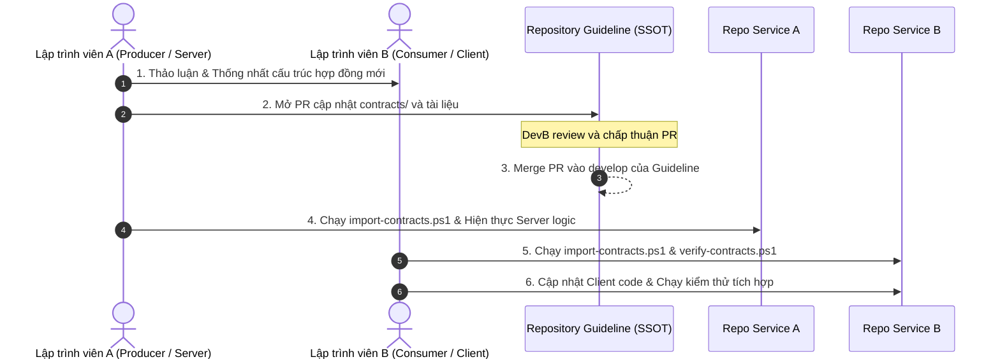

# 15. Phân phối & Quản trị Hợp đồng Giao tiếp Microservices (Contract Distribution Standards)

> **Môn học**: PRN232 — Final Assignment  
> **Dự án**: FPT Alumni Connect  
> **Mục tiêu**: Chuẩn hóa cơ chế phân phối, đồng bộ và kiểm soát tính toàn vẹn của các Hợp đồng Giao tiếp (gRPC Protobuf, Kafka Event Schemas & Envelopes) giữa các repository microservice độc lập mà không gây xung đột, gãy vỡ mã nguồn hay phụ thuộc hạ tầng phức tạp.

---

## 📑 Mục lục
1. [Bối cảnh Kiến trúc & Thách thức Multi-Repository](#1-bối-cảnh-kiến-trúc--thách-thức-multi-repository)
2. [Mô hình Snapshot Kèm Băm Mật mã (Cryptographic Snapshot Model)](#2-mô-hình-snapshot-kèm-băm-mật-mã-cryptographic-snapshot-model)
3. [Cấu trúc Bản kê Hợp đồng (`contracts.manifest.json`)](#3-cấu-trúc-bản-kê-hợp-đồng-contractsmanifestjson)
4. [Bộ công cụ Tự động hóa Phân phối & Xác minh](#4-bộ-công-cụ-tự-động-hóa-phân-phối--xác-minh)
   - [4.1 Script Phân phối Hợp đồng (`scripts/import-contracts.ps1`)](#41-script-phân-phối-hợp-đồng-scriptsimport-contractsps1)
   - [4.2 Script Xác minh Tính toàn vẹn Ngoại tuyến (`scripts/verify-contracts.ps1`)](#42-script-xác-minh-tính-toàn-vẹn-ngoại-tuyến-scriptsverify-contractsps1)
5. [Quy tắc Tiến hóa Hợp đồng & Phiên bản hóa (Contract Evolution & Versioning)](#5-quy-tắc-tiến-hóa-hợp-đồng--phiên-bản-hóa-contract-evolution--versioning)
   - [5.1 Quy tắc tiến hóa Sự kiện Kafka (Kafka Event Evolution)](#51-quy-tắc-tiến-hóa-sự-kiện-kafka-kafka-event-evolution)
   - [5.2 Quy tắc tiến hóa Hợp đồng gRPC Protobuf (gRPC Evolution)](#52-quy-tắc-tiến-hóa-hợp-đồng-grpc-protobuf-grpc-evolution)
6. [Quy trình Phối hợp Nhóm Từng bước (Step-by-Step Developer Coordination)](#6-quy-trình-phối-hợp-nhóm-từng-bước-step-by-step-developer-coordination)
7. [Phân Định Rõ Ràng 3 Cấp Độ Đường Dẫn (Path Scope Disambiguation)](#7-phân-định-rõ-ràng-3-cấp-độ-đường-dẫn-path-scope-disambiguation)
8. [Ví dụ Thực Tế: Cấu Hình Hợp Đồng Cho gRPC & Kafka](#8-ví-dụ-thực-tế-cấu-hình-hợp-đồng-cho-grpc--kafka)
   - [8.1 Cấu hình gRPC Client (Chat Service - BE1)](#81-cấu-hình-grpc-client-chat-service---be1)
   - [8.2 Cấu hình gRPC Server (User Service - BE1)](#82-cấu-hình-grpc-server-user-service---be1)
   - [8.3 Cấu hình Kafka Event Contract](#83-cấu-hình-kafka-event-contract-user-service-producer--notification-worker-consumer)
   - [8.4 Xác minh tính toàn vẹn hợp đồng](#84-xác-minh-tính-toàn-vẹn-hợp-đồng)
9. [Danh mục Kiểm tra Khi Nhận & Cập nhật Hợp đồng (Checklist)](#9-danh-mục-kiểm-tra-khi-nhận--cập-nhật-hợp-đồng-checklist)

---

## 1. Bối cảnh Kiến trúc & Thách thức Multi-Repository

Trong dự án **FPT Alumni Connect**, hệ sinh thái microservices được tổ chức theo mô hình **Multi-Repository** (mỗi service/ứng dụng là một repository Git hoàn toàn độc lập):

```mermaid
flowchart TD
    subgraph SSOT["Single Source of Truth (SSOT)"]
        GuidelineRepo["f-alumni-guideline\n(Chứa contracts/ chính thức & tài liệu kiến trúc)"]
    end

    subgraph ServiceRepos["Các Repository Độc lập (Independent Repositories)"]
        UserRepo["f-alumni-user-service\n(BE1: User Service - gRPC Server & Kafka Producer)"]
        ChatRepo["f-alumni-chat-service\n(BE1: Chat Service - gRPC Client)"]
        ForumRepo["f-alumni-forum-service\n(BE2: Forum Service - Kafka Producer)"]
        AiRepo["f-alumni-ai-service\n(BE2: AI Service - Kafka Consumer)"]
        AdminRepo["f-alumni-admin-service\n(BE3: Admin Service - REST Client)"]
        InfraRepo["f-alumni-infrastructure\n(BE3: YARP Gateway + Worker + Docker)"]
        WebRepo["f-alumni-web\n(React 18 Portal)"]
        MobileRepo["f-alumni-mobile\n(Flutter Mobile App)"]
    end

    GuidelineRepo -.->|import-contracts.ps1\n(grpc/user-profile/v1)| UserRepo
    GuidelineRepo -.->|import-contracts.ps1\n(grpc/user-profile/v1)| ChatRepo
    GuidelineRepo -.->|import-contracts.ps1\nevents/user-registered/v1| UserRepo
    GuidelineRepo -.->|import-contracts.ps1\nevents/user-registered/v1| InfraRepo
```

### 1.1 Thách thức khi dùng đường dẫn tương đối (Relative Paths)
Trong các dự án mẫu (demo projects) thuộc repository `fpt-alumni-guideline`, các file `.csproj` có thể tham chiếu trực tiếp hợp đồng theo đường dẫn tương đối như sau:
```xml
<!-- Chỉ hoạt động khi nằm trong cùng một mono-repo guideline -->
<Protobuf Include="..\..\..\..\contracts\grpc\user-profile\v1\user_profile.proto" GrpcServices="Client" />
```
Khi một thành viên clone `f-alumni-chat-service` về máy cá nhân tại một đường dẫn bất kỳ (ví dụ `D:\Projects\chat-service`), đường dẫn tương đối trên sẽ **hoàn toàn gãy vỡ** vì thư mục `..\..\..\..\contracts\` không tồn tại!

### 1.2 So sánh các giải pháp chia sẻ hợp đồng

| Giải pháp | Ưu điểm | Nhược điểm trong đồ án sinh viên | Đánh giá |
| :--- | :--- | :--- | :--- |
| **Private NuGet Feed** | Đóng gói dll chuẩn, quản lý phiên bản SemVer qua `nuget.org` / GitHub Packages. | Cần thiết lập feed bảo mật, cấu hình PAT/token đăng nhập máy cá nhân, độ trễ phát hành phiên bản, khó debug khi sinh viên gặp lỗi xác thực NuGet. | ❌ *Quá phức tạp đối với đồ án sinh viên* |
| **Git Submodules** | Đồng bộ trực tiếp mã nguồn hợp đồng qua Git. | Trạng thái "Detached HEAD", sinh viên thường xuyên quên `git submodule update --init --recursive`, dễ gây xung đột branch và merge conflict. | ❌ *Dễ gây lỗi thao tác Git cho người mới* |
| **Snapshot Model + SHA-256 Manifest** *(Được chọn)* | Mã hợp đồng được copy trực tiếp vào service repository, lưu trong Git, build offline 100%, có mã băm SHA-256 đối chiếu nguồn gốc rõ ràng. | Cần chạy lệnh copy khi có phiên bản hợp đồng mới từ guideline repo. |  **Được chuẩn hóa chính thức (Đơn giản, tin cậy, minh bạch)** |

---

## 2. Mô hình Snapshot Kèm Băm Mật mã (Cryptographic Snapshot Model)

Repository [`f-alumni-guideline`](file:///c:/Use/University/PRN232/ASM/guideline) đóng vai trò là **Nguồn Sự Thật Duy Nhất (Single Source of Truth - SSOT)** cho toàn bộ hợp đồng giao tiếp giữa các dịch vụ.

### Nguyên tắc vận hành:
1. **SSOT tại Guideline**: Mọi hợp đồng Protobuf (`.proto`), schema JSON (`.json`) và envelope POCO C# (`.cs`) đều được tạo, review và phê duyệt tại thư mục `contracts/` của guideline repository.
2. **Snapshot cục bộ**: Mỗi service độc lập lưu trữ một bản sao snapshot cục bộ tại thư mục `<service-root>/contracts/`.
3. **Mã băm SHA-256**: Mỗi file hợp đồng sau khi copy được tính toán chuỗi băm mật mã SHA-256 và ghi nhận vào `contracts.manifest.json`.
4. **Cam kết phiên bản Git (Provenance)**: Manifest ghi nhận chính xác Git Commit Hash của guideline repo tại thời điểm snapshot, giúp kiểm toán nguồn gốc bất kỳ lúc nào.
5. **Độc lập và Ngoại tuyến (Offline-First)**: Sau khi import, service có thể build, test, đóng gói Docker và triển khai ở bất kỳ đâu mà không cần mạng Internet hay truy cập vào guideline repository.

---

## 3. Cấu trúc Bản kê Hợp đồng (`contracts.manifest.json`)

Khi chạy công cụ `import-contracts.ps1`, file manifest chuẩn sẽ được tự động tạo tại `<service-root>/contracts/contracts.manifest.json`:

```json
{
  "manifestVersion": "1.0",
  "originRepository": "fpt-alumni-guideline",
  "guidelineCommit": "bd6eb11ce7547f3012d731fdd81fed6ec98d774d",
  "importedAt": "2026-10-25T00:21:36Z",
  "contracts": {
    "grpc/user-profile/v1": {
      "type": "gRPC",
      "version": "1.0",
      "description": "Hop dong gRPC Protobuf tra cuu ho so nguoi dung (Chat Service -> User Service)",
      "files": [
        {
          "relativePath": "grpc/user-profile/v1/user_profile.proto",
          "sha256": "5272200628F6067C6D5433CCF6F0D8D60BB0C633092B03E97827CA34606E57BF"
        },
        {
          "relativePath": "grpc/user-profile/v1/README.md",
          "sha256": "0DA644BF9CCE874BA272DFB687D1931AFFD3CAEB2BFA2632E8BCB385874730B8"
        }
      ]
    },
    "events/user-registered/v1": {
      "type": "KafkaEvent",
      "version": "1.0",
      "description": "Hop dong su kien mien Kafka user.registered.v1 (User Service -> Worker / Notification)",
      "files": [
        {
          "relativePath": "events/EventEnvelope.cs",
          "sha256": "D01AD55FFA76E41BEC630AA910D2366A4D5E67DCD7FEB802085CC63E3AE4D86F"
        },
        {
          "relativePath": "events/UserRegisteredEventV1.cs",
          "sha256": "7588A40C7E2A5798425D468F4EE1E4B4B2540F4C928AFF19C764ADB71CD8E316"
        },
        {
          "relativePath": "events/user.registered.v1.json",
          "sha256": "6AB8BAA92497F8B741179221B1E5C2F851175C8E70F4ED85E81E4E024CF1F1A1"
        },
        {
          "relativePath": "events/README.md",
          "sha256": "C7B472E1A181108F7D2FBB00B0FB9CFF9B853E299BB86E2B7B7B54DF07F902C9"
        }
      ]
    }
  }
}
```

### Ý nghĩa các trường:
- `manifestVersion`: Phiên bản định dạng của file manifest.
- `originRepository`: Tên repository gốc phát hành hợp đồng.
- `guidelineCommit`: Mã commit SHA-1 đầy đủ của repository guideline tại thời điểm hợp đồng được trích xuất.
- `importedAt`: Mốc thời gian UTC nhập khẩu theo chuẩn ISO 8601.
- `contracts`: Danh mục các hợp đồng đang được dịch vụ tiêu thụ. Mỗi hợp đồng chứa loại giao tiếp (`gRPC` hoặc `KafkaEvent`), phiên bản, mô tả và danh sách từng file kèm mã băm SHA-256.

---

## 4. Bộ công cụ Tự động hóa Phân phối & Xác minh

Guideline cung cấp sẵn 2 kịch bản PowerShell tiêu chuẩn nằm tại thư mục [`scripts/`](file:///c:/Use/University/PRN232/ASM/guideline/scripts/):

```
scripts/
├── import-contracts.ps1   # Công cụ phân phối/nhập khẩu hợp đồng từ guideline sang service
└── verify-contracts.ps1   # Công cụ kiểm toán tính toàn vẹn độc lập (tự chứa)
```

### 4.1 Script Phân phối Hợp đồng (`scripts/import-contracts.ps1`)

Được chạy từ máy của lập trình viên khi khởi tạo service mới hoặc khi cần cập nhật hợp đồng mới nhất từ guideline.

#### Cú pháp lệnh:
```powershell
.\scripts\import-contracts.ps1 `
    -SourceGuidelinePath <duong-dan-guideline> `
    -TargetDirectory <duong-dan-repo-service> `
    -ContractId <danh-sach-hop-dong> `
    [-Force] `
    [-AllowDirty]
```

#### Bảng tham số:
| Tham số | Bắt buộc | Mặc định | Ý nghĩa |
| :--- | :---: | :---: | :--- |
| `-SourceGuidelinePath` | Không | Thư mục cha của script | Đường dẫn tới thư mục gốc của repository `f-alumni-guideline`. |
| `-TargetDirectory` | **Có** | - | Đường dẫn tới thư mục gốc của repository microservice nhận hợp đồng. |
| `-ContractId` | Không | `all` | Mã hợp đồng cần nhập khẩu (`grpc/user-profile/v1`, `events/user-registered/v1`, hoặc `all`). Có hỗ trợ alias rút gọn: `grpc`, `kafka`, `event`. |
| `-Force` | Không | `$false` | Ghi đè bắt buộc ngay cả khi file đích đã bị chỉnh sửa cục bộ (bỏ qua cảnh báo guardrail). |
| `-AllowDirty` | Không | `$false` | Cho phép nhập khẩu khi thư mục `contracts/` tại guideline repo đang có thay đổi chưa commit (dùng khi thử nghiệm). |

#### Các tính năng an toàn tích hợp:
- **Kiểm tra trạng thái Git (Git Provenance)**: Tự động trích xuất commit SHA của guideline repo để gắn vào manifest.
- **Rào chắn bảo vệ sửa đổi cục bộ (Local Tampering Guardrail)**: Nếu phát hiện file hợp đồng tại repo dịch vụ đã bị ai đó sửa đổi cục bộ khác với hash trong manifest, script sẽ **lập tức dừng lại và báo lỗi**, ngăn chặn việc ghi đè vô ý làm mất mã nguồn. Để ghi đè có chủ đích, lập trình viên phải truyền cờ `-Force`.
- **Tự động sao chép bộ công cụ xác minh**: Tự động sao chép `verify-contracts.ps1` sang thư mục `scripts/` của repo dịch vụ để phục vụ việc kiểm tra độc lập và tích hợp CI/CD.

---

### 4.2 Script Xác minh Tính toàn vẹn Ngoại tuyến (`scripts/verify-contracts.ps1`)

Kịch bản hoàn toàn tự chứa, **không phụ thuộc** vào guideline repo hay mạng Internet. Nó đọc file `contracts.manifest.json` trong chính repo dịch vụ và kiểm tra xem từng file có đúng nguyên bản hay không.

#### Cú pháp lệnh:
```powershell
# Chạy trực tiếp từ thư mục gốc của microservice
.\scripts\verify-contracts.ps1

# Hoặc truyền đường dẫn chỉ định
.\scripts\verify-contracts.ps1 -Path "C:\path\to\service"
```

#### Cơ chế hoạt động:
1. Đọc danh sách file và mã SHA-256 kỳ vọng từ `contracts.manifest.json`.
2. Kiểm tra sự tồn tại của từng file trên ổ đĩa. Nếu thiếu, ghi nhận trạng thái `[MISSING]`.
3. Tính toán mã băm SHA-256 thực tế của file và so khớp với mã ghi trong manifest:
   - Nếu khớp 100%: Ghi nhận `[PASS]`.
   - Nếu khác biệt: Ghi nhận `[MODIFIED]`, in ra Expected SHA-256 vs Actual SHA-256.
4. Trả về mã thoát (Exit Code):
   - Exit Code `0`: Tất cả hợp đồng toàn vẹn 100%.
   - Exit Code `1`: Có ít nhất một file bị thiếu hoặc bị sửa đổi trái phép.

---

## 5. Quy tắc Tiến hóa Hợp đồng & Phiên bản hóa (Contract Evolution & Versioning)

Trong kiến trúc Microservices, **hợp đồng giao tiếp là ranh giới bất biến (Immutable Boundary)** giữa các nhóm phát triển. Mọi thay đổi đơn phương không qua thỏa thuận đều dẫn đến lỗi hệ thống tại môi trường tích hợp.

### 5.1 Quy tắc tiến hóa Sự kiện Kafka (Kafka Event Evolution)

Các sự kiện Kafka được xuất bản ra topic chung và có thể được tiêu thụ bởi nhiều service độc lập (Notification Worker, Forum Service, AI Service).

```mermaid
flowchart LR
    Producer["User Service\n(Producer)"]
    TopicV1[("Topic: falumni.users.v1.registered")]
    TopicV2[("Topic: falumni.users.v2.registered")]
    ConsumerV1["Notification Worker\n(Consumes v1)"]
    ConsumerV2["New Analytics Service\n(Consumes v2)"]

    Producer -->|Publish v1| TopicV1
    Producer -.->|Dual-Publish v2\n(Giai đoạn chuyển giao)| TopicV2
    TopicV1 --> ConsumerV1
    TopicV2 --> ConsumerV2
```

#### Quy tắc tương thích ngược (Backward Compatibility Rules):
1. **Chỉ thêm trường mới tùy chọn (Additive Changes Only)**:
   - Các trường mới thêm vào payload `data` phải có giá trị mặc định hoặc là kiểu nullable (`string?`, `int?`).
   - Consumer đang chạy ở phiên bản cũ khi nhận JSON có trường mới sẽ tự động bỏ qua mà không bị lỗi (nhờ cấu hình `JsonSerializerOptions`).
2. **Tuyệt đối KHÔNG xóa hoặc đổi tên trường trong cùng một phiên bản**:
   - Nếu cần bỏ trường `otpCode` thay bằng `verificationToken`, không được đổi trực tiếp trên `user.registered.v1`.
3. **Đánh dấu lỗi thời (Deprecation)**:
   - Sử dụng thuộc tính `[Obsolete("Use VerificationToken instead")]` trên class C# DTO.
   - Giữ lại trường cũ ít nhất một chu kỳ phát hành (Sprint).
4. **Tạo phiên bản mới khi có Breaking Change**:
   - Khi cấu trúc thay đổi căn bản, tạo topic và hợp đồng mới: `user.registered.v2`.
   - Producer kích hoạt cơ chế **Dual-Publishing**: Gửi sự kiện đồng thời lên cả topic `v1` và `v2` trong giai đoạn chuyển đổi cho đến khi 100% consumer đã nâng cấp.

---

### 5.2 Quy tắc tiến hóa Hợp đồng gRPC Protobuf (gRPC Evolution)

Hợp đồng gRPC được định nghĩa bằng ngôn ngữ Protocol Buffers (`.proto`) tại [`contracts/grpc/user-profile/v1/user_profile.proto`](file:///c:/Use/University/PRN232/ASM/guideline/contracts/grpc/user-profile/v1/user_profile.proto).

#### Các quy tắc vàng:
1. **Số thứ tự trường (Field Tag Number) là BẤT BIẾN**:
   - Trong Protobuf, dữ liệu nhị phân HTTP/2 được mã hóa dựa trên **Field Tag Number** chứ không phải tên trường.
   - Ví dụ: Trong message dưới đây, tag `1`, `2`, `3` tuyệt đối không bao giờ được phép thay đổi:
     ```protobuf
     message UserProfileResponse {
       string user_id = 1;
       string email = 2;
       string full_name = 3;
       // Trường mới THÊM VÀO PHẢI CÓ TAG TIẾP THEO:
       string avatar_url = 4;
       string graduation_year = 5;
     }
     ```
2. **Khai báo `reserved` khi xóa trường**:
   - Nếu một trường không còn sử dụng, **không được tái sử dụng số tag** đó cho trường mới, vì client cũ gửi tag cũ lên sẽ bị gán nhầm dữ liệu sang trường mới!
   - Khai báo rõ ràng:
     ```protobuf
     message UserProfileResponse {
       reserved 4;
       reserved "deprecated_phone";
       string user_id = 1;
       string email = 2;
     }
     ```
3. **Package Namespace theo phiên bản**:
   - Luôn sử dụng package có hậu tố phiên bản rõ ràng: `package fpt.alumni.user.v1;`.
   - Khi có thay đổi phá vỡ tương thích, tạo thư mục và package mới: `contracts/grpc/user-profile/v2/` với `package fpt.alumni.user.v2;`.

---

## 6. Quy trình Phối hợp Nhóm Từng bước (Step-by-Step Developer Coordination)

Khi một thành viên cần thay đổi hoặc bổ sung hợp đồng giao tiếp giữa các service, toàn đội phải tuân thủ quy trình 6 bước chuẩn mực:



### Các bước cụ thể:
1. **Thảo luận & Thống nhất (Alignment)**: Dev phụ trách Service phát hành/máy chủ (ví dụ: BE1 - User Service cho sự kiện `user.registered.v1`) thảo luận với Dev phụ trách Service tiêu thụ (ví dụ: BE3 - Notification Background Worker, hoặc BE2 - Forum Service) về các trường dữ liệu cần bổ sung.
2. **Tạo PR tại Guideline (SSOT PR)**: Dev A tạo nhánh trên `f-alumni-guideline`, cập nhật file `.proto` hoặc schema `.json` tại thư mục `contracts/`.
3. **Review chéo (Peer Review)**: Dev B (người tiêu thụ hợp đồng) trực tiếp review PR trên guideline để đảm bảo phía client có thể tiếp nhận dễ dàng. Sau khi duyệt, PR được merge vào nhánh `develop` của guideline.
4. **Nhập khẩu tại Server / Producer**: Dev A chạy `.\scripts\import-contracts.ps1` vào repo Service Server, triển khai logic nghiệp vụ và commit cả hợp đồng lẫn `contracts.manifest.json`.
5. **Nhập khẩu tại Client / Consumer**: Dev B kéo code guideline mới nhất, chạy `.\scripts\import-contracts.ps1` vào repo Service Client.
6. **Xác minh & Tích hợp**: Dev B chạy `.\scripts\verify-contracts.ps1` để bảo đảm SHA-256 khớp 100%, sau đó viết code client gọi endpoint mới và kiểm thử tích hợp.

---

## 7. Phân Định Rõ Ràng 3 Cấp Độ Đường Dẫn (Path Scope Disambiguation)

Một lỗi rất phổ biến của lập trình viên mới là nhầm lẫn giữa đường dẫn gốc repository, đường dẫn tương đối trong file `.csproj`, và đường dẫn khi gõ lệnh trong PowerShell. Bảng quy chuẩn dưới đây làm rõ 3 phạm vi đường dẫn:

| Phạm vi đường dẫn | Điểm bắt đầu (Base Path) | Ví dụ minh họa | Ngữ cảnh sử dụng |
| :--- | :--- | :--- | :--- |
| **1. Repository-Root Path** | Thư mục gốc của repository (`<service-root>/`) | `contracts/grpc/user-profile/v1/user_profile.proto`<br>`contracts/events/user.registered.v1.json`<br>`contracts/contracts.manifest.json` | - Dùng trong tài liệu kỹ thuật.<br>- Dùng trong cấu hình Dockerfile.<br>- Ghi nhận trong file manifest. |
| **2. Project-Relative Path** | Thư mục chứa file dự án C# (`<service-root>/src/<ProjectName>/`) | `..\..\contracts\grpc\user-profile\v1\user_profile.proto`<br>`..\..\contracts\events\EventEnvelope.cs` | - Khai báo trong thẻ `<Protobuf>` của `.csproj`.<br>- Khai báo trong thẻ `<Compile>` hoặc `<Content>` của `.csproj`. |
| **3. PowerShell Execution Path** | Thư mục hiện hành của cửa sổ Terminal (Current Working Dir) | `.\scripts\verify-contracts.ps1`<br>`..\f-alumni-guideline\scripts\import-contracts.ps1` | - Gõ lệnh trong Terminal/Console từ thư mục gốc service hoặc từ thư mục guideline. |

---

## 8. Ví dụ Thực Tế: Cấu Hình Hợp Đồng Cho gRPC & Kafka

### 8.1 Cấu hình gRPC Client (Chat Service - BE1)
Sau khi nhập khẩu `grpc/user-profile/v1` vào `f-alumni-chat-service`, mở file `src/FAlumni.Chat.Services/FAlumni.Chat.Services.csproj`:
```xml
<Project Sdk="Microsoft.NET.Sdk">
  <PropertyGroup>
    <TargetFramework>net10.0</TargetFramework>
    <ImplicitUsings>enable</ImplicitUsings>
    <Nullable>enable</Nullable>
  </PropertyGroup>

  <!-- Gói NuGet cho gRPC Client -->
  <ItemGroup>
    <PackageReference Include="Google.Protobuf" Version="3.30.0" />
    <PackageReference Include="Grpc.Net.Client" Version="2.70.0" />
    <PackageReference Include="Grpc.Tools" Version="2.70.0">
      <PrivateAssets>all</PrivateAssets>
      <IncludeAssets>runtime; build; native; contentfiles; analyzers; buildtransitive</IncludeAssets>
    </PackageReference>
  </ItemGroup>

  <!-- Tham chiếu Protobuf dạng Client (Project-relative: lùi 2 cấp thư mục ra contracts/) -->
  <ItemGroup>
    <Protobuf Include="..\..\contracts\grpc\user-profile\v1\user_profile.proto" GrpcServices="Client">
      <Link>Protos\user_profile.proto</Link>
    </Protobuf>
  </ItemGroup>
</Project>
```

### 8.2 Cấu hình gRPC Server (User Service - BE1)
Sau khi nhập khẩu `grpc/user-profile/v1` vào `f-alumni-user-service`, mở file `src/FAlumni.User.Api/FAlumni.User.Api.csproj`:
```xml
<Project Sdk="Microsoft.NET.Sdk.Web">
  <PropertyGroup>
    <TargetFramework>net10.0</TargetFramework>
    <ImplicitUsings>enable</ImplicitUsings>
    <Nullable>enable</Nullable>
  </PropertyGroup>

  <!-- Gói NuGet cho gRPC Server trên Kestrel -->
  <ItemGroup>
    <PackageReference Include="Grpc.AspNetCore" Version="2.70.0" />
  </ItemGroup>

  <!-- Tham chiếu Protobuf dạng Server (Project-relative: lùi 2 cấp thư mục ra contracts/) -->
  <ItemGroup>
    <Protobuf Include="..\..\contracts\grpc\user-profile\v1\user_profile.proto" GrpcServices="Server">
      <Link>Protos\user_profile.proto</Link>
    </Protobuf>
  </ItemGroup>
</Project>
```

### 8.3 Cấu hình Kafka Event Contract (User Service Producer & Notification Worker Consumer)
Sau khi nhập khẩu `events/user-registered/v1` vào service, các file snapshot sẽ nằm tại `<service-root>/contracts/events/`:
- `contracts/events/EventEnvelope.cs`
- `contracts/events/UserRegisteredEventV1.cs`
- `contracts/events/user.registered.v1.json`

Trong file `.csproj` của tầng nghiệp vụ (`src/FAlumni.User.Services/` hoặc `src/FAlumni.NotificationWorker/`):
```xml
  <!-- Liên kết các class Envelope và Payload từ thư mục contracts nội bộ -->
  <ItemGroup>
    <Compile Include="..\..\contracts\events\EventEnvelope.cs" Link="Contracts\EventEnvelope.cs" />
    <Compile Include="..\..\contracts\events\UserRegisteredEventV1.cs" Link="Contracts\UserRegisteredEventV1.cs" />
  </ItemGroup>
```

### 8.4 Xác minh tính toàn vẹn hợp đồng
Trước khi commit code hoặc đẩy lên CI/CD:
```powershell
# Chạy từ thư mục gốc của repository
.\scripts\verify-contracts.ps1
```
Kết quả hiển thị mong đợi:
```text
=================================================================
     FPT Alumni Connect -- Contract Integrity Verification      
=================================================================
Contracts Root: C:\Projects\f-alumni-chat-service\contracts
Manifest File : C:\Projects\f-alumni-chat-service\contracts\contracts.manifest.json

Guideline Origin Commit : bc0f53c8eb3502abaed25b4f42a188cfaabc8b17
Imported Timestamp      : 2026-10-25T00:21:36Z
Origin Repository       : fpt-alumni-guideline
-----------------------------------------------------------------

[CONTRACT] grpc/user-profile/v1 (Loai: gRPC | Phien ban: 1.0)
  Mo ta: Hop dong gRPC Protobuf tra cuu ho so nguoi dung (Chat Service -> User Service)
  [PASS] grpc/user-profile/v1/user_profile.proto
         SHA-256: 5272200628F6067C6D5433CCF6F0D8D60BB0C633092B03E97827CA34606E57BF (Khop 100%)
  [PASS] grpc/user-profile/v1/README.md
         SHA-256: 0DA644BF9CCE874BA272DFB687D1931AFFD3CAEB2BFA2632E8BCB385874730B8 (Khop 100%)

=================================================================
                     TONG KET XAC MINH HOP DONG                 
=================================================================
  Tong so tep kiem tra: 2
  Chinh xac  (PASS)   : 2
  Bi sua doi (MODIFIED: 0
  Bi thieu   (MISSING): 0
-----------------------------------------------------------------
>>> KET QUA: TAT CA HOP DONG HOAN TOAN NGUYEN BAN & DAT CHUAN (PASS) <<<
```

---

## 9. Danh mục Kiểm tra Khi Nhận & Cập nhật Hợp đồng (Checklist)

Mỗi lập trình viên cần hoàn thành danh sách kiểm tra sau trước khi mở Pull Request trên repository dịch vụ của mình:

- [ ] **Nguồn gốc chính thức**: Hợp đồng được import từ phiên bản đã merge vào nhánh `develop` của `f-alumni-guideline`.
- [ ] **Có đầy đủ file manifest**: File `contracts/contracts.manifest.json` có mặt và ghi nhận đúng commit SHA gốc.
- [ ] **Không tham chiếu cross-repository**: File `.csproj` chỉ tham chiếu file hợp đồng nằm bên trong cây thư mục của chính service (không có đường dẫn `..\..\..\..\contracts` trỏ ra ngoài).
- [ ] **Không tự ý sửa hợp đồng cục bộ**: Không sửa trực tiếp file `.proto` hay schema `.json` tại repo của service.
- [ ] **Chạy kiểm tra tính toàn vẹn**: Lệnh `.\scripts\verify-contracts.ps1` trả về kết quả `[PASS]` 100% không có file nào bị `[MODIFIED]` hay `[MISSING]`.
- [ ] **Kiểm thử độc lập**: Chạy `dotnet test` vượt qua 100% các bài kiểm thử tự động sử dụng hợp đồng mới.
