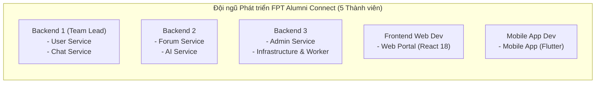

# 16. Báo Cáo Bàn Giao & Đóng Pha Hướng Dẫn Kỹ Thuật (Guideline Phase Handover & Readiness)

> **Môn học**: PRN232 — Final Assignment  
> **Dự án**: FPT Alumni Connect  
> **Mục tiêu**: Xác nhận hoàn thành 100% Pha Thiết kế Hướng dẫn Kiến trúc (Guideline Phase), cung cấp tài liệu bàn giao tinh gọn, chuẩn mực công nghệ, phân công trách nhiệm đội ngũ và tiêu chuẩn sẵn sàng (Definition of Ready) để 5 thành viên chính thức bước vào Pha Triển khai Dịch vụ Thực tế (Service Implementation Phase).

---

## 📑 Mục lục
1. [Trạng Thái Hoàn Thành Pha Guideline](#1-trạng-thái-hoàn-thành-pha-guideline)
2. [Kiến Trúc & Công Nghệ Được Phê Duyệt](#2-kiến-trúc--công-nghệ-được-phê-duyệt)
3. [Phân Công Trách Nhiệm Đội Ngũ (5 Thành Viên)](#3-phân-công-trách-nhiệm-đội-ngũ-5-thành-viên)
4. [Bản Đồ Phân Định Repository](#4-bản-đồ-phân-định-repository)
5. [Điều Kiện Tiên Quyết Cho Lập Trình Viên Backend](#5-điều-kiện-tiên-quyết-cho-lập-trình-viên-backend)
6. [Hướng Dẫn Khởi Tạo Microservice Mới](#6-hướng-dẫn-khởi-tạo-microservice-mới)
7. [Hướng Dẫn Nhập Khẩu & Xác Minh Hợp Đồng](#7-hướng-dẫn-nhập-khẩu--xác-minh-hợp-đồng)
8. [Hướng Dẫn Chạy Kiểm Thử Độc Lập](#8-hướng-dẫn-chạy-kiểm-thử-độc-lập)
9. [Hướng Dẫn Kiểm Thử Tích Hợp Docker](#9-hướng-dẫn-kiểm-thử-tích-hợp-docker)
10. [Ranh Giới & Các Hạn Chế Cần Lưu Ý](#10-ranh-giới--các-hạn-chế-cần-lưu-ý)
11. [Trách Nhiệm Thuộc Pha Triển Khai Kế Tiếp](#11-trách-nhiệm-thuộc-pha-triển-khai-kế-tiếp)
12. [Tiêu Chuẩn Definition of Ready (DoR) Từng Repository](#12-tiêu-chuẩn-definition-of-ready-dor-từng-repository)

---

## 1. Trạng Thái Hoàn Thành Pha Guideline

Pha chuẩn bị kỹ thuật và kiến trúc (`Guideline Phase`) đã hoàn thành toàn diện:
-  **Bộ quy chuẩn kiến trúc**: Đầy đủ 15 tài liệu kỹ thuật từ kiến trúc 3 tầng, bảo mật JWT, REST RFC 7807, gRPC, Kafka, Background Worker, YARP Gateway đến quy chuẩn Git và phân phối hợp đồng.
-  **Mã nguồn mẫu chuẩn**: Template dịch vụ .NET 10 hoàn chỉnh kèm GET/POST/PUT/DELETE, xử lý ngoại lệ tập trung, EF Core Migrations và kiểm thử InMemory/SQL Server.
-  **Dự án chứng minh khả thi (PoC Demos)**: Kafka Demo, gRPC Demo, Notification Background Worker Demo, YARP Gateway Demo, Docker Compose Demo.
-  **Bộ công cụ tự động hóa**: Khởi tạo dịch vụ (`bootstrap-service.ps1`), nhập hợp đồng (`import-contracts.ps1`), kiểm toán ngoại tuyến (`verify-contracts.ps1`), kiểm tra toàn diện (`verify-all.ps1`), và smoke test tích hợp (`smoke-test.ps1`).
-  **Kết quả kiểm toán chất lượng**: Toàn bộ **70/70 kiểm thử tự động đạt 100% PASS**, không có cảnh báo bảo mật NuGet (NU1902/NU1903 resolved), không chứa khóa bí mật trong mã nguồn.

---

## 2. Kiến Trúc & Công Nghệ Được Phê Duyệt

Hệ thống **FPT Alumni Connect** tuân thủ các quyết định kiến trúc đã được hội đồng chuyên môn thông qua:

| Thành phần | Công nghệ đã duyệt | Quy chuẩn kỹ thuật áp dụng |
| :--- | :--- | :--- |
| **Nền tảng Backend** | .NET 10 / ASP.NET Core | Layered Architecture: `Api` $\rightarrow$ `Services` $\rightarrow$ `Repositories` (Xem [Tài liệu 04](file:///c:/Use/University/PRN232/ASM/guideline/docs/04-dotnet-standards.md)). |
| **Cơ sở dữ liệu** | SQL Server + EF Core 10 | 1 Database riêng biệt cho mỗi service (`FptAlumni_*_Db`) trên 1 SQL Server instance chung. Tuyệt đối không foreign key hay truy vấn cross-database (Xem [Tài liệu 05](file:///c:/Use/University/PRN232/ASM/guideline/docs/05-database.md)). |
| **Giao diện Client** | React 18 (Web) / Flutter 3 (Mobile) | Kết nối qua duy nhất một cổng API Gateway tại `http://localhost:5000`. |
| **Cổng API Gateway** | Microsoft YARP Reverse Proxy | Cổng 5000, chuyển tiếp route `/api/v1/<service>/*`, xử lý CORS tập trung (Xem [Tài liệu 11](file:///c:/Use/University/PRN232/ASM/guideline/docs/11-api-gateway.md)). |
| **Xác thực & Phân quyền**| JWT Bearer Token | User Service là cơ quan cấp token duy nhất; Claims: `sub`, `email`, `role` (`USER`, `ADMIN`); cấu hình ký đối xứng runtime qua biến môi trường (Xem [Tài liệu 07](file:///c:/Use/University/PRN232/ASM/guideline/docs/07-authentication.md)). |
| **Giao tiếp Đồng bộ** | gRPC (HTTP/2 Binary) | Chat Service $\rightarrow$ User Service tra cứu hồ sơ người dùng theo protobuf v1 tại port nội bộ 50051 (Xem [Tài liệu 09](file:///c:/Use/University/PRN232/ASM/guideline/docs/09-grpc.md)). |
| **Giao tiếp Bất đồng bộ**| Apache Kafka Broker | Các sự kiện miền (`user.registered.v1`, v.v.) bọc trong `EventEnvelope<T>` với Partition Key là `userId` (Xem [Tài liệu 08](file:///c:/Use/University/PRN232/ASM/guideline/docs/08-kafka.md)). |
| **Tác vụ Nền** | .NET BackgroundService | Notification Worker tiêu thụ Kafka để gửi email/OTP giả lập (Xem [Tài liệu 10](file:///c:/Use/University/PRN232/ASM/guideline/docs/10-background-worker.md)). |
| **Giao tiếp Real-time** | SignalR (WebSockets) | ChatHub (tin nhắn 1-1, nhóm) và ForumHub (thông báo tương tác). |

---

## 3. Phân Công Trách Nhiệm Đội Ngũ (5 Thành Viên)

Phân công quyền sở hữu chính thức đã được thống nhất:



| Thành viên | Vai trò | Dịch vụ sở hữu chính (Primary Ownership) | Trách nhiệm chi tiết | Người duyệt chéo (Reviewer) |
| :--- | :--- | :--- | :--- | :--- |
| **Backend 1** | **Backend Lead** | - **`f-alumni-user-service`**<br>- **`f-alumni-chat-service`**<br>- **`f-alumni-guideline`** | - Quản trị guideline & hợp đồng chung.<br>- Xây dựng Auth JWT, User Directory, Profile gRPC Server.<br>- Xây dựng Chat 1-1, Group Chat, SignalR ChatHub & Profile gRPC Client. | **BE2, BE3** |
| **Backend 2** | **Backend Dev** | - **`f-alumni-forum-service`**<br>- **`f-alumni-ai-service`** | - Xây dựng diễn đàn, bài viết, bình luận phân cấp, SignalR ForumHub.<br>- Xây dựng AI FAQ Assistant, gợi ý kết nối mạng lưới cựu sinh viên, Kafka Consumer. | **BE1, Web** |
| **Backend 3** | **Backend Dev** | - **`f-alumni-admin-service`**<br>- **`f-alumni-infrastructure`** | - Xây dựng Admin Dashboard, duyệt bài viết, khóa tài khoản qua API, Audit Log.<br>- Phụ trách YARP Gateway, Docker Compose, Notification Background Worker & Kafka Broker setup. | **BE1, Mobile** |
| **Frontend Web** | **Web Dev** | - **`f-alumni-web`** | - Phát triển giao diện Web Portal (React 18 + Vite + Tailwind + shadcn/ui).<br>- Tích hợp REST API qua Gateway và WebSockets SignalR. | **BE1, BE2** |
| **Mobile App** | **Flutter Dev** | - **`f-alumni-mobile`** | - Phát triển ứng dụng di động Flutter đa nền tảng (Android/iOS).<br>- Tối ưu danh bạ cựu sinh viên, giao diện chat SignalR và nhận thông báo đẩy. | **BE1, BE3** |

---

## 4. Bản Đồ Phân Định Repository

Toàn bộ hệ thống được chia thành 9 repository độc lập trong tổ chức GitHub `F-Alumni`:

```
F-Alumni GitHub Organization/
├── f-alumni-guideline          [BE1 Lead] (Tài liệu kiến trúc, SSOT Hợp đồng, Scripts)
├── f-alumni-infrastructure     [BE3]      (API Gateway YARP, Docker Compose, Notification Worker)
├── f-alumni-user-service       [BE1]      (User Service API, Auth, gRPC Server, Kafka Producer)
├── f-alumni-chat-service       [BE1]      (Chat Service API, SignalR Hub, gRPC Client)
├── f-alumni-forum-service      [BE2]      (Forum Service API, SignalR Hub, Kafka Producer)
├── f-alumni-ai-service         [BE2]      (AI Service API, FAQ Chatbot, Kafka Consumer)
├── f-alumni-admin-service      [BE3]      (Admin Service API, Dashboard, Moderation)
├── f-alumni-web                [FE]       (React 18 Web Portal)
└── f-alumni-mobile             [Mobile]   (Flutter Mobile Application)
```

---

## 5. Điều Kiện Tiên Quyết Cho Lập Trình Viên Backend

Trước khi bắt đầu clone và lập trình bất kỳ service nào, máy tính của bạn bắt buộc phải cài đặt:
1. **.NET 10 SDK**: Kiểm tra bằng lệnh `dotnet --version` (phiên bản `10.0.x`).
2. **Git CLI**: Kiểm tra bằng lệnh `git --version`.
3. **PowerShell**: Windows PowerShell 5.1 hoặc PowerShell Core 7+.
4. **Docker Desktop** (hoặc Docker Engine): Đang chạy với Linux containers.
5. **SQL Server Management Studio (SSMS)** hoặc **Azure Data Studio / DBeaver**: Dùng để kết nối và kiểm tra database `localhost,14333`.

---

## 6. Hướng Dẫn Khởi Tạo Microservice Mới

Mỗi lập trình viên backend khi nhận dịch vụ của mình sẽ sử dụng công cụ bootstrap có sẵn trong repository guideline:

```powershell
# Di chuyển tới thư mục làm việc chung của bạn
cd C:\Projects\PRN232

# Chạy script bootstrap để sinh khung service chuẩn 3 tầng
.\f-alumni-guideline\scripts\bootstrap-service.ps1 `
    -ServiceName "ForumService" `
    -TargetDirectory ".\f-alumni-forum-service"
```

### Kết quả sinh ra:
- Khung dự án 4 layer: `ForumService.Api`, `ForumService.Services`, `ForumService.Repositories`, `ForumService.Tests`.
- Cấu hình EF Core DbContext, Dependency Injection, Middleware ProblemDetails và bộ unit test mẫu đã sẵn sàng biên dịch `0 errors`.

---

## 7. Hướng Dẫn Nhập Khẩu & Xác Minh Hợp Đồng

### Bước 1: Nhập khẩu hợp đồng từ Guideline
Từ thư mục gốc của repository microservice mới tạo:

```powershell
# 1. Nếu là Chat Service (gọi gRPC sang User Service):
..\f-alumni-guideline\scripts\import-contracts.ps1 `
    -SourceGuidelinePath "..\f-alumni-guideline" `
    -TargetDirectory "." `
    -ContractId "grpc/user-profile/v1"

# 2. Nếu là User Service hoặc Notification Worker (phát/nhận sự kiện Kafka):
..\f-alumni-guideline\scripts\import-contracts.ps1 `
    -SourceGuidelinePath "..\f-alumni-guideline" `
    -TargetDirectory "." `
    -ContractId "events/user-registered/v1"
```

### Bước 2: Cấu hình Project-Relative Path trong file `.csproj`
Trong file `.csproj` của dự án, tham chiếu bằng đường dẫn tương đối (Project-relative):

```xml
<!-- Dành cho gRPC Client trong Chat Service: src/FAlumni.Chat.Services/FAlumni.Chat.Services.csproj -->
<ItemGroup>
  <Protobuf Include="..\..\contracts\grpc\user-profile\v1\user_profile.proto" GrpcServices="Client">
    <Link>Protos\user_profile.proto</Link>
  </Protobuf>
</ItemGroup>

<!-- Dành cho gRPC Server trong User Service: src/FAlumni.User.Api/FAlumni.User.Api.csproj -->
<ItemGroup>
  <Protobuf Include="..\..\contracts\grpc\user-profile\v1\user_profile.proto" GrpcServices="Server">
    <Link>Protos\user_profile.proto</Link>
  </Protobuf>
</ItemGroup>

<!-- Dành cho Kafka Event trong Notification Worker: src/FAlumni.Worker/FAlumni.Worker.csproj -->
<ItemGroup>
  <Compile Include="..\..\contracts\events\EventEnvelope.cs" Link="Contracts\EventEnvelope.cs" />
  <Compile Include="..\..\contracts\events\UserRegisteredEventV1.cs" Link="Contracts\UserRegisteredEventV1.cs" />
</ItemGroup>
```

### Bước 3: Xác minh tính toàn vẹn hợp đồng ngoại tuyến
```powershell
# Chạy từ thư mục gốc của service
.\scripts\verify-contracts.ps1
```
*Kết quả phải đạt 100% `[PASS]`, không có file nào bị `[MODIFIED]` hay `[MISSING]`.*

---

## 8. Hướng Dẫn Chạy Kiểm Thử Độc Lập

Mỗi microservice có bộ kiểm thử tự chứa hoàn toàn (xUnit + InMemory/Mock):

```powershell
# Chạy kiểm thử tự động của service
dotnet test --configuration Release
```

Đối với repository guideline:
```powershell
# Chạy kiểm tra toàn diện 5 solution và kiểm tra tĩnh
.\scripts\verify-all.ps1
```

---

## 9. Hướng Dẫn Kiểm Thử Tích Hợp Docker

Thành viên BE3 (Infrastructure) hoặc bất kỳ ai muốn diễn tập tích hợp hệ sinh thái mẫu cục bộ:

```powershell
# 1. Di chuyển vào thư mục hạ tầng
cd C:\Projects\PRN232\f-alumni-guideline

# 2. Tạo file cấu hình môi trường
Copy-Item docker\.env.example docker\.env

# 3. Khởi chạy toàn bộ hệ thống demo
docker compose --env-file docker\.env -f docker\compose.demo.yml up --build -d

# 4. Chạy kịch bản kiểm thử khói (Smoke Test)
.\scripts\smoke-test.ps1

# 5. Dọn dẹp sau khi kiểm thử xong
docker compose -f docker\compose.demo.yml down
```

---

## 10. Ranh Giới & Các Hạn Chế Cần Lưu Ý

Những nội dung sau **thuộc phạm vi guideline** và **không được xem là lỗi thiếu hụt**:
1. **Mock Email Sender**: Trong `examples/demo-worker/`, email sender được triển khai dạng an toàn (ghi log `[REDACTED]`). Việc cấu hình SMTP thật (SendGrid, MailKit, Gmail API) thuộc về repository `f-alumni-infrastructure`.
2. **Khóa bí mật JWT**: Khóa signing key mẫu không được lưu trong mã nguồn. Mỗi lập trình viên tự sinh khóa 256-bit an toàn bằng PowerShell và lưu vào User Secrets hoặc biến môi trường cục bộ (Xem [Tài liệu 07](file:///c:/Use/University/PRN232/ASM/guideline/docs/07-authentication.md)).
3. **Database Migrations Mẫu**: Guideline cung cấp migration mẫu `InitialCreate` cho bảng `SampleItems`. Các bảng nghiệp vụ thật (`Users`, `Posts`, `Comments`, `Chats`) sẽ do từng thành viên tạo trong repository dịch vụ tương ứng.
4. **Đường dẫn Dockerfile**: Dockerfile trong guideline demo phục vụ việc chạy mẫu tổng hợp. Từng repository thực tế sẽ có Dockerfile độc lập của riêng mình.

---

## 11. Trách Nhiệm Thuộc Pha Triển Khai Kế Tiếp

Khi bước vào **Service Implementation Phase**, từng thành viên chịu trách nhiệm:
1. **BE1**: Tạo repository `f-alumni-user-service` và `f-alumni-chat-service`, triển khai các User Story P0 (US-01 đến US-05, CH-01 đến CH-05).
2. **BE2**: Tạo repository `f-alumni-forum-service` và `f-alumni-ai-service`, triển khai các User Story P0 (FO-01 đến FO-05, AI-01 đến AI-03).
3. **BE3**: Tạo repository `f-alumni-admin-service` và `f-alumni-infrastructure`, thiết lập Gateway định tuyến các route thật, triển khai User Stories (AD-01 đến AD-05) và duy trì compose cho cả nhóm.
4. **FE & Mobile**: Tạo repository và phát triển màn hình giao diện tương ứng với các User Stories P0 theo tiến độ của backend.

---

## 12. Tiêu Chuẩn Definition of Ready (DoR) Từng Repository

Một repository microservice thực tế chỉ được coi là **Sẵn sàng phát triển (Ready for Development)** khi đáp ứng đầy đủ bảng kiểm tra DoR sau:

- [ ] **Khởi tạo đúng chuẩn**: Khởi tạo từ `scripts/bootstrap-service.ps1`, có đủ 4 tầng (`.Api`, `.Services`, `.Repositories`, `.Tests`).
- [ ] **Hợp đồng đã nhập khẩu**: Đã chạy `import-contracts.ps1`, có file `contracts/contracts.manifest.json`.
- [ ] **Kiểm toán hợp đồng đạt chuẩn**: Chạy `.\scripts\verify-contracts.ps1` trả về mã thoát `0` (`PASS 100%`).
- [ ] **Biên dịch & Test ban đầu PASS**: Lệnh `dotnet build` và `dotnet test` hoàn thành với `0 errors`, `0 warnings`.
- [ ] **Không chứa Secret**: File `appsettings.json` không chứa mật khẩu SQL hay signing key JWT.
- [ ] **Thiết lập Git đúng chuẩn**: Nhánh mặc định là `main`, nhánh làm việc là `develop`, có file `.gitignore` loại trừ `bin/`, `obj/`, `.env`.
